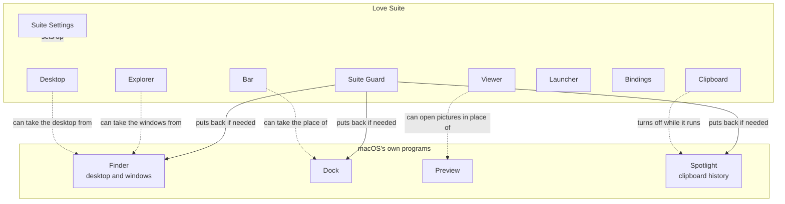

# Level 1: what the suite is

Love Suite is a set of macOS apps that bring the Mac closer to Windows where the user wants
it, one app per job: a file manager, a desktop, a Dock, a clipboard history, a picture viewer, an app
launcher, keyboard shortcuts, and one app holding the settings of all the others. Each app can be
installed and used on its own.

## The rule: start from macOS, then change what you want

The suite follows **progressive enhancement**. Opened for the first time, an app behaves as macOS does,
as the user has set it up: Finder's desktop and windows, the Dock, their own settings. Every difference
from macOS is a setting, off by default, that the user turns on in their profile. Nothing is imposed.

**(to build)** Today's apps follow this rule in part: Bar starts with the system Dock and Desktop with
Finder's desktop as the user set it up, but Explorer still takes Finder's place for folders at its first
launch. [The architecture page](architecture.md) lists what changes.

## Roles

macOS gives each job to one of its own programs. The suite offers another program for some of those
jobs; the user chooses, in their profile, which one holds each role.

| Role | Held by macOS | Can be held by |
|---|---|---|
| Desktop | Finder | [Desktop](3-apps/desktop.md) |
| File windows, "Show in Finder" | Finder | [Explorer](3-apps/explorer.md) |
| Dock | Dock | [Bar](3-apps/bar.md) |
| Clipboard history | Spotlight (its clipboard results) | [Clipboard](3-apps/clipboard.md) |
| App launcher | none (Launchpad is gone in macOS 27) | [Launcher](3-apps/launcher.md) |
| Picture and PDF viewing | Preview | [Viewer](3-apps/viewer.md) |
| Keyboard shortcuts | System Settings | [Bindings](3-apps/bindings.md) |

Two more apps hold no role of their own:

- [Suite Settings](3-apps/suite-settings.md), the settings of every app and the profiles.
- [Suite Guard](3-apps/suite-guard.md), a small agent that puts Finder's desktop, the system Dock and
  Spotlight's clipboard history back should the app that turned them off stop by accident (a crash, a
  forced quit).

## Mixing as you like

Because each app holds one role and works alone, the user can mix: keep Finder for file windows and use
the suite's Desktop, or keep the system Dock and use Explorer. An app that needs another role (the
desktop opening a folder, for instance) asks who holds it and talks to that app, or to macOS's own.

## Where to read next

- [Level 2: how the apps work together](2-working-together.md)
- [Level 3: each app](README.md#level-3-each-app)
