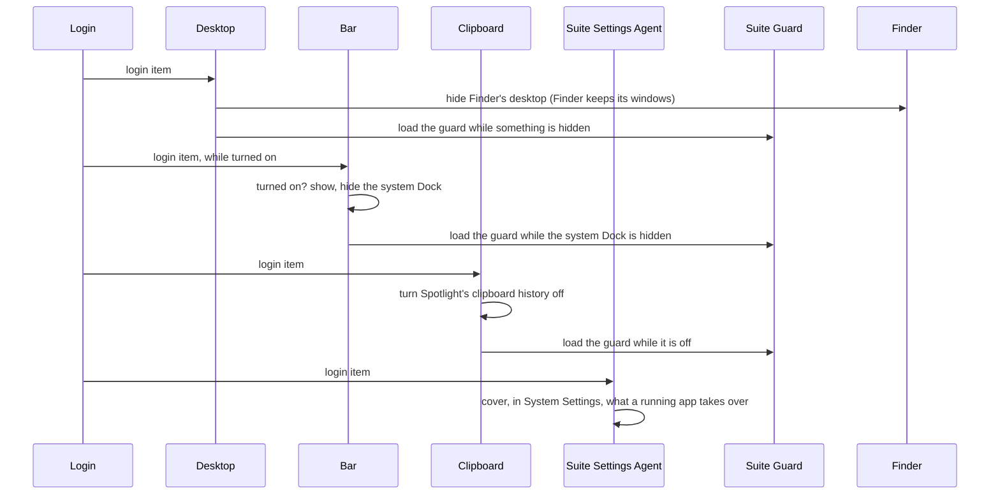
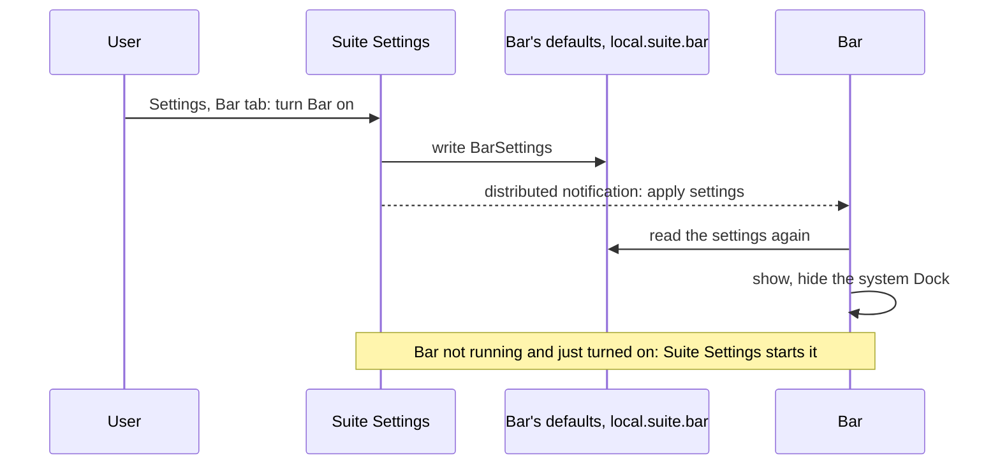
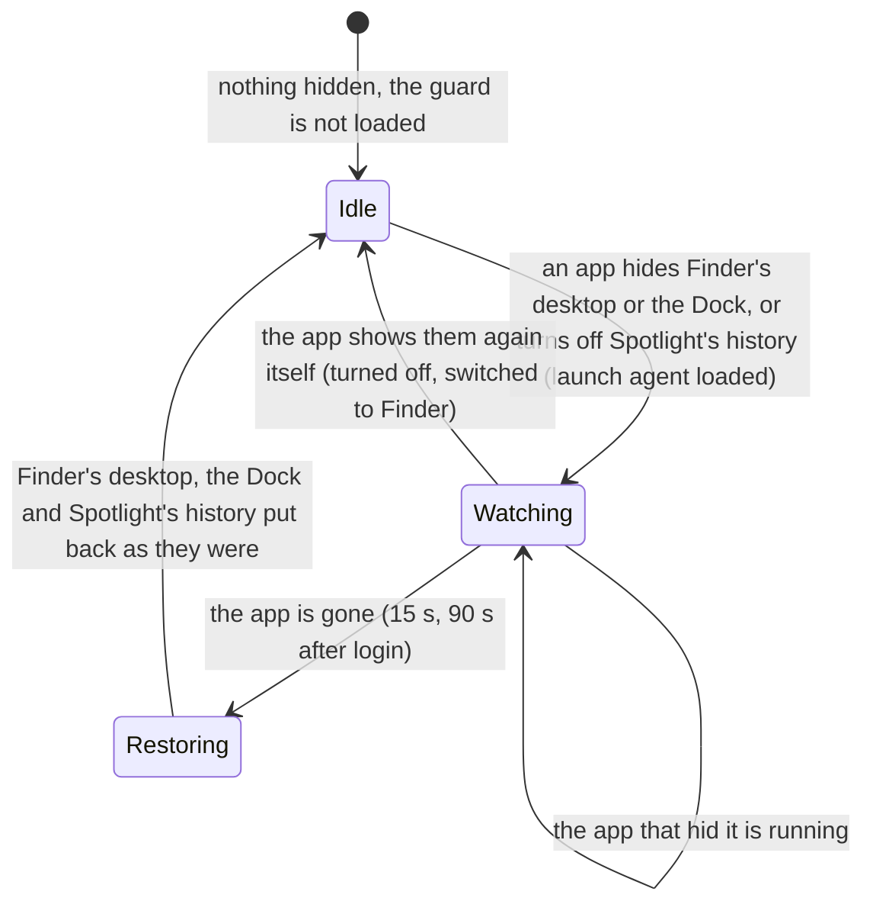
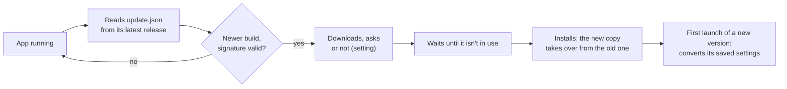

# Level 2: how the apps work together

This page follows the apps while they run: who starts whom, how a setting reaches an app, what happens
when an app stops by accident, how the apps update. Each mechanism is described in depth at
[level 5](README.md#level-5-mechanisms-in-depth).

A few macOS words first:

- **Agent app** (`LSUIElement`): an app with no Dock icon and no menu bar of its own unless it shows a
  window. Explorer (while no window is open), Bar, Clipboard, Launcher, Bindings, Suite Guard and the
  Suite Settings Agent are agent apps; Desktop is a regular app, which Bar doesn't show.
- **Defaults domain**: where an app's settings are kept, one property list per app in
  `~/Library/Preferences` (`local.suite.bar.plist` for Bar). Any app can read another's by its name.
- **Distributed notification**: a message one app posts and every app listening receives, with a small
  payload and no reply. The suite's apps tell one another about changes this way.
- **Launch agent**: a small program that `launchd`, the system's process manager, starts and restarts
  for the user, described by a file in `~/Library/LaunchAgents`.

## Start-up today

No app starts another. Desktop, Bar and Clipboard each start at login through a login item of their own
(`SMAppService`), Suite Settings registers its agent, and Explorer opens when a folder is opened.

Explorer, opened for a folder, keeps Finder closed while Desktop hides Finder's desktop, and puts it back
when it quits. Each app checks for updates on its own feed. **(to build)** With progressive enhancement
nothing is hidden or started until the user turns it on in their profile.

## A setting changes

Each app keeps its settings in its own defaults domain and exposes them as a small library
(`BarSettings`, `ClipboardSettings`, `DesktopSettings`, `ExplorerSettings`). Suite Settings depends on these libraries,
writes the settings, then tells the app.

Explorer works the same way for its own settings (`ExplorerLink`), Desktop with `DesktopMessage`,
Clipboard with `ClipboardMessage`.

## Profiles

A profile is every app's settings saved together under a name, on this Mac or in iCloud Drive, with the
version of each app that saved it. Loading a profile writes the settings back and tells every app; an
app finding settings from an older version converts them first, with the migrations its update brought.

## When an app stops by accident

Hiding Finder's desktop or the system Dock, or turning off Spotlight's clipboard history, changes macOS
settings that stay changed if the app that changed them crashes. Suite Guard is there for that.

By hand, the same is done by `Desktop --restore-finder` (Finder's desktop), `Bar --restore-bar` (the
system Dock) and `Explorer --restore-finder` (starts Finder and asks Bar for the Dock).

## Updates

Every app updates itself from its own GitHub releases, apart from the others:

The signature is checked against the update key's public half, written into the app when it is built:
an app accepts only updates signed with the suite's key.

## Where to read next

- [Level 3: each app](README.md#level-3-each-app)
- [Level 5: messages between apps](5-internals/messages.md),
  [settings and profiles](5-internals/settings-and-profiles.md),
  [updates and releases](5-internals/updates-and-releases.md),
  [Finder and the Dock](5-internals/finder-and-dock.md)
