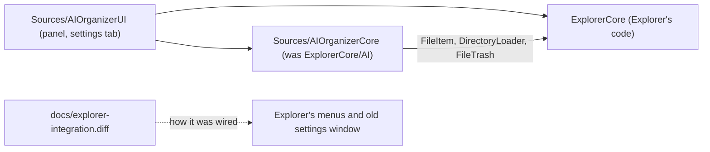

# AI Organizer

> **Not an app yet.** `main` of `suite-ai-organizer` holds only the brief, the README and the version.
> Branch `feat/ai-organizer` holds the code as it was written in the old monorepo, moved without changes.
> It was not adapted to the split into repositories: it has no `Package.swift` and does not build.

AI Organizer is meant to tidy a folder. A provider proposes a plan, the user reviews it and applies only
what they keep, and nothing is erased: what the plan removes goes to the Trash. It holds no macOS role.
Repository: `suite-ai-organizer`, planned bundle id `local.suite.ai-organizer`.

## What it is meant to do

- From a folder (the planned "Organise with AI" item of the folder and desktop background menus, now Explorer's
  and Desktop's, and Explorer's File menu), a provider reads the folder's items and returns a plan (`AIOrganizePlan`): a summary and
  actions, each with a reason. The kinds are create a subfolder, move a file into a subfolder, rename a
  file, add Finder tags, move a file to the Trash.
- A review panel (`OrganizerPanel`) shows the actions grouped as Structure, Rename, Tags and Cleanup, each
  with a checkbox. Applying runs the checked ones (`AIOrganizer.apply`), Trash last, without overwriting:
  a name already taken gets a new one.
- Two providers (`AIProvider`): `LocalProvider`, offline, grouping files by type and date and flagging
  obvious junk; `ClaudeProvider`, through Anthropic's Messages API, with the API key kept in the Keychain
  (`AISettings`). The local provider is the default.

## State on the branch

- `Sources/AIOrganizerCore/`: the plan, the provider protocol, the two providers, the settings, the
  organizer that applies a plan. It uses Explorer's types (`FileItem`, `DirectoryLoader`, `FileTrash`).
- `Sources/AIOrganizerUI/`: the review panel and a settings tab written for Explorer's old settings
  window; both import `ExplorerCore`.
- `docs/explorer-integration.diff`: the changes it made to Explorer's menus, handlers and settings
  window.
- Settings are read from the running app's own defaults (`UserDefaults.standard`: `AIProvider`,
  `AIModel`), and the key from the Keychain service `local.explorer.ai`, both from before the split.
- The Claude model is hard-coded to an old one (`claude-opus-4-5`), as default of `AISettings.model` and of
  `ClaudeProvider`.

## What adapting it needs

1. A shape: an app of its own that Explorer hands a folder to by bundle id, as it hands pictures to
   Viewer, with no dependency on Explorer's code **(to build)**.
2. A `Package.swift` with its core, its app and tests, depending on suite-core and suite-files; Explorer's types
   replaced by its own or by suite-files' (`SuiteTrash` for the Trash) **(to build)**.
3. An `AIOrganizerSettings` library and its tab in [Suite Settings](suite-settings.md), the settings in its
   own domain and the Keychain item renamed for the suite **(to build)**.
4. The current Claude model instead of the old one **(to build)**.
5. `scripts/make-app.sh`, `scripts/publish.sh`, the release and version workflows, the release certificate
   and update key, a cask, as the other app repositories have **(to build)**.
6. In suite-explorer, the menu items that open a folder with it, without the old diff's direct calls
   **(to build)**.
