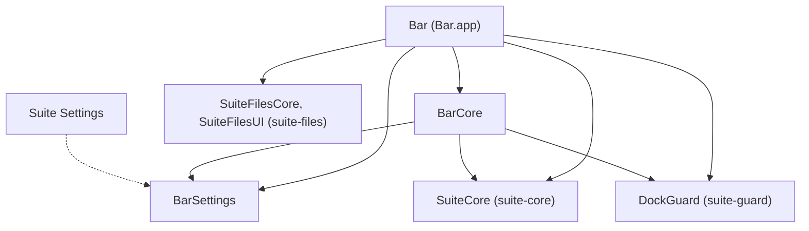
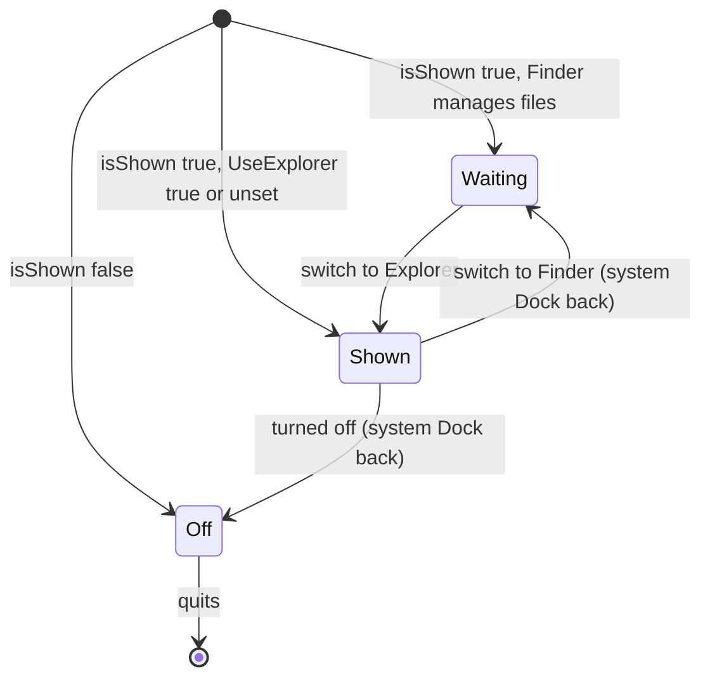
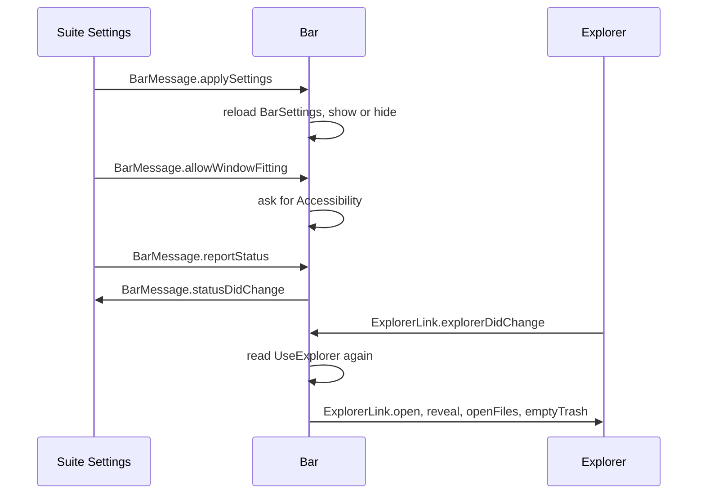

# Bar

Bar is the suite's Dock, shown in place of the system one: a bar of icons at the bottom of the main
screen with Explorer, the pinned apps, the running apps, the Downloads stack, minimized windows and the
Trash. It is an app of its own (`Bar.app`, bundle id `local.suite.bar`, repository `suite-bar`), an
`LSUIElement` app, which means it has no icon in the Dock and no menu bar of its own. It is off by
default: on first launch it reads its settings, finds itself turned off and quits at once, leaving the
system Dock alone. Turned on in Suite Settings's Bar tab, it hides the system Dock and shows itself while
Explorer manages files.

## What it does

- **Icons.** Explorer first (in Finder's place; Finder never shows), then the pinned apps, a separator,
  the running apps that aren't pinned, Downloads as a stack, the minimized windows of other apps, and the
  Trash. A missing app can be removed from the bar.
- **Pinned apps.** Taken once, read only, from the system Dock's own list (`persistent-apps` in
  `com.apple.dock`), then kept by Bar. Drag an icon to reorder it, drag it up and away to remove it.
- **Click and menus.** A click opens or brings forward an app. A right-click offers Keep in Dock or
  Remove from Dock, Show in Explorer, Quit, and Force Quit for an app still running after it was asked to
  quit (or at once with Option held). Explorer's tile, the Downloads stack and the Trash have their own
  menus, all with Bar Settings, which opens Suite Settings on the Bar tab.
- **Apps never shown.** Apps of the suite that are ordinary apps only for macOS's sake (Desktop, which
  macOS must be able to pick as it picks Finder) never show in the bar; their windows are neither fitted
  nor watched (`BarHiddenApps`).
- **Dropping files.** On an app, the files open with it (only apps that can open every file light up);
  on the Trash, they go to the Trash; on the Downloads stack, they are moved or copied as Explorer does,
  asking whether to replace (the old item goes to the Trash), skip or keep both.
- **Downloads stack.** A grid of the folder's items, newest first, with thumbnails. Files open as
  Explorer opens them while it runs (pictures and PDFs in Viewer), as the system opens them otherwise.
- **Minimized windows.** Other apps' minimized windows show before the Trash; a click brings one back.
- **Staying or hiding.** Bar either stays on screen, with other apps' maximized windows shortened to end
  above it, or hides and slides in when the pointer reaches the bottom edge. The default can be changed
  per app (a list of apps with which it hides, another with which it stays), and full screen has a choice
  of its own: hides (the default), stays, or as for the app in front.
- **Mission Control.** While Bar hides itself, it slides in for Mission Control so that it covers the
  sliver of the hidden system Dock that Mission Control always shows.

## How it is built

The package (`Package.swift`) has three targets. Only `BarSettings` is a product other repositories can
use.

- **`BarSettings`** (`Sources/BarSettings/`, no UI). `BarSettings` is the settings value, loaded and
  saved through `BarSettings.current`; `BarFullScreenMode` is the full-screen choice; `BarMessage` holds
  the distributed notifications with Suite Settings (see [How it runs](#how-it-runs)).
- **`BarCore`** (`Sources/BarCore/Bar.swift`, no AppKit, unit-tested). `BarApp` (an app by bundle id and
  path), `DockReader` (reads the system Dock's pinned apps), `BarPins` and `BarStore` (the pinned apps and
  where they are saved), `BarTile`, `BarLayout` and `BarGeometry` (what the bar shows and where),
  `BarWindow` (a minimized window), `BarHiddenApps` (the suite's apps never shown), `WindowFit` (the frame a window should take to end above the bar),
  `ScreenEdge`, `EdgeGuard` and `DockSpan` (where the hidden system Dock sits and how to keep the pointer
  off it), `BarStackOrder` (a stack's order), `QuitRequests` (when to offer Force Quit),
  `FullScreenSpace` and `MissionControl` (noticing both from the windows on screen).
- **`Bar`** (`Sources/Bar/`, the app):

| Type | File | Role |
|---|---|---|
| `AppDelegate`, `BarRelaunch` | `AppDelegate.swift` | Listens to messages, the updater, quitting and signals, hand-over to a newer copy |
| `BarController` | `BarController.swift` | Shows or hides the bar, hides the system Dock, placing, automatic hiding, edge guard, full screen, Mission Control |
| `BarPanel`, `BarBackground` | `BarController.swift` | The borderless panel and its translucent rounded background |
| `DockMeasure` | `BarController.swift` | Asks the system Dock, through Accessibility, where its icons are |
| `BarView`, `BarLabel`, `BarMenuItem` | `BarView.swift` | The icons, clicks, drags, menus, drops, the name shown above an icon |
| `BarStackPopover`, `BarStackGrid`, `BarStackViewController` | `BarStack.swift` | The Downloads stack (its icon is `StackIcon`, from `suite-files`) |
| `BarFiles`, `BarDrop` | `BarFiles.swift`, `BarDrop.swift` | Trash, thumbnails, opening files; files dropped on the stack |
| `MinimizedWindows` | `MinimizedWindows.swift` | Other apps' minimized windows, through Accessibility |
| `WindowFitter` | `WindowFitter.swift` | Shortens other apps' windows to end above the bar |
| `BarEdgeProbe` | `BarEdgeProbe.swift` | A temporary diagnostic (see below) |

Its executable is `Bar`, never `Dock`: the system Dock's process is called "Dock", which
`killall Dock` restarts and Suite Guard tells apart by its path.

From the other repositories it uses `SuiteCore` for Explorer (`ExplorerLink.activate`, `open`, `reveal`,
`openFiles`, `send(.emptyTrash)`), Suite Settings (`SuiteSettingsApp.show(tab:)`), `SuiteDefaults` and
`SuiteUpdater`; `SuiteFilesCore` and `SuiteFilesUI` for the Trash (`TrashLocations`, `SuiteTrash`),
`DirectoryWatcher`, file icons and the stack's icon; and
`DockGuard` for hiding the system Dock (`DockManager`, `AppPreferenceDomain`) and loading Suite Guard
(`GuardAgent.update()`). It never imports Explorer's code.

## How it runs

**Start.** While turned on, Bar starts at login by itself (its own login item, `SMAppService`, registered
when it is turned on and removed when it is turned off), and Suite Settings starts it when it is turned on. `Sources/Bar/main.swift` first handles `--restore-bar` (put the system
Dock back and exit), then keeps one copy at a time: a second copy leaves at once, unless started with
`--relaunch`, in which case it posts `BarRelaunch.handOver` and waits up to 10 seconds for the running
copy to quit. The app then runs as an accessory app (no Dock icon). If the settings say it is turned off,
it quits right away.

**When it shows.** `BarController` shows the bar while both of these hold: `BarSettings.isShown` is on,
and Explorer manages files. The second is Explorer's Explorer/Finder switch, read from Explorer's
defaults (`SuiteDefaults.explorer`, key `UseExplorer`). Explorer writes that key only once the switch is
turned, so when it was never written Bar takes it as true: on a fresh install, Bar shows as soon as it is
turned on.

**Showing.** The bar is a non-activating panel (`BarPanel`: it never takes the focus from the app in
front) one level above the system Dock's window level, 2 points from the bottom of the main screen, on
every Space including full-screen ones. On showing, `DockManager.hide()` saves the system Dock's
settings in Bar's defaults (`DockSettingsBeforeHiding`), sets them to hide it and restarts the system
Dock, and `GuardAgent.update()` loads Suite Guard. While Bar runs, Suite Settings' agent covers the
Dock's settings in System Settings, with a button opening Bar's tab ([Suite Settings](suite-settings.md)).
The settings it sets are listed in
[Finder and the Dock](../5-internals/finder-and-dock.md): automatic hiding with a delay and an animation
of 1000 seconds, icons of 1 point, at the bottom, running apps only.

**The bottom edge.** macOS 27 ignores the long delay: the hidden system Dock wakes up when the pointer
touches the bottom row of pixels. So Bar watches the pointer (global and local mouse monitors, which need
no permission) and, along the short stretch the hidden system Dock covers, moves the pointer a few points
back up (`EdgeGuard`, `CGWarpMouseCursorPosition`). The stretch is measured through Accessibility
(`DockMeasure`) or estimated from the system Dock's settings (`DockSpan`), re-measured a second after an
app launches or quits. The rest of the edge and the corners stay free.

**Hiding by itself.** When the settings say it hides (`BarSettings.hides(frontmost:inFullScreen:)`), the
bar slides out 0.35 seconds after the pointer leaves it and slides in 0.12 seconds after the pointer
reaches the edge below it. It doesn't slide away while a stack is open or an icon is dragged. Full screen
is noticed after each Space or app change (at 0, 0.6 and 1.5 seconds) by `FullScreenSpace`: the app in
front has an ordinary window covering the whole screen. Mission Control has no notification, so while the
bar hides itself it looks five times a second for WindowManager's Spaces bar among the windows on screen
(`MissionControl`) and slides in while it is open.

**What it reads and writes.**

- Its own defaults, `local.suite.bar`: `BarSettings` (the settings, as JSON), `BarPinnedApps` (the
  pinned apps, as JSON; absent until the user changes them, the system Dock's apps are used),
  `DockSettingsBeforeHiding` (the system Dock's settings from before hiding, which Suite Guard reads),
  `StatusWindowFittingAllowed` (whether it has Accessibility, for Suite Settings to show), and
  `SuiteGuardRegisteredBuild` (written by `GuardAgent`).
- `com.apple.dock`: read for the pinned apps and the hidden Dock's size; written only by `DockManager`.
- Explorer's defaults: `UseExplorer` and `ShowThumbnails`, read only.

**Messages.** A distributed notification is a message macOS delivers to every app of the session that
listens for its name; Bar posts them with `deliverImmediately` so that apps in the background get them at
once.

All `BarMessage` names start with `local.suite.bar.`; `BarMessage.showSettings` is defined but not
posted by Bar today.

**Stopping.** Quit by the user, turned off, or stopped by Ctrl+C, `kill` or the terminal closing
(`SIGINT`, `SIGTERM`, `SIGHUP` are turned into a normal quit), Bar puts the system Dock back
(`BarController.restoreSystemDock()`, which also updates Suite Guard), so the Mac is never left without a
Dock. It does not put it back when a newer copy takes over (an update, `make-app.sh`) nor at logout or
shutdown (`NSWorkspace.willPowerOffNotification`): each system Dock restart leaves Spaces, Command-Tab and
Mission Control unusable for a minute or two.

**Crash and restore paths.**

- Should Bar vanish while the system Dock is hidden (a crash, a forced quit, not started at login),
  [Suite Guard](suite-guard.md) puts the system Dock back after 15 seconds (90 after login), from the copy
  in Bar's defaults.
- By hand: `~/Applications/Bar.app/Contents/MacOS/Bar --restore-bar`. Explorer's `--restore-finder` runs
  this too (`BarCompanion.restoreSystemDock()`).

**Updates.** `AppDelegate.updater` is a `SuiteUpdater` (see
[Updates and releases](../5-internals/updates-and-releases.md)); to relaunch, it opens a new copy with
`--relaunch`, which takes over without restarting the system Dock.

## Settings

The library is `BarSettings` (`Sources/BarSettings/BarSettings.swift`). The settings are kept in Bar's
defaults domain `local.suite.bar`, key `BarSettings`, as JSON. Bar reads them; Suite Settings's Bar tab
writes them (through `UserDefaults(suiteName:)`) and then posts `BarMessage.applySettings`, on which Bar
reads them again (`BarSettings.reloadFromDefaults()`). Profiles (`SettingsProfiles` in `suite-core`)
include the `local.suite.bar` domain.

| Field | Default | Meaning |
|---|---|---|
| `isShown` | `false` | Bar in place of the system Dock |
| `iconSize` | 48 | Icon size, 32 to 96 points |
| `autohides` | `false` | By default, hides and slides in at the bottom edge |
| `hidingApps` | empty | Bundle ids with which it hides, though by default it stays |
| `stayingApps` | empty | Bundle ids with which it stays, though by default it hides |
| `fullScreen` | `.hides` | In full screen: `.hides`, `.stays` or `.asForTheApp` |

A value saved without some keys keeps the defaults for the missing ones. More on the settings in
[Settings and profiles](../5-internals/settings-and-profiles.md).

## macOS mechanisms used

- **`com.apple.dock` preferences** (through `CFPreferences`, the public calls behind `defaults`) and a
  restart of the system Dock with `killall Dock`. No private API; SIP stays on.
- **`NSPanel`** with `.nonactivatingPanel` at `CGWindowLevelForKey(.dockWindow) + 1`, joining all Spaces
  and full-screen ones (`.canJoinAllSpaces`, `.fullScreenAuxiliary`).
- **Accessibility API** (`AXUIElement`, `AXObserver`): fitting other apps' windows above the bar,
  following and restoring their minimized windows, measuring the hidden system Dock. It needs the user's
  permission in System Settings › Privacy & Security › Accessibility; Suite Settings's Bar tab asks for it
  through `BarMessage.allowWindowFitting` (`AXIsProcessTrustedWithOptions`). Without it, windows are not
  fitted, other apps' minimized windows don't show and the system Dock's stretch is estimated.
- **Mouse monitors** (`NSEvent.addGlobalMonitorForEvents`) and `CGWarpMouseCursorPosition` for the edge
  guard; a listen-only event tap in `BarEdgeProbe`.
- **`CGWindowListCopyWindowInfo`** to notice full screen and Mission Control.
- **`NSWorkspace`** notifications: apps launching, quitting and activating, the active Space, power off.
- **QuickLook thumbnails** (`QLThumbnailGenerator`) in the Downloads stack.
- **Distributed notifications** (`DistributedNotificationCenter`) with Suite Settings and Explorer.
- **launchd**, indirectly, through `GuardAgent` (see [Suite Guard](suite-guard.md)).

## Building and testing

- `swift build` and `swift test` for development. `Tests/BarCoreTests/BarTests.swift` tests `BarCore`
  and the settings with Swift Testing: reading the system Dock's list from a copy of its file, pins, the
  layout, geometry, window fitting, the edge guard, the span estimate, stack order, Force Quit, full
  screen and Mission Control detection. The tests never touch the real Dock.
- `scripts/make-app.sh` builds `build/Bar.app` in release mode, gives it the system Dock's icon (taken
  from `/System/Library/CoreServices/Dock.app` on this Mac, never committed), copies the French strings,
  signs it with the "Suite Local Signing" certificate (ad-hoc signing as a fallback, which makes macOS ask
  for permissions again on each build) and installs it as `~/Applications/Bar.app`. It records the branch
  and commit (`SuiteBuildBranch`, `SuiteBuildCommit`) and refuses to replace a copy built from another
  branch unless `--force`; `INSTALL_DIR=` builds without installing. A running copy is replaced with
  `open -n Bar.app --args --relaunch`, never quit, so the system Dock is not restarted.
- Versions: `VERSION` (27.1), development builds `27.1-dev.N`; releases by `scripts/publish.sh` and
  `.github/workflows/release.yml`, feed from the repository it is built from (`love-suite/suite-bar`).
  See [Code](../4-code.md).
- What can't be unit-tested: the panel, the real system Dock, Accessibility, Mission Control. UI is
  checked by rendering views offscreen (`cacheDisplay`) from a scratch package.
- `BarEdgeProbe` is a temporary diagnostic, to find why the bar sometimes doesn't slide in at the edge:
  it logs misses under the category `BarEdge`
  (`log show --predicate 'category == "BarEdge"' --last 1d`). It is to be removed once the cause is found.

## Waiting on branches

- **`feat/dock-parity`**: brings Bar closer to the system Dock. Folders and files in the bar
  (`BarItems.swift`), stack views and options, recent apps, badges, app menus, magnification, the bar on
  the left or right of the screen, the display with the pointer, Show All Windows, Open at Login, full
  screen asked through Accessibility (`BarAccessibility.swift`). Ported from the old monorepo and already
  moved onto the Bar names.
- **`feat/launcher/core`**: a Launcher tile just after Explorer's, turned on by a new setting
  `showsLauncher`; it opens [Launcher](launcher.md) through `LauncherApp.open()`, and its menu has Open
  Launcher and Bar Settings.
- **`archive/no-system-dock`** (archived, not to be merged): tried living without the system Dock by
  stopping it for the session (`launchctl bootout` of its agent), with the suite's own Command-Tab,
  Mission Control overview and minimizing to replace what stops with it.
