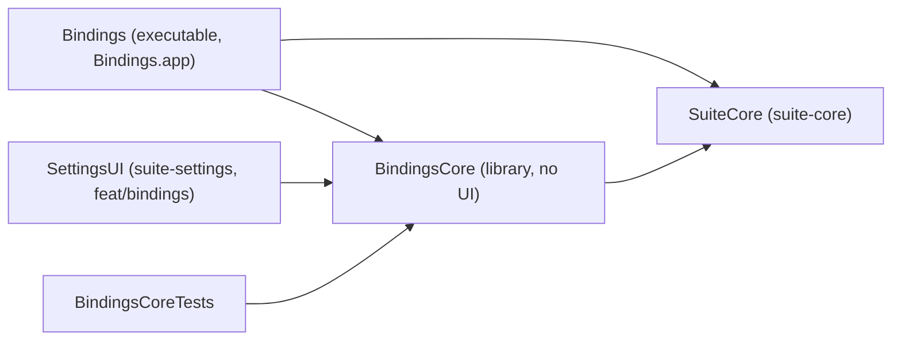
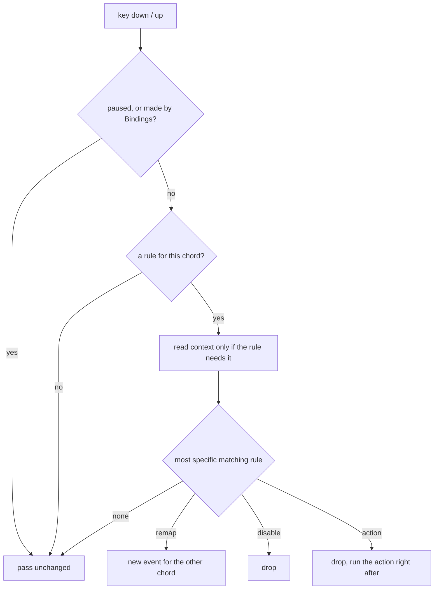
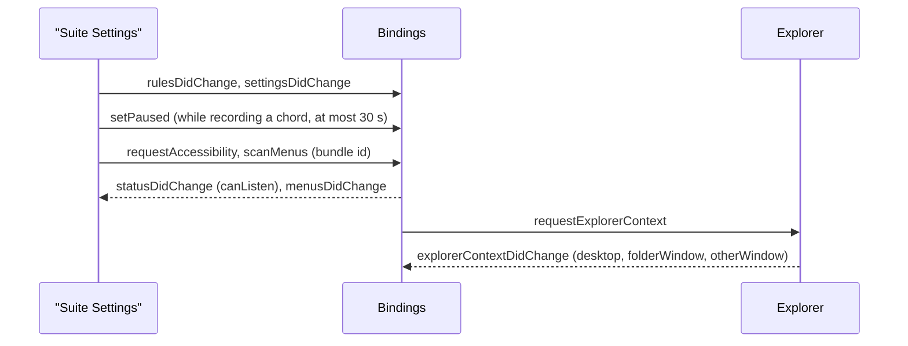

# Bindings

> **Not on `main` yet.** `main` of `suite-bindings` holds only the brief, the README and the version. The
> app described here is on branch `feat/bindings`, waiting to be merged, together with the matching
> `feat/bindings` branches of suite-explorer and suite-settings. Nothing of it ships today.

Bindings runs keyboard shortcuts of the user's own, system-wide, in given apps or in a narrower context,
in the spirit of Karabiner-Elements. It holds no macOS role: it is an `LSUIElement` app, an app macOS runs
with no Dock icon and no menu bar of its own, with no window and no menu bar icon either. On first launch
it has no rules and does nothing; it is on by default, Explorer starts it at launch (with suite-explorer's
`feat/bindings`), and its rules are edited in [Suite Settings](suite-settings.md)'s Bindings tab or by hand in
a JSON file. Repository: `suite-bindings`, bundle id `local.suite.bindings`.

## What it does

- A rule is a chord (a key and its modifiers), an action, and where it applies. Rules live at three
  levels, and where several match, the most specific wins:
  - **Everywhere**, except in apps it leaves out;
  - **In apps**, while one of the listed apps is in front;
  - **In a context**: the focus is in a text field or not, Explorer's desktop, an Explorer folder window or
    another Explorer window, a window whose title contains a text; optionally only in given apps.
- Actions: press another chord instead (held and repeated as long as the key is), open an app, open a
  folder in Explorer, run a shortcut of the Shortcuts app, run a command in a login zsh, choose a menu item
  of the front app by its titles, or nothing (turn the chord off).
- Keys are matched by position on the keyboard (the virtual key code, as Karabiner's `key_code`), and
  named as the current layout shows them.
- It reads every app's menu shortcuts, so Suite Settings's Shortcuts window can show them, turn them off or
  give them another chord; macOS' own shortcuts are shown read only.
- No modifier-only remaps (Caps Lock to Escape): those need a driver, which Karabiner has.

## How it is built

`Package.swift` has one product, the library `BindingsCore`, which Suite Settings depends on for its tab,
plus the executable and the tests. Everything that decides is in `BindingsCore`, without UI, and tested;
the app is the event tap and the actions.

`BindingsCore` (`Sources/BindingsCore/`):

| Type | File | Role |
| --- | --- | --- |
| `BindingRule`, `BindingScope`, `BindingLevel`, `BindingAction` | `BindingRule.swift` | A rule, where it applies and what it does; plain `Codable` structs so the file stays readable JSON |
| `KeyChord`, `Modifiers`, `KeyCode` | `KeyChord.swift` | A key position and its modifiers, and how to name it |
| `BindingEngine` | `BindingEngine.swift` | Decides for each key event: pass, swallow, replace by another chord, or perform a rule; remembers held keys so a release and repeats go the way the press went |
| `BindingContextReading`, `BindingContext` | `BindingEngine.swift` | What a rule may ask about the situation; answered lazily by the app |
| `BindingsStore` | `BindingsStore.swift` | Loads and saves the rules file |
| `BindingsSettings` | `BindingsSettings.swift` | On or off, and the reported `canListen`, in Bindings' defaults; `forManager()` for Suite Settings |
| `BindingConflicts`, `BindingIssue`, `BindingProblem` | `BindingConflicts.swift` | Clashes between rules and with known shortcuts, shown under each rule in Suite Settings |
| `KnownShortcuts` | `KnownShortcuts.swift` | Shortcuts most apps use, and macOS' own read from `com.apple.symbolichotkeys` |
| `MenuShortcut`, `AppMenus`, `MenuCatalog`, `MenuShortcutEditor` | `MenuShortcuts.swift` | The menus read from each app, kept one file per app, and the rules that turn a menu shortcut off or rebind it |

The app (`Sources/Bindings/`):

| Type | File | Role |
| --- | --- | --- |
| `BindingsAppDelegate` | `AppDelegate.swift` | Ties it together: rules file to tap, messages, status, menu scanning |
| `KeyTap` | `KeyTap.swift` | The keyboard event tap, feeding `BindingEngine` |
| `FrontContext` | `FrontContext.swift` | The front app, and through Accessibility the focused element and the window title, asked only when a rule needs them, with a 0.15 s timeout |
| `ActionRunner`, `MenuPresser` | `ActionRunner.swift` | Runs actions; presses a menu item by titles (case, accents and the ellipsis character ignored); what can't be done beeps |
| `MenuScanner` | `MenuScanner.swift` | Reads an app's menus and their shortcuts through Accessibility, off the main thread, with bounds (depth 4, 80 items a menu, 2000 in all) |

## How it runs

### Start and stop

`main.swift` waits for a previous copy to quit (after an update, `AppRelauncher.waitForPreviousCopy`) and
runs as an accessory app. At launch, if Bindings is turned off it quits at once. Otherwise it starts its
updater, listens to the messages, watches front apps for menu reading, loads the rules, watches the rules
folder, reports its status and asks Explorer where the keyboard is (`requestExplorerContext`). Started with
`--request-accessibility` (by Suite Settings), it opens the Accessibility settings. Turned off from Suite
Settings, it quits; turned on, Suite Settings starts it again (`BindingsApp.launch()`).

### The event tap

An event tap is a hook macOS offers (`CGEvent.tapCreate`) that sees every keyboard event of the session
before apps do, and may let it through, drop it or replace it. It needs the Accessibility permission.

- The tap runs only while Bindings is on and some rule is on: an idle tap would still see every key.
  Without Accessibility it touches nothing and retries every 2 s until it is given.
- A remap posts a new event rather than changing the old one, so the characters are the new key's; the
  events Bindings makes carry a marker (`eventSourceUserData`) so its own tap lets them through. Clipboard's
  hold-⌘V tap works the same way: each app touches only its own chords.
- A rule that replaces a chord (a rebound menu shortcut) also turns the old chord off where it applies.

### What it reads and writes

| What | Where | Written by |
| --- | --- | --- |
| Rules | `~/Library/Application Support/Explorer/Bindings/bindings.json` (`{"version": 1, "rules": [...]}`, pretty-printed) | Suite Settings, or by hand; read by Bindings, which watches the folder and reloads 0.3 s after a change. A file it can't read is kept as it is and never written over; a newer format is refused |
| Menus read | `~/Library/Application Support/Explorer/Bindings/Menus/<bundle id>.json` | Bindings (it holds the Accessibility permission reading menus needs); read by Suite Settings. An app is read again when it comes to the front if its file is a day old, or on request |
| Settings | defaults domain `local.suite.bindings`: `isEnabled`, `canListen` | `isEnabled` by Suite Settings, `canListen` by Bindings |

### Messages

All are distributed notifications (`BindingsMessage` in suite-core, named `local.suite.bindings.<case>`),
messages macOS delivers to every process listening for that name.

Explorer posts `explorerContextDidChange` on every key window change (`ExplorerContext`, suite-core);
Bindings uses it only while Explorer is in front. Accessibility is checked every 2 s and reported when it
changes.

### Crash and restore

Bindings keeps nothing in memory that is not in its files: started again, it reloads the rules. A key held
when the tap stops goes back to the apps (`BindingEngine.reset()`); a pause from Suite Settings ends by
itself after 30 s.

## Settings

Bindings' settings library is `BindingsCore` (`BindingsSettings` for the switch, `BindingsStore` for the
rules). Suite Settings's Bindings tab (on suite-settings's `feat/bindings`) is the only writer besides the
user editing the JSON file. A settings profile carries the `local.suite.bindings` domain, not the rules
file. See [settings and profiles](../5-internals/settings-and-profiles.md).

## macOS mechanisms used

- Quartz event taps (`CGEvent.tapCreate` at `.cgSessionEventTap`, `.defaultTap`), re-enabled if macOS
  disables them for a timeout.
- The Accessibility API (`AXUIElement`): focused element and role, focused window title, menu bar items and
  their shortcut attributes (`AXMenuItemCmdChar`, `AXMenuItemCmdModifiers` and so on), `AXPress` for menu
  items. `AXIsProcessTrustedWithOptions` adds Bindings to the Accessibility list.
- Carbon's Text Input Sources (`TISCopyCurrentKeyboardLayoutInputSource`, `UCKeyTranslate`) to name keys
  in the current layout.
- `NSWorkspace` to open apps and folders and to follow the front app; `Process` for `/usr/bin/shortcuts`
  and `/bin/zsh -l -c`.
- A `DispatchSource` file-system watch on the rules folder.
- `SuiteUpdater` (suite-core) for its own updates.

Permission needed: **Accessibility**, for the tap, the context and reading and pressing menus.

## Building and testing

- `swift build` and `swift test`. `Tests/BindingsCoreTests` (Swift Testing, 39 tests) covers the core:
  rules, levels, the engine, the store, conflicts, menu shortcuts.
- `scripts/make-app.sh` builds `build/Bindings.app`, takes the icon from this Mac's Keyboard Setup
  Assistant, signs with "Suite Local Signing" so the Accessibility permission survives rebuilds, and
  installs `~/Applications/Bindings.app`, refusing to replace a copy built from another branch unless
  `--force`.
- Release and version workflows are on the branch; `Support/release-certificate.cer` and
  `Support/update-public-key.txt` are not, so it can't be released yet.
- What can't be unit-tested: the event tap, Accessibility answers of real apps, and menu reading; they need
  the built app with the permission given.

## Waiting on branches

Everything on this page is on `feat/bindings` of suite-bindings. It goes with:

| Repository | Branch | Adds |
| --- | --- | --- |
| suite-explorer | `feat/bindings` | Explorer starts Bindings at launch when it is on, and posts where the keyboard is (`BindingsCompanion`) |
| suite-settings | `feat/bindings` | The Bindings tab and the Shortcuts window, depending on `BindingsCore` from this branch |

`BindingsMessage`, `BindingsApp` and `ExplorerContext` are already on suite-core's `main`.
