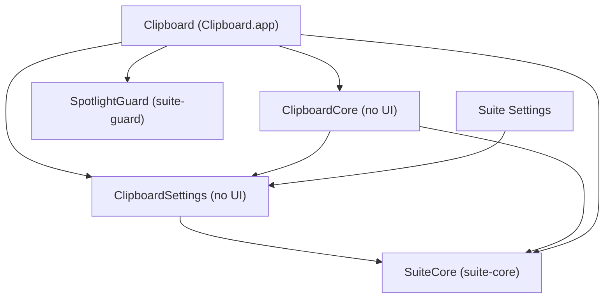
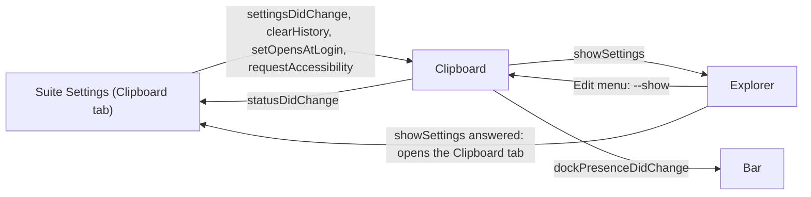

# Clipboard

Clipboard is the suite's clipboard history, Windows' Win+V for macOS. macOS has no app for this role.
It is an `LSUIElement` app (an agent: no Dock icon, no menu bar icon, no window but its panel) that
watches what is copied and keeps it. It has no shortcut of its own: holding ⌘V opens the list next to the
text caret. It starts at login when its login item is on ("Open Clipboard at login"), when it is turned
on in Suite Settings, or from Explorer's Edit menu ("Clipboard History"); on first launch it is on, keeps
the 50 latest copies, ignores Keychain Access and Passwords, and backs nothing up. While it runs,
Spotlight's own clipboard history (macOS 26) is off, and [Suite Guard](suite-guard.md) puts it back
should Clipboard vanish.

## What it does

- **Keeps copies**: text, rich text, links, pictures and files, newest first; copying something already in
  the history moves it back to the top; the oldest go beyond the limit (50 by default, up to 1000).
  Items can expire after 1, 7 or 30 days (never by default). Never recorded: what password managers mark
  (`org.nspasteboard.ConcealedType`, `TransientType`, `AutoGeneratedType` and older markers) and copies
  made in ignored apps. Copies from another device (Universal Clipboard) are tagged "iCloud".
- **Hold ⌘V**: a short ⌘V still pastes; held (0.3 seconds), it opens a panel above and to the right of the
  caret (else of the text field, else at the mouse), the way ⌘Tab works: with ⌘ down, each V goes one item
  further; letting go of ⌘ pastes. Letting go before pressing V again leaves the list open.
- **In the list**: search (it also finds the text in pictures, read with Vision), arrows, Enter or a
  click pastes, Shift+Enter pastes plain text, Cmd+1 to Cmd+9 paste the nine latest (by key position,
  so AZERTY works), Cmd+Delete or the × deletes, the space bar shows an item the row cuts short, items
  drag out (as contents for apps, as a file for folders and desktops). The quick list shows the latest 20
  (a setting); "Show All" opens the whole history in a window, during which Clipboard is in the Dock and
  ⌘Tab. The pin keeps the list open, above other windows by default. A Space change closes an unpinned
  list.
- **iCloud Drive backup** (off by default): the history copied to `iCloud Drive/Explorer/Clipboard/<Mac
  name>`, one folder per Mac; an empty history comes back from this Mac's backup, else from the latest
  another Mac made.
- **Without Accessibility**: ⌘V is left alone, a chosen item is only copied, and the panel says how to
  allow pasting.
- **Spotlight's clipboard history**: so the two don't both keep the copies, Clipboard turns Spotlight's
  history (`com.apple.Spotlight`'s `PasteboardHistoryEnabled`) off while it runs and puts it back as the
  user had it when it quits or is turned off. While it runs, Suite Settings' agent covers "Results from
  Clipboard" in System Settings › Spotlight with a button opening Clipboard's settings
  ([Suite Settings](suite-settings.md)).

## How it is built

| Target | Kind | What it holds |
|---|---|---|
| `ClipboardSettings` | library, the only product other repositories see | `ClipboardSettings` (every setting, and what Clipboard reports), `ClipboardBackupPlace` (where the backup goes) |
| `ClipboardCore` | library, unit-tested | `ClipItem`, `PasteboardSnapshot` and `PasteboardType` (`ClipItem.swift`), `ClipClassifier` (kind, de-duplication, the 50 MB limit), `ClipboardHistory`, `ClipboardFilter`, `ClipboardStore`, `ClipboardBackup`, `ClipTime`, `PasteHoldGesture` (the hold ⌘V decisions) |
| `Clipboard` | executable, links Carbon and ServiceManagement, uses `SpotlightGuard` | `ClipboardAppDelegate` (`Sources/Clipboard/AppDelegate.swift`), `ClipboardWatcher`, `HoldToPaste`, `Paster`, `HistoryModel`, `HistoryPanel` and `HistoryWindow`, `HistoryViewController`, `ClipRowView`, `PreviewWindow`, `ClipDrag`, `TextRecognizer`, `KeyboardLayout`, `LoginItem` |

- `ClipboardWatcher` checks `NSPasteboard.general`'s change count twice a second (macOS sends no
  notification when the pasteboard changes) and hands new copies to `HistoryModel`, unless the filter
  refuses them.
- `HoldToPaste` installs a keyboard event tap, sees ⌘V before the app in front, holds it back until
  `PasteHoldGesture` says whether it is a tap (posted again) or a hold (the panel opens).
- `Paster` puts an item back on the pasteboard, posts Cmd+V on the key that types "v" in the current
  layout (`KeyboardLayout`), and finds the caret through Accessibility.
- `HistoryPanel` is a non-activating panel: the app in front keeps focus and its caret, so the paste lands
  where the user was typing.

## How it runs

- **Start** (`Sources/Clipboard/main.swift`): waits for a previous copy after an update
  (`AppRelauncher`), runs with the `.accessory` policy. If `isEnabled` is off, it puts Spotlight's
  history back (should a crash have left it off) and quits at once. Otherwise it turns Spotlight's history
  off (`SpotlightHistoryManager.turnOff()`, Spotlight's own setting kept as `SpotlightHistoryBefore`: "on",
  "off" or "none"), calls `GuardAgent.update()`, then starts the updater, the watcher, the event tap, the link with Suite Settings, a status
  check every 2 seconds, an expiry check every hour, and the backup. `--show` opens the panel.
- **What it reads and writes**: its settings in its own defaults domain `local.suite.clipboard`; the
  history in `~/Library/Application Support/Explorer/Clipboard`: `history.json` for the list and one
  property list per item in `Items`; the backup in iCloud Drive when on; its frame for the history
  window (`ClipboardHistory`); `SpotlightHistoryBefore` in its defaults and Spotlight's
  `PasteboardHistoryEnabled` while it runs.
- **Talking to others**: distributed notifications named `local.suite.clipboard.<message>`
  (`ClipboardMessage`, SuiteCore), and the defaults both sides read.

  `showSettings` asks Explorer to open Suite Settings on the Clipboard tab; if Explorer is not running,
  Clipboard starts it with `--clipboard-settings`. `dockPresenceDidChange` says Clipboard entered or left
  the Dock (its history window), for [Bar](bar.md). Clipboard writes `canPaste` and `loginStatus` into
  its defaults (only it can know them) and posts `statusDidChange`. See
  [messages](../5-internals/messages.md).
- **Stop**: turned off in Suite Settings, it quits on the next `settingsDidChange`. Quitting Explorer leaves
  it running. On quitting it puts Spotlight's history back and calls `GuardAgent.update()`, except when it
  reopens itself for an update (the new copy keeps it off). After a crash or a forced quit, Suite Guard
  puts Spotlight's history back once Clipboard has been gone 15 seconds; the history is saved after every
  change.
- **Updates**: `SuiteUpdater(appName: "Clipboard")`, installed once its panel and history window are
  closed. See [updates and releases](../5-internals/updates-and-releases.md).

## Settings

`ClipboardSettings` (`Sources/ClipboardSettings/ClipboardSettings.swift`) holds them in
`local.suite.clipboard`. Clipboard uses `.standard`; Suite Settings (`Suite Settings.app`, bundle id
`local.suite.settings`) uses `ClipboardSettings.forExplorer()` for its Clipboard tab, writes, then
posts `settingsDidChange`.

| Key | Default | What |
|---|---|---|
| `isEnabled` | true | Clipboard runs at all |
| `holdsCommandV` | true | holding ⌘V opens the list |
| `historyLimit` | 50 | items kept (10, 25, 50, 100, 200, 500 offered) |
| `quickListSize` | 20 | items the panel shows |
| `pinnedListOnTop` | true | a pinned list stays above other windows |
| `expiryDays` | 0 | 0 never; 1, 7, 30 |
| `backsUpToICloud` | false | iCloud Drive backup |
| `ignoredApps` | Keychain Access, Passwords | bundle ids never recorded |
| `canPaste`, `loginStatus` | written by Clipboard | Accessibility granted; login item on, off or needing approval |
| `SpotlightHistoryBefore` | written by Clipboard, absent when it doesn't run | Spotlight's own clipboard history setting while Clipboard keeps it off; read by Suite Guard |

The login item is Clipboard's own (`SMAppService.mainApp`, which only the app itself can register), so
Suite Settings asks for it with `setOpensAtLogin`. Profiles include these settings
([settings and profiles](../5-internals/settings-and-profiles.md)).

## macOS mechanisms used

- `LSUIElement` (`Support/Clipboard-Info.plist`) and `NSApp.setActivationPolicy`, `.regular` only while
  the history window is open.
- `NSPasteboard` change count polling.
- A `CGEvent` tap at the session level (`.cgSessionEventTap`, `.defaultTap`) to hold ⌘V back, and
  `CGEvent` posting for the paste: both need the **Accessibility** permission (`AXIsProcessTrusted`). In
  password fields macOS hides keys from taps, so ⌘V pastes there as usual.
- The Accessibility API (`AXUIElement`, `kAXBoundsForRangeParameterizedAttribute`) to find the caret.
- Carbon's Text Input Sources (`TISCopyCurrentKeyboardLayoutInputSource`) for the key layout.
- Vision for text in pictures, on this Mac only.
- `NSFilePromiseProvider` to drag items out as files.
- `SMAppService.mainApp` for open at login; `NSWorkspace.activeSpaceDidChangeNotification`.
- `DistributedNotificationCenter` for the suite's messages.
- `CFPreferences` on `com.apple.Spotlight` (`PasteboardHistoryEnabled`, a public setting) through
  `SpotlightGuard`.

## Building and testing

- `swift build` and `swift test`; `ClipboardCoreTests` covers the classifier, history, filter, store,
  backup, times and the hold ⌘V gesture (Swift Testing).
- `scripts/make-app.sh [--force]` builds `build/Clipboard.app` in release, copies macOS' text clipping
  icon from this Mac (never committed), copies its French strings and SuiteCore's strings bundle, signs
  with "Suite Local Signing" (ad-hoc without it, which changes the signature at every build, so macOS
  asks for its permissions again), records version, branch and commit, and installs `~/Applications/Clipboard.app`. It refuses to
  replace a copy built from another branch without `--force`; `INSTALL_DIR=` builds only.
- Releases as for every app: `scripts/publish.sh`, then `.github/workflows/release.yml`.
- Not testable by unit tests: the event tap, pasting into other apps, the caret position. Views are
  checked offscreen (`cacheDisplay`) from a scratch package.

## Waiting on branches

None.
