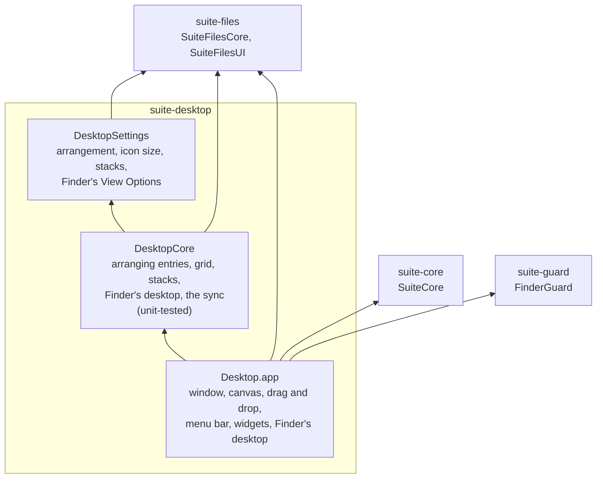
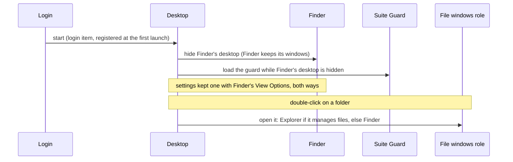

# Desktop

Desktop (Bureau on a Mac in French) is the suite's desktop in place of Finder's: the icons on the
screen's background, their arrangement, stacks, what a right-click on the desktop offers. It was part of
[Explorer](explorer.md) until 2026-11-24, and is now an app of its own.

Its first launch changes nothing visible: it shows Finder's desktop as the user set it up (Finder's View
Options for the desktop, the icons where Finder placed them); every change after that is the user's, in
Suite Settings' Desktop tab or the desktop's own menus.

## What it does

Free placement or a grid (Align Icons to Grid, Keep Arranged, Clean Up and Clean Up By), icon sizes from 16
to 256 points (Large, Medium and Small in the View menu, a slider in Suite Settings), grid spacing, text
size, label position (bottom or right), item info (a picture's size, a folder's item count, a disk's free
space, in blue under the name) and icon preview as Finder's, stacks unfolding in place, grouped as Finder's
Group Stacks By (kind, a date, tags), an overflow stack, the disks and servers Finder's settings show on the
desktop (with Eject), spring-loaded folders and stacks while dragging (after macOS's delay), the right-click
menu (Open, Open With, Cut, Copy, Rename, Move to Trash, Extract All, Compress, Quick Look, Change Icon,
Properties; Open, Eject and Properties on a disk; on the background View, Sort By, Use Stacks, Group Stacks
By, Clean Up, Clean Up By, Overflow Stack, New, Paste, Desktop Settings, Display Settings, Change Wallpaper),
drops, its own menu bar while the desktop is clicked, and the shortcuts of Explorer's windows. macOS's
widgets stay visible: the icons keep out of their way.

## How it is built

- Repository `suite-desktop`, app `Desktop.app`, bundle id `local.suite.desktop`, cask `desktop` (which
  brings Suite Guard).
- Built from Explorer's files with their history: `DesktopWindow`, `DesktopViewController`,
  `DesktopCanvasView`, `DesktopDragAndDrop`, `StackViewController`, the arrangement
  (`DesktopArrangement`) and its settings (`DesktopSettings`, the only product other repositories see:
  Suite Settings reads it for its Desktop tab).
- The file views, operations, the shared Undo history and Copy, Cut and Paste come from `suite-files`;
  display settings shared with Explorer's windows (file extensions, for instance) are read from
  Explorer's defaults (`DisplaySettings`). Desktop never imports Explorer's code.
- An ordinary app, as Finder is (no `LSUIElement`, `.regular` from launch): macOS picks it when an app quits with its last window instead of switching Space. Bar never
  shows it (`BarHiddenApps`).

## How it runs

- Hides only Finder's desktop (`FinderManager`, Finder's own setting kept in Desktop's defaults);
  quitting gives it back as the user had it, and Suite Guard does should Desktop vanish.
  `Desktop --restore-finder` does it by hand after a crash. Keeping Finder closed and redirecting "Show in
  Finder" belong to the file windows role, held by Explorer or by Finder.
- While it runs, its settings and Finder's are synced both ways (`FinderSync`): the View Options for the
  desktop (icon size, grid spacing, text size, label position, item info, icon preview, Sort By, Use Stacks
  and Group Stacks By) and the items Settings › General shows on the desktop (hard disks, external disks,
  CDs, DVDs and iPods, connected servers). Finder gets the closest value it accepts, so going back to
  Finder's desktop finds it as near as possible.
- Spring-loading follows macOS's own setting and delay (System Settings › Accessibility › Pointer Control),
  which Desktop only reads.
- Widgets: drawn by Notification Center; Desktop learns of their changes from its Accessibility events
  (`WidgetWatcher`; the permission is asked until granted) and reads their places from the Window Server.
- A cut or copy on the desktop pastes in Finder or any app through the system pasteboard, and the other
  way round.
- In System Settings, Suite Settings' agent covers "Show items on desktop" and "Click wallpaper to reveal
  desktop" while Desktop runs ([Suite Settings](suite-settings.md)).

## Open questions

- "Delete Immediately" of items that need root uses the Suite Trash root helper, which today lets only
  Explorer in: Desktop reports them as not deleted. The helper could accept Desktop as well.
