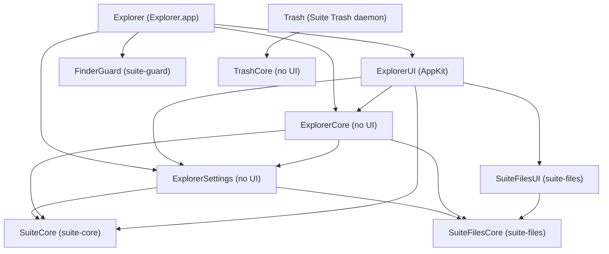
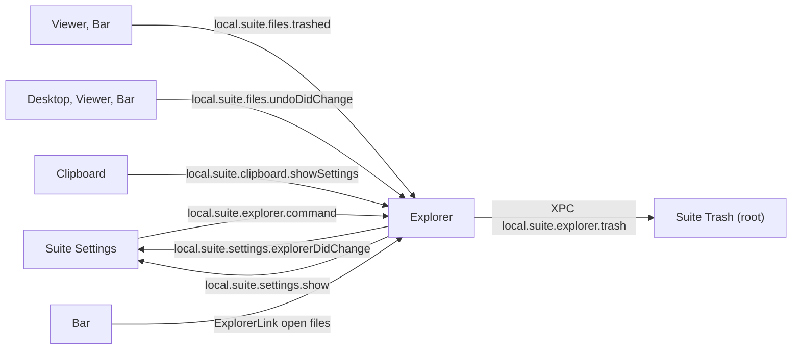
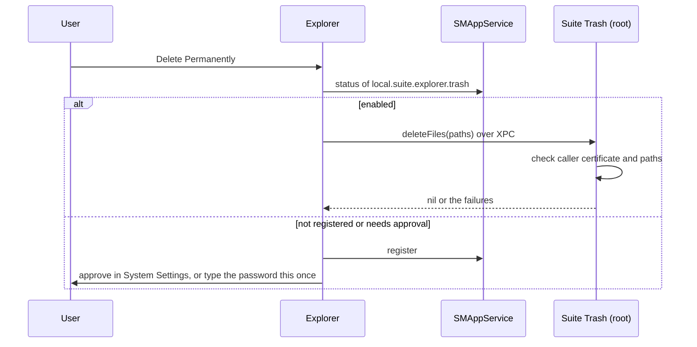

# Explorer

Explorer is the suite's file manager, in the spirit of Windows Explorer: folder windows with a sidebar, a
breadcrumb address bar, tabs, Side by Side panes, Windows keys and one Undo history for every file
operation. It holds the role of "file windows and Show in Finder" in place of Finder, keeps Finder out of
the way, and carries Suite Trash, a small root helper that erases Trash items needing root. The desktop is
an app of its own, [Desktop](desktop.md), which shares Explorer's file code through `suite-files`. On first
launch the switch "Explorer in place of Finder" (`UseExplorer`) is on: Explorer quits Finder once it is
idle (while Desktop hides Finder's desktop), becomes the default folder viewer, and opens no window until
asked (it starts with no Dock icon). Bar and Clipboard start by themselves at login; Explorer starts
neither.

## What it does

- **Explorer windows**: a sidebar the whole height on the left, laid out like Finder's (Recents, Shared,
  Favorites, then Locations: iCloud Drive, cloud storage accounts, this Mac, its disks, AirDrop, the
  Trash), each place can be turned off; a toolbar of file commands (New Folder, Rename, Trash,
  Properties, preview pane, Restore, Delete Permanently and Empty Trash in the Trash, Show Hidden Files,
  Side by Side, Swap Sides, and so on) whose order and visibility are set in Suite Settings; per pane:
  back, forward, up, a breadcrumb address bar that accepts Windows paths and completes typed paths, and
  view options. Views: icons, details (folders unfold), columns. Tabs (optional), Side by Side (two panes
  in one window or two windows on half the screen each, F5 and F6 copy or move to the other side),
  search as you type (Spotlight, then a walk of the folders for what Spotlight does not index), Quick
  Look preview pane, status bar per pane. Windows that were open come back at launch (on by default).
- **Files everywhere**: Windows keys (Ctrl or Cmd with X, C, V, A, Z, Y; Delete, F2, Enter, Backspace,
  Alt with arrows, type to select), Mac keys by default for Return; cut and paste of files, one Undo
  history (`FileUndo`), rename in place, conflicts (Replace, Skip, Keep Both) with progress, Open With,
  Copy as Path, Compress and Extract All, Add to Favorites, Properties (Cmd+I or Alt+Enter), Change Icon
  (Apple's icons, a personal library, coloured folders with an emoji), thumbnails, space bar Quick Look,
  sync badges for iCloud Drive and File Provider apps, hidden file extensions by default, and drag and
  drop that leaves the items in place at half opacity as Windows does.
- **The Trash**: nothing is erased without going through it. Delete moves to the Trash; only items
  already in it can be erased. The Trash gathers, as Finder's does, the home `.Trash`, iCloud Drive's
  (`~/Library/Mobile Documents/.Trash`) and each disk's `.Trashes/<uid>`. Restore (Finder's Put Back)
  also works for what Finder deleted, read from the Trash's `.DS_Store` (`FinderTrashRecords`).
- **Finder kept away** (while the switch is on): Finder quit and quit again once idle while Desktop hides
  Finder's desktop (`QuitFinder`, on by default), clicking Finder optionally brings Explorer instead, asking first
  (`RedirectFinder`, off by default), and "Show in Finder" in other apps opens Explorer
  (`OpenFoldersFromOtherApps`, on by default). Switching to Finder undoes all of it.
- **Hand-offs**: pictures go to Viewer (a setting, on by default), PDFs go to Viewer whenever it is
  installed; without Viewer, both open in the system's app (`ViewerHandoff`, `SuiteFilesUI`). Edit ›
  Clipboard History (shown while Clipboard is installed and turned on) starts Clipboard with `--show`.
- **Menu bar extra** (off by default): New Explorer Window, Switch to Finder or Explorer, Settings, Quit.
- **Sounds**: Finder's own (moving to the Trash, emptying it), when user interface sound effects are on.

## How it is built

Targets, from `Package.swift`:

| Target | Kind | What it holds |
|---|---|---|
| `ExplorerSettings` | library, the only product other repositories see | Explorer's settings as Explorer and Suite Settings read and write them: `WindowSettings`, `ToolbarLayout`, `SidebarPlaces`, `QuickAccessStore` (Favorites), `ExplorerSession`, `FinderSwitches` |
| `ExplorerCore` | library, unit-tested | Explorer's own logic: `PathParser` (Windows paths too), `NavigationHistory`, `NameSearch`, `VirtualPlace`, `FolderSummary`, `WindowTiling` |
| `ExplorerUI` | library, AppKit | `ExplorerWindowController`, `FolderPane`, `FolderTreeViewController` (the sidebar), `FileListViewController`, `AddressBar`, `CommandsBar`, `HoverLabel`, `FolderSearch`, `PlaceContents`, `PreviewViewController`, `InactiveGreyscale`, `AppMenu`, `PrivilegedEraser` |
| `Explorer` | executable, the app | `AppDelegate`, Finder handling (`FinderReplacement`, `FinderApp`, `FinderQuitter`, `FinderRedirect`), `BarCompanion`, `ClipboardCompanion`, `SettingsApp`, `ExplorerUpdates.swift` |
| `TrashCore` | library, unit-tested | what Suite Trash accepts: `ClientRequirement` (who may connect), `TrashErasePolicy` (which paths) |
| `Trash` | executable, Suite Trash | the root daemon, embedded in Explorer.app |

The file code Explorer shares with Desktop, Bar and Viewer is in `suite-files` ([files](../5-internals/files.md)):
`SuiteFilesCore` (`FileItem`, `DirectoryLoader`, `FileTransfer`, `FileTrash`, `TrashFolder` and
`TrashLedger`, `FinderTrashRecords`, `FileRenamer`, `FileTemplate`, `ShortcutResolver`, `ItemProperties`,
`IconLibrary`, `SearchScope`, `SyncState`, `CloudStorage`, `Archiver`, `DisplaySettings`,
`FolderViewStore`, `FileUndoJournal`) and `SuiteFilesUI` (`FileActions`, `FileUndo`
(`FileOperations.swift`), `FileDrop`, `DragGhost`, `PropertiesWindow`, `IconPickerWindow`, `QuickLook`,
`Thumbnails`, `SyncBadge`, `DefaultFileViewer`, `ViewerHandoff`, `FinderSounds`).

The main types of the app layer:

- `FinderReplacement` (`Sources/Explorer/FinderReplacement.swift`) holds the one switch, `usesExplorer`,
  and applies it: `FinderQuitter` and `FinderRedirect` suspended or not, Finder launched again when the
  switch goes back to Finder, the default folder viewer set or given back. Desktop reads the same
  switch from Explorer's defaults for its own desktop.
- `FinderApp` (`Sources/Explorer/FinderApp.swift`) acts on Finder itself: whether it runs, quits or
  launches it, and counts its windows by AppleScript.
- `FinderQuitter` quits Finder whenever it is running, not in front and has no window, and only while
  Desktop hides Finder's desktop (`GuardedApps.finderDesktopHidden`, FinderGuard).
- `FinderRedirect` hides Finder the moment it is activated, optionally asks, then reopens Finder's windows
  as Explorer windows and closes them in Finder.
- `SettingsApp` (`Sources/Explorer/SettingsApp.swift`) opens Suite Settings on a tab and is Explorer's end
  of the link with it.
- `BarCompanion` runs `Bar --restore-bar` for `--restore-finder`; `ClipboardCompanion` opens Suite
  Settings on the Clipboard tab when Clipboard's gear button asks (`ClipboardMessage.showSettings`).
- `PrivilegedEraser` (`Sources/ExplorerUI/PrivilegedEraser.swift`) erases Trash items needing root
  through Suite Trash.

## How it runs

**Start.** `Sources/Explorer/main.swift`:

1. `--restore-finder` (the escape hatch after a crash or a force quit): Finder started, and Bar asked to
   put the system Dock back (`Bar --restore-bar`); then exit. Finder's desktop is Desktop's
   (`Desktop --restore-finder`).
2. `AppRelauncher.waitForPreviousCopy()` (SuiteCore): after an update or `--relaunch`, the new copy waits
   for the old one to be gone.
3. One Explorer at a time: if another copy runs, this one activates it (or, with `--relaunch`, sends it
   `ExplorerLink` `.relaunch` or `.relaunchInBackground`) and exits without touching Finder.
4. The activation policy starts as `.accessory` (no Dock icon). Explorer is an `LSUIElement` app (an
   agent: no Dock icon or menu bar unless it asks for them); it switches to `.regular` while it is active
   or has Explorer windows open, because macOS only gives the menu bar to apps with a Dock icon.

`applicationDidFinishLaunching` then hands the shared file views their Explorer hooks (`FileViewer`,
`FileActions`), answers Clipboard's gear button (`ClipboardCompanion.start`), listens for Undo and Trash
changes made by other apps of the suite (`FileUndo.recordTrashingInOtherApps`), starts the link with Suite
Settings, turns SIGINT, SIGTERM and SIGHUP into a normal quit (so Finder comes back), starts
`FinderReplacement`, reopens the windows of last time (unless `--background`) and starts the updater.
`Explorer <path>` opens that folder.

**Requests from other apps.** Folders opened with Explorer arrive in `application(_:open:)`. "Show in
Finder" arrives as the Apple event `kAEMiscStandards`/`kAEMakeObjectsVisible` ("reveal") once Explorer
is the default folder viewer: the `NSFileViewer` key that `DefaultFileViewer` writes in the global
defaults. `Support/Explorer-Info.plist` declares Explorer a viewer of `public.folder` at rank
`Alternate`.

**What it reads and writes.**

| Where | What |
|---|---|
| defaults domain `local.suite.explorer` (`SuiteDefaults.explorer`, which is `.standard` inside Explorer) | every setting: `UseExplorer`, `QuitFinder`, `RedirectFinder`, `RedirectFinderAsks`, `OpenFoldersFromOtherApps`, `ToolbarLayout`, `SidebarPlaces`, `QuickAccessFolders`, `ExplorerSession`, `ShowMenuBarIcon`, `OpenPicturesInViewer`, and so on (the shared file settings, `DisplaySettings` and `FolderViewStore`, live here too); the status keys Suite Settings shows (`ExplorerLink.StatusKey`) |
| global defaults `NSFileViewer` | `local.suite.explorer` while Explorer answers "Show in Finder"; removed to give the role back |
| `~/Library/Application Support/Explorer/Icons` | the personal icon library |
| `~/Library/Application Support/Suite Files/Undo.json` | the Undo history shared with Desktop, Bar and Viewer (`FileUndoJournal`) |
| the Trash folders | moves, restores, erasures |

**Talking to the other apps.**

These are distributed notifications (`DistributedNotificationCenter`: messages macOS passes between
processes of the same user, by name, with a small dictionary). `ExplorerLink` (SuiteCore) commands are
`applySettings`, `checkForUpdates`, `allowWindowFitting` (ignored now, asked of Bar), `emptyTrash`,
`relaunch`, `relaunchInBackground` and `reportStatus`. On `applySettings`, Explorer synchronizes its
domain, runs settings migrations, reloads the Finder switches and the update settings, and posts its own
change notifications so everything redraws. See [messages](../5-internals/messages.md).

**Suite Guard.** Explorer hides nothing of its own: Desktop hides Finder's desktop and registers Suite
Guard, which puts it back should Desktop vanish. Explorer only reads, through FinderGuard, whether
Finder's desktop is hidden. See [Suite Guard](suite-guard.md) and
[Finder and the Dock](../5-internals/finder-and-dock.md).

**Suite Trash.** Erasing an item that needs root goes through `PrivilegedEraser`: if the daemon
`local.suite.explorer.trash` is registered with `SMAppService` (the macOS API that registers helpers
shipped inside an app bundle), it is an XPC call; otherwise Explorer registers it, which asks the user to
approve it in System Settings, and offers the administrator password for this one time. The daemon
accepts only a caller with bundle id `local.suite.explorer` signed with the same leaf certificate as
itself (`ClientRequirement`), and erases only paths inside the caller's Trash folders
(`TrashErasePolicy`). See [the Trash](../5-internals/trash.md).

**Stop.** On quit Explorer launches Finder again (not when it reopens itself); Desktop, Bar and
Clipboard keep running. To restart after a build, `open -n ~/Applications/Explorer.app --args
--relaunch` makes the running copy reopen itself as for an update, without bringing Finder back.

**Crash and restore.** If Explorer vanishes, Finder stays closed until something opens it. By hand:
`~/Applications/Explorer.app/Contents/MacOS/Explorer --restore-finder`. The windows come back at the
next launch from `ExplorerSession`, saved half a second after each change.

**Updates.** `SuiteUpdater.explorer` (SuiteCore) reads `update.json` from the latest GitHub release of
`love-suite/suite-explorer` a minute after launch and every six hours, checks its signature, and installs
without asking once no Explorer window is open. See
[updates and releases](../5-internals/updates-and-releases.md).

## Settings

`ExplorerSettings` is the library; the values live in the defaults domain `local.suite.explorer`, through
`SuiteDefaults.explorer`. Two apps write them: Explorer itself (its menus, the window's own options) and
Suite Settings (`Suite Settings.app`, bundle id `local.suite.settings`), whose Explorer, Toolbar, Trash
and Viewer tabs read and write the same keys and then send `applySettings`. Folder view options (icons or
list, sort) are SuiteFilesCore's `FolderViewStore`, in the same domain, which Desktop and Viewer read to
follow the same order. Profiles save and load
these settings with the other apps' ([settings and profiles](../5-internals/settings-and-profiles.md)).
Explorer opens Suite Settings on a tab with `--tab <name>`, or with `local.suite.settings.show` when it
runs; without it, Explorer says it is not installed.

## macOS mechanisms used

- `LSUIElement` and `NSApp.setActivationPolicy` to show the Dock icon only while in use.
- AppleScript to Finder (`NSAppleScript`) to count and take over its windows: needs the **Automation**
  permission; without it Finder is left open rather than risk closing a window in use.
- `NSWorkspace` activation notifications to notice Finder.
- The global `NSFileViewer` default and the "reveal" Apple event for "Show in Finder".
- `DistributedNotificationCenter` for the suite's messages.
- `SMAppService.daemon` and `NSXPCConnection.setCodeSigningRequirement` for Suite Trash.
- Spotlight (`NSMetadataQuery`) for search and Recents, FSEvents (SuiteFilesCore's `DirectoryWatcher`) to follow
  folders, Quick Look for thumbnails and previews, resource values for the sync state of iCloud Drive and
  File Provider items.
- Folder access needs macOS privacy permissions (Desktop, Documents, removable disks; Full Disk Access
  for some Trash folders).

## Building and testing

- `swift build` and `swift test` for development. Tests use Swift Testing: `ExplorerCoreTests`,
  `ExplorerSettingsTests`, `TrashCoreTests`.
- `scripts/make-app.sh [--force]` runs `scripts/gen-build-info.sh` (writes `Sources/Explorer/BuildInfo.swift`
  with a timestamp), builds the `Explorer` and `Trash` products in release, makes `build/Explorer.app`
  with Finder's icon copied from this Mac, embeds Suite Trash in `Contents/Library/LaunchDaemons/` with
  `Support/Trash-LaunchDaemon.plist`, signs both with the "Suite Local Signing" certificate (ad-hoc
  without it), records the version (`VERSION`, `-dev.N` between releases), the branch and the commit, and
  installs `~/Applications/Explorer.app`. It refuses to replace a copy built from another branch without
  `--force`; `INSTALL_DIR=` builds only. A running Explorer is relaunched with `--relaunch`. It does not
  build Suite Guard, which comes from `suite-guard`.
- Releases: `scripts/publish.sh` pushes the tag; `.github/workflows/release.yml` builds with "Suite
  Release Signing", signs `update.json` and publishes. `.github/workflows/sync-version.yml` brings a new
  `AA.Y` from the `suite` repository.
- Not testable by unit tests: the AppKit layers, and anything acting on the real Finder or desktop.
  Views are checked offscreen (`cacheDisplay`) from a scratch package, with a fake folder.

## Waiting on branches

- `feat/bindings`: Explorer starts Bindings at launch (`BindingsCompanion`, unless turned off) and tells
  it where the keyboard is (the desktop, a folder window, another window), with PARITY notes for
  Bindings. See [Bindings](bindings.md).
- `feat/dock-parity`: PARITY notes only, on the Dock's parity with the system Dock (the Dock itself is in
  `suite-bar`).
- `feat/locations`: Eject (sidebar button, right-click menu, File › Eject, Cmd+E), disks listed live as
  they are mounted, ejected or renamed (`VolumeMonitor`), Go › Connect to Server (Cmd+K, NetFS, recent
  servers, Windows' `\\server\share` accepted), disk images mounted and opened as disks; links the NetFS
  framework.
