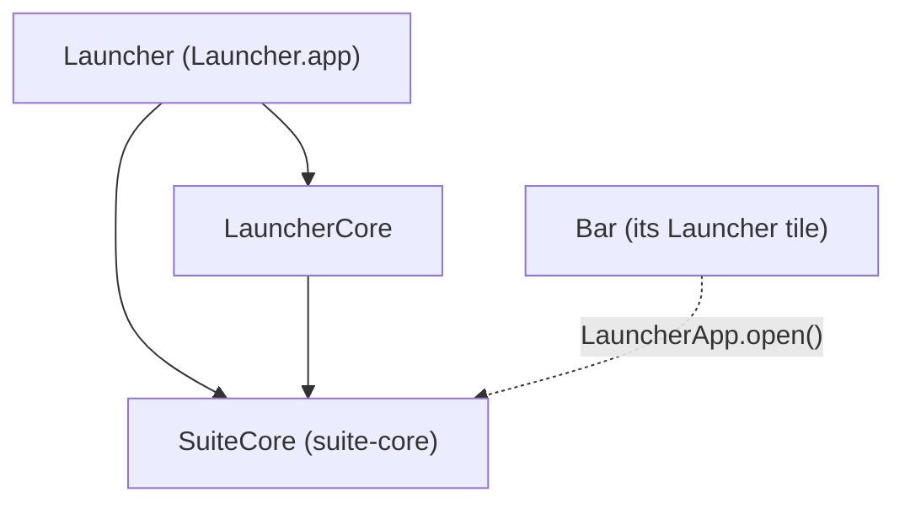
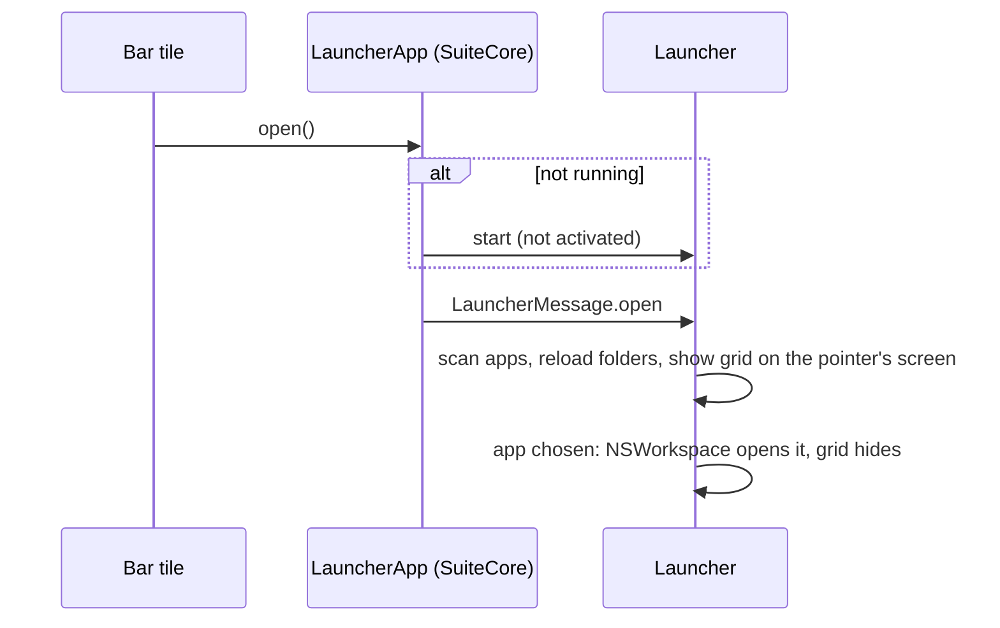

# Launcher

> **Not on `main` yet.** The repository's `main` holds no app today, only its brief, README and
> `VERSION`. The app described on this page is on branch `feat/launcher/core`, which the user has not
> tried yet. Everything below describes that branch.

Launcher replaces Launchpad, which macOS 27 no longer has: a full-screen grid of the installed apps, with
a search field, folders of apps and an order of your own. Choosing an app opens it, and the grid closes.
It is an app of its own (`Launcher.app`, bundle id `local.suite.launcher`, repository `suite-launcher`),
an `LSUIElement` app, which means it has no Dock icon and no menu bar of its own. It holds no macOS role.
It shows nothing at launch: it waits to be asked, by [Bar](bar.md)'s Launcher tile (itself on a
branch) or by a reopen of the app, and starts with an empty folder list and the apps sorted by name.

## What it does

- **The grid.** Every `.app` found directly in `/Applications`, `/System/Applications` and
  `~/Applications` (not in subfolders), each app once, on a dark blurred background over the screen with
  the pointer. Apps are scanned again each time the grid opens.
- **Search.** The search field has the keyboard when the grid opens; typing filters the apps by name
  (folders are left out while searching). Esc clears the search, then closes the grid.
- **Sort By.** Name, Date (the app's modification date, newest first) or Custom (the order given by
  dragging). Dragging an item between two others switches to Custom.
- **Folders.** Drop an app on another to make a folder, named after the app's category
  (`LSApplicationCategoryType`) or "Folder"; drop an app on a folder to add it. A folder shows a 2 by 2
  grid of its apps; a click opens it over the grid, from which apps open, or are dragged out. A folder
  left with a single app goes, that app taking its place.
- **Menus.** On an app: Open, Show in Applications Folder (in the system's file viewer), Add to Folder.
  On a folder: Open, Open All, Rename, Remove Folder. On the background: New Folder, Sort By Name.
- **Closing.** Choosing an app, Esc, a click outside the icons, another app coming to the front or a
  change of Space closes the grid. Esc and the click outside can each be turned off in the settings.

## How it is built

`Package.swift` has two targets and one product, the library `LauncherCore`.

- **`LauncherCore`** (`Sources/LauncherCore/`, no UI, tested):
  - `AppItem` (`AppItem.swift`): an app found on the Mac, its id (bundle id, or path), name, URL,
    modification date and category.
  - `AppScanner` (`AppScanner.swift`): scans the three folders, sorted by name.
  - `LauncherFolder`, `GridEntry`, `LauncherLayout`, `LauncherFolderStore` (`LauncherFolder.swift`): a
    folder (id, name, app ids); an entry of the grid, saved as `f:<id>` or `a:<id>`; the custom order and
    how to arrange, move and replace entries in it; the store that loads and saves both.
  - `LauncherSettings` (`LauncherSettings.swift`): the two closing settings.
- **`Launcher`** (`Sources/Launcher/`, the app):
  - `main.swift`: waits for the copy it replaces after an update (`AppRelauncher.waitForPreviousCopy()`),
    then runs as an accessory app.
  - `LauncherAppDelegate` (`AppDelegate.swift`): listens for `LauncherMessage`, shows and hides the
    window, starts the updater.
  - `LauncherWindow` (`LauncherWindow.swift`): a borderless, non-activating panel at window level 490
    (just below the level of dragged images, 500, above every app window), on every Space including
    full-screen ones, that can still take the keyboard, as Spotlight does.
  - `LauncherViewController` (`LauncherViewController.swift`): the background, search field, sort control,
    grid (`NSCollectionView`), cells (`AppCell`, `FolderCell`, `FolderIconGridView`), the folder panel
    (`FolderPanelView`), menus, dragging and dropping.

## How it runs

**Opening.** `LauncherApp.open()` in `suite-core` is how another app opens the grid: if Launcher runs, it
posts `LauncherMessage.open`; otherwise it starts Launcher through Launch Services and posts the message
0.4 seconds later. A distributed notification is a message macOS delivers to every app of the session
that listens for its name. Reopening the app (for instance opening it from Finder while it runs) shows
the grid too.

**Showing and hiding.** `show()` sizes the window to the screen under the pointer, brings it forward,
reloads the folders and the order, scans the apps, clears the search and gives it the keyboard.
`hide()` orders the window out and deactivates Launcher. It hides when another app is activated and 0.4
seconds after the active Space changes. Launcher keeps running in the background after the grid closes.

**What it reads and writes.**

- Its defaults, `local.suite.launcher`: `dismissOnEsc` and `dismissOnClickOutside`.
- Files in `~/Library/Application Support/Explorer/Launcher/`: `folders.json` (the folders) and
  `layout.json` (whether the order is custom, and the order).
- It listens for `LauncherMessage.open` and `LauncherMessage.settingsDidChange` (names starting with
  `local.suite.launcher.`); on the second it reads its settings again. It posts nothing.

**Updates.** `LauncherAppDelegate.updater` is a `SuiteUpdater`; the new copy waits for the old one to be
gone before it carries on. See [Updates and releases](../5-internals/updates-and-releases.md).

**Stopping and crashes.** Launcher hides nothing of the system and changes no system setting, so a crash
or quit leaves nothing to put back; [Suite Guard](suite-guard.md) does not watch it.

## Settings

`LauncherSettings` (`Sources/LauncherCore/LauncherSettings.swift`), kept in Launcher's own defaults
(`local.suite.launcher`):

| Key | Default | Meaning |
|---|---|---|
| `dismissOnEsc` | `true` | Esc closes an open folder, then the grid |
| `dismissOnClickOutside` | `true` | A click outside the icons closes the grid |

Launcher reads them as its own; `LauncherSettings.forManager()` is there for Suite Settings to read and
write them, followed by `LauncherMessage.settingsDidChange`. Suite Settings has no Launcher tab yet
**(to build)**. The library is named `LauncherCore` and holds more than the settings, where the suite's
convention is a `LauncherSettings` library of settings only (see [Code](../4-code.md)). The folders and
the order are files, not settings, so profiles don't carry them.

## macOS mechanisms used

- **`NSPanel`** with `.nonactivatingPanel`, `canBecomeKey` true, a high window level and
  `.canJoinAllSpaces` and `.fullScreenAuxiliary`, so it shows over full-screen apps without leaving the
  Space. The `LSUIElement` setting matters for the same reason: activating a regular app with no window on
  the current Space makes macOS leave that Space.
- **`NSVisualEffectView`** (`.fullScreenUI`, behind the window) for the blurred background.
- **`NSCollectionView`** with drag and drop on custom pasteboard types for the grid and folders.
- **`NSWorkspace`**: opening apps, revealing them (`activateFileViewerSelecting`), the app-activated and
  Space-changed notifications.
- **Distributed notifications** (`LauncherMessage`).
- No permission is needed.

## Building and testing

- `swift build` and `swift test`. `Tests/LauncherCoreTests/LauncherLayoutTests.swift` tests the grid
  entries, the custom order (unknown items last, gone ones dropped, moves forward and backward, an app out
  of a folder), folders dissolving into their last app, and the store keeping the order across launches,
  in a temporary folder.
- `scripts/make-app.sh` builds `build/Launcher.app` in release mode. Its icon is drawn at build time by
  `scripts/launcher-icon.swift` (a blue rounded square with the `square.grid.3x3.fill` symbol, made into
  an `.icns` with `iconutil`). It signs with "Suite Local Signing" (ad-hoc as a fallback) and installs as
  `~/Applications/Launcher.app`, with the same branch check, `--force` and `INSTALL_DIR=` as the other
  apps; a running copy is quit and opened again.
- Releases by `scripts/publish.sh` and `.github/workflows/release.yml`, feed from
  the repository it is built from (`love-suite/suite-launcher`). See [Code](../4-code.md).
- What can't be unit-tested: the window, the grid, dragging, the scan of the real folders.

## Waiting on branches

- **`feat/launcher/core`** (this repository): the whole app as described above. Still to do on it, from
  the brief: a Launcher tab in Suite Settings **(to build)**, an icon of its own for Bar's tile **(to
  build)**, apps in subfolders of `/Applications` **(to build)**, groups as in Launchpad **(to build)**.
- **`feat/launcher/core`** in `suite-bar`: Bar's Launcher tile, see [Bar](bar.md#waiting-on-branches).
