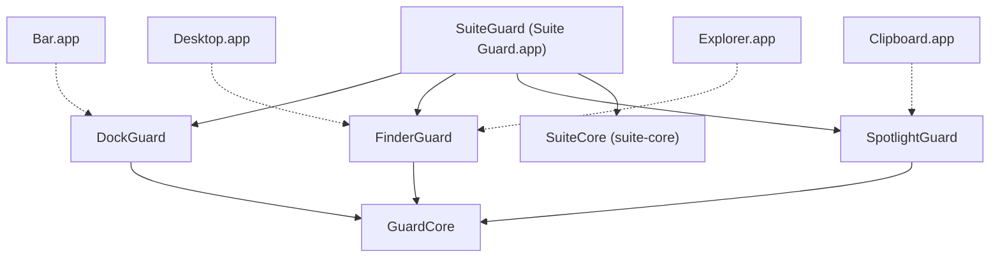
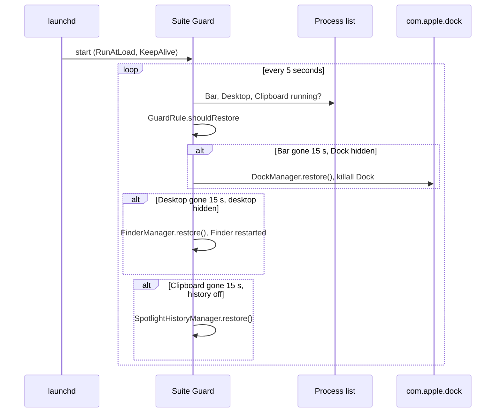

# Suite Guard

Suite Guard puts back what the suite's apps hide, should the app that hid it vanish (a crash, a forced
quit, not started at login): the system Dock, which [Bar](bar.md) hides while it shows, Finder's
desktop, which [Desktop](desktop.md) hides while it shows its own, and Spotlight's clipboard history,
which [Clipboard](clipboard.md) turns off while it runs. It is an app with no window
(`Suite Guard.app`, bundle id `local.suite.guard`, executable `SuiteGuard`, repository `suite-guard`),
marked `LSBackgroundOnly`: macOS gives it no Dock icon, no menu bar and no windows. It is never opened by
hand. It runs as a launch agent only while something is hidden; on a Mac where nothing is hidden (none of
Bar, Desktop and Clipboard running), it doesn't run at all. The repository also provides the libraries the apps use
to hide and put back.

## What it does

- While the system Dock is hidden by Bar: if Bar's process is gone for 15 seconds, it puts the system
  Dock's settings back from the copy Bar kept and restarts the system Dock.
- While Finder's desktop is turned off by Desktop: if Desktop's process is gone for 15 seconds, it puts
  Finder's desktop back as the user had it (off stays off) and restarts Finder (or starts it, if Explorer
  had quit it).
- While Spotlight's clipboard history (macOS 26) is turned off by Clipboard: if Clipboard's process is gone
  for 15 seconds, it puts Spotlight's `PasteboardHistoryEnabled` back as the user had it (on, off, or not
  set).
- Just after it starts (at login), the apps get 90 seconds to show up before anything is put back.
- It does nothing while those apps run, and it keeps itself up to date quietly.

## How it is built

`DockGuard`, `FinderGuard` and `SpotlightGuard` are the three products (`Package.swift`); each re-exports
`GuardCore` (`@_exported import`), so an app importing one also sees `GuardAgent` and `GuardedApps`.
Explorer imports `FinderGuard` only to read the state (`GuardedApps`, `RunningProcesses`) and keep Finder
quit while Desktop runs.

- **`GuardCore`** (`Sources/GuardCore/`, no UI, links `ServiceManagement`):
  - `GuardRule` (`GuardRule.swift`): when to put back. `shouldRestore(ownerRunning:hidden:lastSeen:started:)`
    is true only while the thing is hidden and its owner isn't running, once the owner has been gone
    `grace` (15 seconds), or, if it was never seen since the guard started, `startGrace` (90 seconds)
    after the start.
  - `RunningProcesses` (`GuardRule.swift`): whether a process whose executable path ends with a given
    suffix is running, read from the system's process list (`proc_listallpids`, `proc_pidpath`), since
    an app with no window doesn't get `NSWorkspace`'s running apps refreshed.
  - `GuardedApps` (`GuardedApps.swift`): what is watched, for each owner its domain, its executable
    suffix and the key holding the setting from before: Bar (`local.suite.bar`,
    `/Bar.app/Contents/MacOS/Bar`, `DockSettingsBeforeHiding`), Desktop (`local.suite.desktop`,
    `/Desktop.app/Contents/MacOS/Desktop`, `FinderDesktopBeforeHiding`), Clipboard (`local.suite.clipboard`,
    `/Clipboard.app/Contents/MacOS/Clipboard`, `SpotlightHistoryBefore`); `systemDockHidden`,
    `finderDesktopHidden` and `spotlightHistoryHidden` are true while that key is present in the owner's
    defaults (Finder's desktop turned off by the user in Finder doesn't count).
  - `GuardAgent` (`GuardAgent.swift`): the launch agent, loaded while something is hidden.
  - `PreferenceDomain` and `AppPreferenceDomain` (`PreferenceDomain.swift`): another app's preferences
    through `CFPreferences`; tests use a dictionary instead.
- **`DockGuard`** (`Sources/DockGuard/DockManager.swift`): `DockManager` hides the system Dock with
  public settings and puts the old values back; `carry(_:)` replaces them with Bar's own size and
  automatic hiding, so a user going back to the system Dock keeps them; `DockGuardRule`, a name for
  `GuardRule`.
- **`FinderGuard`** (`Sources/FinderGuard/FinderManager.swift`): `FinderManager` keeps Finder's own
  `CreateDesktop` in `FinderDesktopBeforeHiding` (once), sets it to false and restarts Finder; `restore()`
  puts it back as the user had it (the key removed when the desktop was shown) and restarts or starts
  Finder; `FinderGuardRule`, a name for `GuardRule`.
- **`SpotlightGuard`** (`Sources/SpotlightGuard/SpotlightHistoryManager.swift`): `SpotlightHistoryManager`
  keeps `com.apple.Spotlight`'s `PasteboardHistoryEnabled` in `SpotlightHistoryBefore` ("on", "off", or
  "none" when the user never set it; once), then sets it to false; `restore()` puts it back (the key
  removed for "none"). No restart is needed; `SpotlightGuardRule`, a name for `GuardRule`.
- **`SuiteGuard`** (`Sources/SuiteGuard/main.swift`): the agent, a timer and a run loop.

**How `DockManager` hides the system Dock.** It first saves the current values of the keys it will
change into `DockSettingsBeforeHiding` (in the calling app's defaults, which for Bar is `local.suite.bar`),
each key marked as saved so that a key added later is saved once before it changes. Then, unless the Dock
already has the hidden values, it writes them and restarts the Dock:

| Key in `com.apple.dock` | Value while hidden |
|---|---|
| `autohide` | `true` |
| `autohide-delay` | 1000 seconds |
| `autohide-time-modifier` | 1000 |
| `tilesize` | 1 point |
| `orientation` | `bottom` |
| `static-only` | `true` (running apps only) |

`restore()` writes the saved values back (removing keys that had none), deletes the saved copy and
restarts the Dock. More in [Finder and the Dock](../5-internals/finder-and-dock.md).

## How it runs

**Loading the agent.** Each app that hides or shows something calls `GuardAgent.update()` afterwards.
Every app sees the same state (Bar's, Desktop's and Clipboard's defaults), so whichever calls last is right:

- Something hidden: `install()` writes `~/Library/LaunchAgents/local.suite.guard.plist` (label
  `local.suite.guard`, the path of Suite Guard.app's executable as found by Launch Services, `RunAtLoad`,
  `KeepAlive`, `ProcessType` `Background`) and loads it with `launchctl bootstrap gui/<uid>`. If the
  file changed it is booted out and loaded again; if only Suite Guard's build changed (an update), it is
  restarted with `launchctl kickstart -k`. The last build seen is kept under `SuiteGuardRegisteredBuild`
  in the calling app's defaults.
- Nothing hidden: the agent is booted out and its plist file removed.
- Suite Guard.app not installed: nothing guards; the app writes so to its standard error.

A launch agent is a program launchd, macOS's service manager, runs in the user's session; with
`KeepAlive` it starts it again should it stop, and with `RunAtLoad` at login. A plain plist is used
rather than `SMAppService`: registered that way, launchd held the agent to the code signature of an
earlier build (the local certificate not being Apple's) and refused to start it after most updates.

**The loop.** Every 5 seconds the agent checks the three rules:

Once something is back, its saved key is gone, so its rule stays false; the agent
keeps running until the next `GuardAgent.update()` from an app removes it.

**What it reads and writes.** Reads the saved keys in Bar's, Desktop's and Clipboard's defaults. When it
restores, it writes `com.apple.dock`, `com.apple.finder`'s `CreateDesktop` or `com.apple.Spotlight`'s
`PasteboardHistoryEnabled` from them and removes the saved key from the owner's defaults. It logs what it
puts back on its standard error.

**Updates.** A `SuiteUpdater` in quiet mode (no window to ask in): once the new copy is in place it
exits, and launchd starts it again from there. See
[Updates and releases](../5-internals/updates-and-releases.md).

**Stopping.** It never stops by itself while it is loaded; the apps unload it when nothing is hidden. How
this fits with the other apps at start-up and login is in [Working together](../2-working-together.md).

## Settings

None. Suite Guard has no settings library and no defaults of its own; it reads what the apps it guards
write.

## macOS mechanisms used

- **launchd launch agents**: a plist in `~/Library/LaunchAgents`, `launchctl bootstrap`, `bootout`,
  `kickstart` and `print` in the `gui/<uid>` domain.
- **`CFPreferences`** to read and write another app's preferences (`com.apple.dock`, `com.apple.finder`,
  `com.apple.Spotlight`).
- **`killall Dock`** and **`killall Finder`** to make them read their preferences again; `open -g -b
  com.apple.finder` to start Finder.
- **`proc_listallpids` and `proc_pidpath`** (libproc) to find processes by executable path. Bar's
  executable is `Bar` so that it is never confused with the system Dock's process, `Dock`.
- **Launch Services** (`NSWorkspace.urlForApplication(withBundleIdentifier:)`) to find Suite Guard.app.
- No permission is needed. No private API; SIP stays on.

## Building and testing

- `swift build` and `swift test`. `Tests/GuardTests/` has `GuardRuleTests.swift` (the grace periods),
  `DockManagerTests.swift` (hiding, saving each key once, restoring, carried values),
  `FinderManagerTests.swift` and `SpotlightHistoryManagerTests.swift` (keeping the user's setting once,
  putting it back), against a dictionary `PreferenceDomain` and a recorded restart. The tests never touch
  the real Dock, Finder or Spotlight.
- `scripts/make-app.sh` builds `build/Suite Guard.app` in release mode, with no icon and nothing more in
  its bundle, signs it with "Suite Local Signing" (ad-hoc as a fallback) and installs it as
  `~/Applications/Suite Guard.app`, with the same branch check, `--force` and `INSTALL_DIR=` as the other
  apps. A running copy is restarted with `launchctl kickstart -k gui/<uid>/local.suite.guard`.
- Releases by `scripts/publish.sh` and `.github/workflows/release.yml`, feed from
  the repository it is built from (`love-suite/suite-guard`). See [Code](../4-code.md).
- What can't be unit-tested: launchd, the real Dock and Finder restarts, Spotlight, the timing after
  login.

## Waiting on branches

None: the repository has only `main`.
