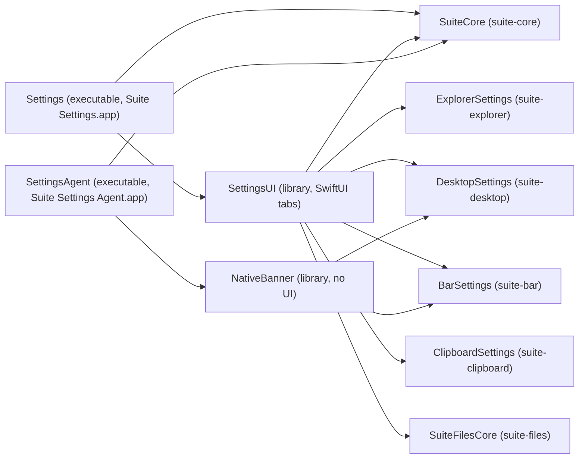
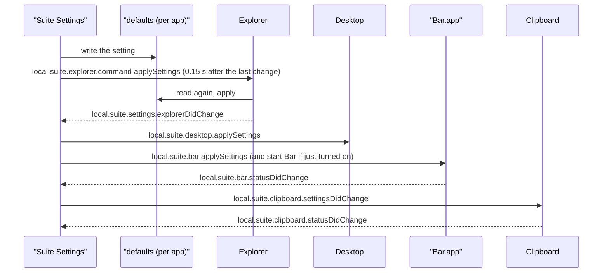
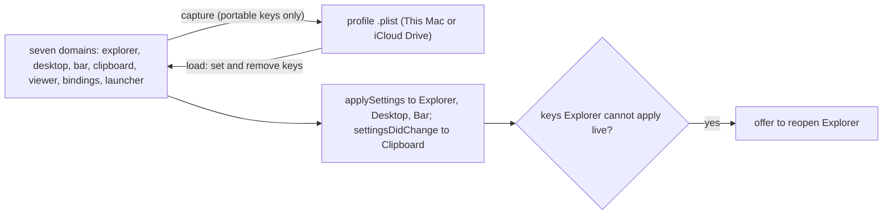

# Suite Settings

Suite Settings is the settings app of the suite: one window with a tab for each app, plus the settings
profiles that save and load every app's settings at once. It is an ordinary app with its own Dock icon
(Finder's icon with System Settings' gear in a corner, drawn at build time from this Mac's own icons). It
holds no macOS role of its own; the apps open it on the right tab from their menus, and it quits when its
window closes. Its bundle is `Suite Settings.app` (bundle id `local.suite.settings`); inside it, Suite
Settings Agent (`local.suite.settings.agent`), its login item, marks in System Settings the settings a
running suite app takes over (see [Suite Settings Agent](#suite-settings-agent)). Repository:
`suite-settings`, cask `settings`.

## What it does

The window is a row of toolbar tabs. They come in this order (`Sources/SettingsUI/SettingsWindow.swift`):

| Tab | What it holds |
| --- | --- |
| General | The language of the apps (system, English, French), with a Restart to Apply button; Explorer's updates: its version, check automatically, install automatically or after asking, Check Now, the feed address |
| Profile | The settings profiles (see [Profiles](#profiles)) |
| Explorer | Explorer or Finder to manage files, the menu bar icon, the Finder switches (open folders from other apps, keep Finder closed, redirect Finder, ask first), files (thumbnails, full names, extensions, cloud badges, hidden files, Return to rename or open), reopening windows, tabs, the sidebar and its places, Favorites, Side by Side |
| Toolbar | Explorer's toolbar drawn at real size for a window width set by a slider; buttons are dragged to reorder them, into the More menu, or out of the bar to hide them; Restore Default and Restore Profile Default |
| Trash | What Restore does, whether iCloud Drive's Trash is included, the Trash folders gathered, Empty Trash |
| Desktop | Desktop's settings (`DesktopSettings`, in Desktop's domain): icon size, grid spacing, text size, bold names; keep arranged, where icons start, folders first, align to grid, drag behaviour; stacks |
| Bar | The suite's Dock (Bar.app) or the system Dock, icon size, hides automatically or stays on screen, per-app exceptions, full screen behaviour, the Accessibility permission Bar needs to fit other apps' windows |
| Viewer | Whether Explorer opens pictures in Viewer |
| Clipboard | Shown only when Clipboard is installed: history on or off, hold ⌘V, list size, history length and expiry, open at login, iCloud Drive backup, the Accessibility state, apps to ignore |

A tab is added when its app exists, not before.

## How it is built

Four targets (`Package.swift`), and a test target, `NativeBannerTests`:

- `Settings`, the executable (`Sources/Settings/main.swift`). `SettingsDelegate` starts the updater,
  registers the agent as a login item (`AgentLoginItem`, `SMAppService.loginItem`), sets the icon and the
  menus, listens for `ExplorerLink.showNotification` and shows the window, on the tab named
  by `--tab` on the command line if there is one.
- `SettingsUI`, the library holding the tabs. It never imports an app's own code, only each app's settings
  library: `ExplorerSettings`, `DesktopSettings`, `BarSettings`, `ClipboardSettings` (and `SuiteFilesCore`
  for the file display settings). From `SuiteCore` it takes where
  Explorer's settings live (`SuiteDefaults`), the messages (`ExplorerLink`, `ClipboardMessage`) and the
  profiles (`SettingsProfile`, `ProfileStore`).
- `NativeBanner`, the library deciding what to cover in macOS's settings: which pane a window shows
  (`NativePane`), what to cover there for the suite apps running (`PaneMarks`, `PaneCover`) and where
  (`RowLayout`). No UI, unit-tested.
- `SettingsAgent`, the executable of Suite Settings Agent (`Sources/SettingsAgent`): reads the pane
  (`PaneReader`), draws the covers (`RowOverlay`), swallows clicks under them (`ClickGuard`).

The main types in `SettingsUI`:

| Type | File | Role |
| --- | --- | --- |
| `SettingsWindow` | `SettingsWindow.swift` | Builds the `NSTabViewController` window once, selects a tab by label, asks Explorer and Bar for their status each time it is shown |
| `SettingsModel` | `SettingsWindow.swift` | Bindings for the tabs: each Explorer write goes through the setting's own store, then `ExplorerLink.settingsChanged()`; a Desktop write goes to `DesktopSettings.current`, then `DesktopMessage.applySettings`; redraws when Explorer or Bar report a change |
| `GeneralSettings`, `ExplorerTab`, `TrashSettingsView`, `DesktopSettingsView`, `ViewerSettings` | `SettingsWindow.swift` | The SwiftUI forms of those tabs |
| `ToolbarSettingsView`, `MockToolbar` | `ToolbarSettingsView.swift` | The Toolbar tab and its drawn toolbar |
| `BarSettingsView`, `BarApp` | `BarSettingsView.swift` | The Bar tab; `BarApp.settingsChanged()` tells Bar and starts it when it was just turned on |
| `ClipboardSettingsModel`, `ClipboardSettingsView` | `ClipboardSettingsTab.swift` | The Clipboard tab |
| `ProfilesModel`, `ProfileSettingsView` | `ProfileSettingsTab.swift` | The Profile tab |
| `CurrentProfile` | `CurrentProfile.swift` | The profile last loaded or saved, for Restore Profile Default |
| `UIL` | `Localization.swift` | Picks the strings of the language set in General, which `Bundle.main` alone would not |

## How it runs

### Start and stop

Explorer opens it from its Settings menu items (`SettingsApp.show` in suite-explorer), Bar from its own
"Bar Settings" item and other apps through `SuiteSettingsApp.show` (suite-core). If Suite Settings is
already running, they post `local.suite.settings.show` with the tab in the user info and bring it to the
front; otherwise they launch it with `--tab <label>`. Clipboard asks Explorer, which opens it on the
Clipboard tab. Suite Settings quits when its window closes
(`applicationShouldTerminateAfterLastWindowClosed`); only its agent runs in the background.

### Reading and writing the settings

Every app keeps its settings in its own defaults domain. A defaults domain is the per-app store of macOS
preferences (`UserDefaults`), named after the bundle id and kept as a property list in
`~/Library/Preferences`; another app can read and write it by name with `UserDefaults(suiteName:)`. Suite
Settings writes each app's domain directly, through that app's settings library:

| App | Domain | How the tab reaches it |
| --- | --- | --- |
| Explorer (and the Toolbar, Trash, Viewer tabs) | `local.suite.explorer` | `SuiteDefaults.useExplorerDomain()` at launch points `SuiteDefaults.explorer` at Explorer's domain; every store of `ExplorerSettings` goes through it |
| Desktop | `local.suite.desktop` | `DesktopSettings.current` |
| Bar | `local.suite.bar` | `BarSettings.current` |
| Clipboard | `local.suite.clipboard` | `ClipboardSettings.forExplorer()` |

The language picker writes `AppleLanguages` into the domains of Explorer, Suite Settings, Viewer and
Clipboard.

### Telling the apps

After writing, Suite Settings tells the app through distributed notifications. A distributed notification
is a named message macOS delivers to every process that listens for that name; it carries a small
dictionary and no reply.

- **Explorer.** `ExplorerLink.settingsChanged()` waits 0.15 s so a burst of changes is applied once,
  flushes the domain to the preferences daemon (`CFPreferencesAppSynchronize`), then sends
  `ExplorerLink.Command.applySettings`. Explorer reads its settings again and applies them as if changed
  in Explorer. What only Explorer can do is asked the same way: `checkForUpdates`, `emptyTrash`,
  `relaunch`, `reportStatus`. Explorer answers with `explorerDidChange` after writing `Status` keys in
  its own domain (updater state, whether it can be the default folder viewer), which the tabs show.
- **Desktop.** `CFPreferencesAppSynchronize` on Desktop's domain, then `DesktopMessage.applySettings`.
- **Bar.** `BarMessage.applySettings`; when the Dock was just turned on and Bar is not running, Suite
  Settings starts it in the background. Allow posts `BarMessage.allowWindowFitting`, Bar asks for
  Accessibility, then reports with `BarMessage.statusDidChange` and the `StatusWindowFittingAllowed` key in
  its domain.
- **Clipboard.** `ClipboardMessage.settingsDidChange`; turning the history on starts Clipboard
  (`ExplorerLink.launchClipboard()`), off lets it quit on its own. Open at login, Clear History and Open
  Accessibility Settings are asked of Clipboard (`setOpensAtLogin`, `clearHistory`,
  `requestAccessibility`).

Each time the window is shown it sends `reportStatus` to Explorer and `BarMessage.reportStatus` to Bar, so
what it shows about them is fresh.

### Profiles

A profile is a named copy of the suite's settings, kept as a property-list file
(`SettingsProfile`, `ProfileStore` in suite-core) either on this Mac, in
`~/Library/Application Support/Explorer/Profiles`, or in iCloud Drive › Explorer › Profiles, where every
Mac on the account sees it.

- **Create from Current Settings** and **Save Current Settings** capture the domains listed in
  `SettingsProfile.domains` (`local.suite.explorer`, `local.suite.desktop`, `local.suite.bar`, `local.suite.clipboard`,
  `local.suite.viewer`, `local.suite.bindings`, `local.suite.launcher`). Only portable keys are kept: the
  system's keys (`NS`, `Apple`, `com.apple.` and so on) and each app's state (`Status` keys, the hidden
  Dock's previous settings, the current profile and so on) are left out, while named window frames are
  kept. Each domain's settings version is recorded so a later app version can convert them
  (`SettingsMigrations`).
- **Load** asks first, then for each domain sets the profile's values and removes the portable keys the
  profile does not hold (back to their defaults). It tells Explorer, Desktop and Bar to apply and Clipboard that its
  settings changed. Explorer keys outside the list of those it applies live make it offer to reopen
  Explorer.
- A profile can be moved between This Mac and iCloud Drive, or moved to the Trash. The current profile's
  path is kept under `CurrentProfile` in Explorer's domain. The Toolbar tab's Restore Profile Default reads
  the toolbar keys from it.

### Suite Settings Agent

`Suite Settings.app/Contents/Library/LoginItems/Suite Settings Agent.app` (`LSUIElement`, no window of its
own), registered as a login item the first time Suite Settings opens, then started by macOS at each login;
the user can turn it off in System Settings › General › Login Items. One copy runs at a time. In System
Settings only (Finder's settings are left alone), it covers the settings a running suite app takes over,
which would do nothing there or undo what the app does (`PaneMarks.covers`):

| Pane | Covered while | What |
| --- | --- | --- |
| Desktop & Dock | Bar runs and shows | The Dock's sections: size, position, hide automatically (with magnification and the rest of those sections) |
| Desktop & Dock | Desktop runs | The "Show items: On Desktop" checkbox alone ("In Stage Manager" stays macOS's) and the "Click wallpaper to reveal desktop" field |
| Spotlight | Clipboard runs | "Results from Clipboard" (Clipboard turns Spotlight's clipboard history off while it runs) |

With Stage Manager on, nothing is covered. A cover is a dark overlay with grey hatching and a grey border,
and a white button in its middle, red under the pointer ("Open Bar settings", "Open Desktop settings",
"Open Clipboard settings"), which opens Suite Settings on that app's tab (`SuiteSettingsApp.show`). The
scroll wheel goes through to the pane; clicks under a cover are swallowed by an event tap (`ClickGuard`),
except on its button. Panes are recognised by window title, in every language, read from macOS's own
settings extensions (`NativePane`); controls by their Accessibility identifier (`auto-hide-dock`), as the
Nth slider, or by their localized title. The agent waits on Accessibility notifications (apps, windows,
panes, focus, moves, scrolls), no timer: the covers step aside while the window is dragged or scrolled and
come back once it stops. It needs the Accessibility permission, asked at each launch until granted. What it
sees is logged (subsystem `local.suite.settings.agent`, `LastSeen` in its defaults), and a pane whose
settings it can't find is recorded once in `~/Library/Logs/Suite Settings Agent/<pane>.txt` (`PaneDump`).

### Crash and restore

Suite Settings keeps no state of its own besides its window: every setting is in the apps' domains as soon
as it is changed. If it crashes, nothing is lost; it is opened again from an app's menu. If the agent
crashes, its covers go with it; it is started again at the next login or the next time Suite Settings is
built.

## Settings

Suite Settings has no settings library of its own: it writes the other apps'. Its own domain,
`local.suite.settings`, holds only the language (`AppleLanguages`) and what macOS keeps for it. The current
profile is kept in Explorer's domain. Explorer's update settings in General are Explorer's
(`UpdateSettings` in Explorer's domain). See [settings and profiles](../5-internals/settings-and-profiles.md)
and [messages](../5-internals/messages.md).

## macOS mechanisms used

- `UserDefaults(suiteName:)` and `CFPreferencesAppSynchronize` to read and write another app's defaults
  domain.
- `DistributedNotificationCenter` for every message, posted with `deliverImmediately` so apps in the
  background get them at once.
- `NSWorkspace` to find apps by bundle id (a tab shows only when its app is installed), start them in the
  background (`OpenConfiguration.activates = false`) and draw app icons.
- `NSTabViewController` with the toolbar tab style, hosting SwiftUI forms (`NSHostingController`).
- `SMAppService.loginItem` for the agent; in the agent, `AXObserver` and `AXUIElement` to read System
  Settings' panes, `CGEvent.tapCreate` to swallow clicks under the covers, borderless `NSPanel`s left out of
  Mission Control for the covers.
- `NSAlert` for the confirmations (load a profile, reopen Explorer, restore the toolbar).
- `SuiteUpdater` (suite-core): Suite Settings updates itself from its own GitHub releases. It is replaced in
  place and never relaunched; the next launch is the new version.

The app needs no permission of its own (Bar and Clipboard ask for Accessibility for themselves); its agent
needs Accessibility.

## Building and testing

- `swift build` for development, `swift test` for `NativeBannerTests` (which panes and parts are covered,
  and where).
- `scripts/make-app.sh` builds `build/Suite Settings.app` in release, copies the two resource bundles
  (`SuiteSettings_SettingsUI.bundle` and the French strings of the app), builds the agent into
  `Contents/Library/LoginItems/Suite Settings Agent.app` (with the `NativeBanner` and `SuiteCore` bundles,
  signed as `local.suite.settings.agent` so its Accessibility permission survives rebuilds), draws the icon
  (`scripts/settings-icon.swift`), records the version (`VERSION-dev.N` outside a release tag), the build
  number (the commit count), the branch and commit (`SuiteBuildBranch`, `SuiteBuildCommit`), the update
  key and feed, signs it with the "Suite Local Signing" certificate (ad-hoc if missing) and installs it as
  `~/Applications/Suite Settings.app`. It refuses to replace a copy built from another branch unless
  `--force`; `INSTALL_DIR=` builds without installing. A running copy is relaunched, and the agent is
  started again from the new copy.
- Releases: `scripts/publish.sh` pushes the tag; `.github/workflows/release.yml` builds, signs, publishes
  the release and updates the `settings` cask in `homebrew-tap`. The feed is the latest release of
  `love-suite/suite-settings` (the GitHub repository it is built from). See
  [updates and releases](../5-internals/updates-and-releases.md).
- The tabs cannot be checked by unit tests: they are checked by rendering the views offscreen
  (`cacheDisplay`) from a scratch package that compiles the sources.
- To change a setting in an app's library and its tab at once:
  `swift package edit <Package> --path ../<repository>`, then `swift package unedit`.

## Waiting on branches

These branches depend on the branch of the same name in another repository; they are listed by name in
`Package.swift` until that branch is merged there.

| Branch | Adds | Needs |
| --- | --- | --- |
| `feat/bindings` | The Bindings tab (shown when Bindings is installed): rules at three levels, a chord recorder that pauses Bindings while recording, clash warnings, the rules file; and the Shortcuts window, every app's menu shortcuts to turn off or rebind, and macOS' own, read only. Depends on `BindingsCore` | `feat/bindings` of suite-bindings ([Bindings](bindings.md)) |
| `feat/dock-parity` | In the Bar tab: magnification and its size, position (left, bottom, right), which display, minimize into the app icon, animate opening, indicators, recent apps | `feat/dock-parity` of suite-bar |
| `feat/launcher/core` | In the Bar tab: a Show Launcher switch | `feat/launcher/core` of suite-bar ([Launcher](launcher.md)) |

Planned and not built: About windows, a catalog of the suite's apps read from
`suite`'s `catalog.json` with installing them **(to build)**; each app's tabs moving into a
`<App>SettingsUI` product of its own repository, with Suite Settings laying them out **(to build)**.
