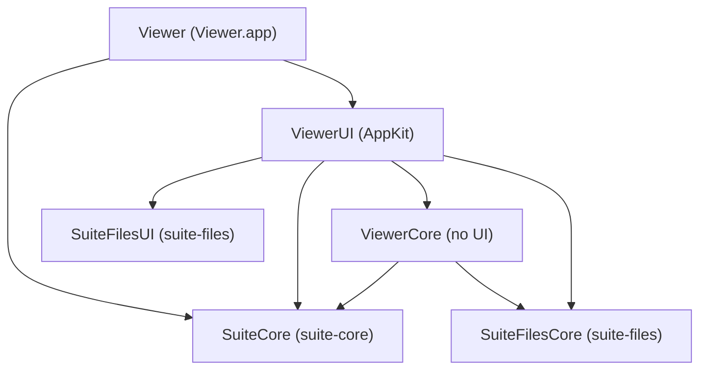
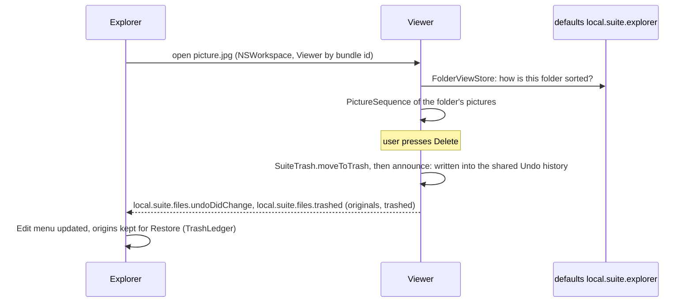

# Viewer

Viewer is the suite's picture and PDF viewer, an ordinary app with its own Dock icon and menu bar. It can
hold the role of "picture and PDF viewing" in place of Preview. Explorer and Desktop hand it pictures (a
setting, on by default) and PDFs (whenever Viewer is installed), through `SuiteFilesUI`'s `ViewerHandoff`;
without Viewer, they open them in the system's app. Started on its own, Viewer asks for a file to open; it quits when its last window closes.

## What it does

- **Pictures**: shown fitted to the window and centred; the arrow keys (and the space bar) go through the
  pictures of the same folder, in the order Explorer shows that folder, wrapping round at both ends, as
  Windows' Photos does. Zoom in and out (`+`, `-`, Cmd+`=`), Fit to Window (Cmd+0), full screen (`f` or
  Ctrl+Cmd+F, Escape leaves it), Move to Trash (Backspace, Forward Delete or Cmd+Backspace), Open in
  Preview for everything Viewer does not do (editing, markup).
- **PDFs**: continuous single pages, page label with previous and next, zoom and fit, thumbnails sidebar
  (Ctrl+Cmd+2), search (Cmd+F, next and previous match), Move to Trash, Open in Preview.
- **Trash with Undo**: a picture or PDF moved to the Trash from Viewer joins the suite's shared Undo
  history (Explorer's Edit › Undo puts it back) and can be restored from Explorer's Trash, with Finder's
  Trash sound.

## How it is built

| Target | Kind | What it holds |
|---|---|---|
| `ViewerCore` | library, unit-tested | `FolderFiles` (a folder's files sorted with SuiteFilesCore's `FolderViewStore` and `FileSorter`, the Trash's several folders at once), `PictureSequence` (the pictures the arrows step through, "3 of 12") |
| `ViewerUI` | library, AppKit | `PictureViewer` (entry points and the menu bar, `Sources/ViewerUI/PictureViewer.swift`), `PictureViewerController` (the picture window), `PDFViewerController` (the PDF window, `Sources/ViewerUI/PDFViewerController.swift`), English and French strings |
| `Viewer` | executable | `ViewerDelegate` (`Sources/Viewer/main.swift`): opening files, the Open panel, the updater |

Viewer has no settings library: it has no setting of its own today.

## How it runs

- **Start**: Viewer runs with the `.regular` activation policy (a Dock icon and a menu bar). Before
  launch finishes, it reads Explorer's folder view options from the defaults domain `local.suite.explorer`
  so its order matches Explorer's. Files arrive through `application(_:open:)` or as a path argument;
  `PictureViewer.openFile` sends PDFs to the PDF window and the rest to the picture window. With no
  file, the Open panel (pictures and PDFs) shows; cancelling it with no window open quits.
- **What it reads and writes**: reads `local.suite.explorer` (folder views); writes only window frames
  (`PictureViewer` and `PDFViewer` frame autosave names) in its own domain `local.suite.viewer`, and the
  language Suite Settings may set there (`AppleLanguages`). It moves files to the Trash with SuiteFilesCore's
  `SuiteTrash`, which writes the move into the shared Undo history
  (`~/Library/Application Support/Suite Files/Undo.json`, `FileUndoJournal`).
- **What it tells others**: after a Trash move (`SuiteTrash.announce`), the distributed notifications
  `local.suite.files.undoDidChange` (the shared Undo history changed) and `local.suite.files.trashed` with
  the original and trashed paths; Explorer and Desktop listen to them
  (`FileUndo.recordTrashingInOtherApps`: Edit menus updated, origins kept for Restore). It listens to nothing. See
  [messages](../5-internals/messages.md).
- **Stop**: it quits with its last window. Nothing to restore after a crash.
- **Updates**: `SuiteUpdater(appName: "Viewer", isBusy: { false }, relaunch: {})`: an update replaces the
  app in place and is never relaunched; the next file opens in the new version. See
  [updates and releases](../5-internals/updates-and-releases.md).

## Settings

Viewer keeps no settings of its own. Whether Explorer hands pictures to Viewer is Explorer's setting,
`DisplaySettings.opensPicturesInViewer` (key `OpenPicturesInViewer` in `local.suite.explorer`), shown in
the Viewer tab of Suite Settings (`Suite Settings.app`, bundle id `local.suite.settings`).
PDFs have no such switch. The language chosen in Suite Settings is written into `local.suite.viewer` too.

## macOS mechanisms used

- `CFBundleDocumentTypes` in `Support/Viewer-Info.plist`: Viewer is offered in Open With for
  `public.image`, at rank `Alternate` (it never takes the role unless chosen). PDFs are not declared.
- `NSScrollView` magnification for zoom, PDFKit (`PDFView`, `PDFThumbnailView`, `PDFSelection`) for PDFs,
  through the Quartz framework.
- `NSWorkspace` to open Preview (`com.apple.Preview`).
- `DistributedNotificationCenter` for the Trash message.
- No special permission; reading the Trash folders may need Full Disk Access.

## Building and testing

- `swift build` and `swift test`; `ViewerCoreTests` covers `FolderFiles` and `PictureSequence` (Swift
  Testing).
- `scripts/make-app.sh [--force]` builds `build/Viewer.app` in release, copies Preview's icon from this
  Mac (never committed), copies `Viewer_ViewerUI.bundle` and the strings bundles of SuiteCore and
  SuiteFilesUI into Resources,
  signs with "Suite Local Signing" (ad-hoc without it), records version, branch and commit, and installs
  `~/Applications/Viewer.app` unless `INSTALL_DIR=` is empty. It refuses to replace a copy built from
  another branch without `--force`.
- Releases as for every app: `scripts/publish.sh`, then `.github/workflows/release.yml`.
- The windows can only be checked offscreen (`cacheDisplay`) from a scratch package.

## Waiting on branches

- `feat/viewer-edit`: picture editing that stays editable. A new library, `PictureEditCore` (no UI,
  unit-tested: `EditDocument`, `EditHistory`, `EditRenderer`, `EditStore`, `RecognizedText`,
  `ShapeGeometry`), keeps an editable version of each picture (shapes that can be moved again, simple
  layers, light and colour, crop, a named history to undo and redo) in
  `~/Library/Application Support/Explorer/Viewer/Edits`, apart from the picture, which stays a plain
  file; text recognition with Vision (select and search the text in a picture); rotate and fit below the
  toolbar. In `ViewerUI`: an editing strip and panels (`PictureCanvas`, `PictureEditor`,
  `PictureEditPanels`), a larger `PictureViewerController` and `PictureViewerMenu`. On quit, edits in
  progress are written into the picture first. Strings in English and French.
