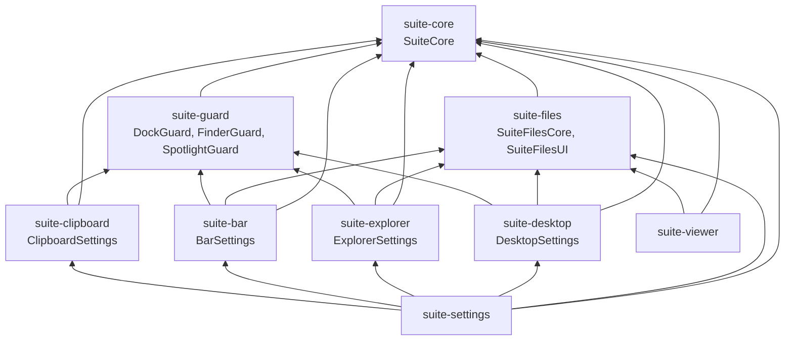
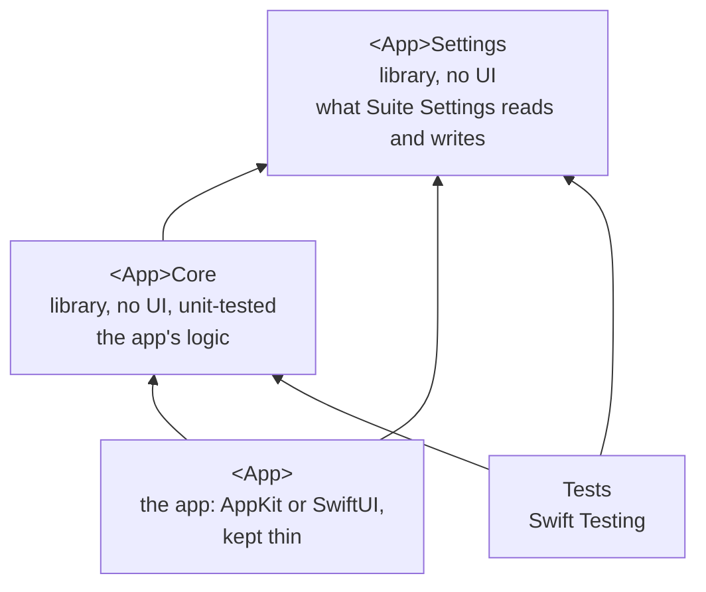

# Level 4: repositories, libraries and building

How the code is split, what depends on what, how an app is built, versioned and tested.

## One repository per app

| Repository | What it holds | Products other repositories use |
|---|---|---|
| `suite-core` | what every app needs: updates, versions, settings migrations, profiles, where settings live, messages between apps, knowledge of the other apps (`SuiteApps`) | `SuiteCore` |
| `suite-files` | the file layer of the apps handling files (Explorer, Desktop, Bar, Viewer): files and folders, operations, the Trash, Undo, the file views | `SuiteFilesCore`, `SuiteFilesUI` |
| `suite-guard` | Suite Guard.app and the libraries that hide and restore Finder's desktop, the system Dock and Spotlight's clipboard history | `DockGuard`, `FinderGuard`, `SpotlightGuard` |
| `suite-desktop` | Desktop.app (Bureau in French) | `DesktopSettings` |
| `suite-explorer` | Explorer.app and the Suite Trash root helper | `ExplorerSettings` |
| `suite-bar` | Bar.app | `BarSettings` |
| `suite-viewer` | Viewer.app | none |
| `suite-clipboard` | Clipboard.app | `ClipboardSettings` |
| `suite-settings` | Suite Settings.app and its agent, Suite Settings Agent | none |
| `suite-launcher` | Launcher.app (on branch `feat/launcher/core`) | none yet |
| `suite-bindings` | Bindings.app (on branch `feat/bindings`) | none yet |
| `suite-ai-organizer` | AI Organizer (on branch `feat/ai-organizer`, not adapted) | none |
| `homebrew-tap` | the Homebrew tap: one cask per app | |
| `suite` | the front page, the suite's version, the catalog, scripts acting on every repository, these documents | |

## What depends on what (main branches)

An arrow reads "depends on". Suite Settings depends on the apps' settings libraries only, never on their
code: an app exposes nothing but its settings (`<App>Settings`). On the waiting branches Launcher and
Bindings depend on `suite-core`, and Suite Settings's `feat/bindings` also on `suite-bindings`.

## Inside a repository

Every app repository has the same layers, from the bottom up:

The logic that can be tested without a screen lives in the core library; the app layer only shows it and
talks to macOS. UI is checked by rendering views offscreen from a scratch package, since screenshots of the
user's screen are not available to the developers' tools.

## Tools

- Swift Package Manager, `swift-tools-version:5.9`, macOS 13 or later; Swift 6.4.2 through swiftly.
- `swift build`, `swift test` (Swift Testing, `import Testing`) for development.
- `scripts/make-app.sh` builds the app in release mode, puts it in a bundle with its `Info.plist`
  (version, build number, update key, update feed, the branch and commit it was built from), stamps the
  binary with the SDK it was built with (`vtool`, so the app looks as the latest macOS), signs it
  with the "Suite Local Signing" certificate from the login keychain (so macOS permissions survive a
  rebuild), installs it in `~/Applications` and relaunches it if it was running. It refuses to replace a
  copy built from another branch unless given `--force`; `INSTALL_DIR=` builds without installing.

## Versions and dependencies

- `VERSION` is `AA.Y` (27.1), then `AA.Y.Z` for a fix (27.1.1). `AA` is the latest macOS in production;
  `AA.Y` is the same in every repository so the apps work together, `Z` belongs to each repository.
- While a version is being prepared, development builds are `27.1-dev.N`, N the commits since `VERSION`
  was set, merges aside. A change another repository needs gets a development tag `v27.1-dev.N`, which
  releases nothing.
- The build number (`CFBundleVersion`, which the updater compares) is the number of commits.
- Dependencies use `.upToNextMinor(from: "27.1.0-dev.1")`: the latest development tag, then the release.
  `Package.resolved` is committed. Tags are never moved once pushed.
- Changing two repositories at once: `swift package edit <Package> --path ../<repository>` points at the
  neighbour's working copy until its tag exists; never committed.

## Branches

One worktree per feature under `.worktrees/`, one branch per change (`feat/<feature>`,
`fix/<area>/<what>`), merged into `main` one by one with a merge commit; `main` stays stable.

## Releases

Each app repository releases itself through GitHub Actions; the suite repository changes `AA.Y` for all
of them. In depth: [updates and releases](5-internals/updates-and-releases.md).
