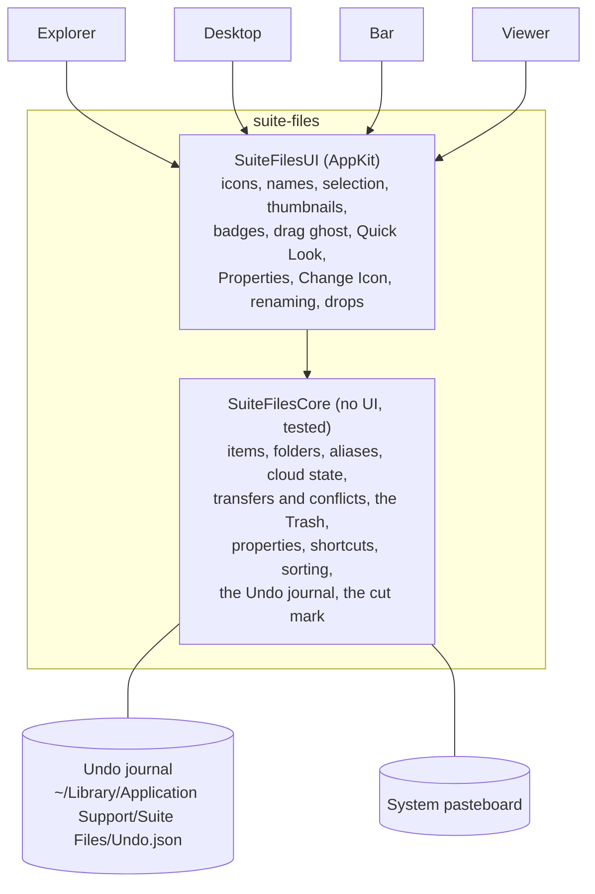
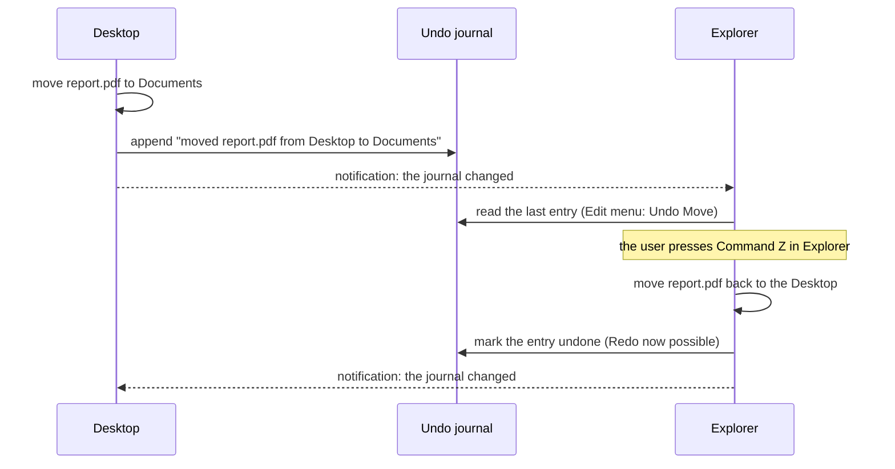

# Files: shared views, operations, Undo and Cut

How the file apps (Explorer, Desktop, Bar, Viewer) share what they show and what they do with files, now
that the desktop is an app of its own. It all lived inside Explorer (`ExplorerCore`, `ExplorerUI`), where
the desktop and the windows shared one process, until 2026-11-24; it is now the `suite-files` library.
This page is the design decided on 2026-11-24; what is not built yet says so.

## Why something must be built

macOS has no shell. In Windows, the desktop and every Explorer window are one program (`explorer.exe`),
which copies files, shows progress, asks about conflicts and keeps one Undo history. On a Mac:

- each app does its own file operations with the system's tools (`FileManager` to copy, move and trash,
  `NSWorkspace` to open files and get their icons);
- each app keeps its own Undo history (`NSUndoManager`); there is none for the whole Mac;
- the pasteboard can carry files, but it has no Cut: Finder fakes it with Copy, then Command Option V;
- some deletions need root, hence a separate helper (Suite Trash).

With the desktop and the windows two apps, what they shared by being one program is shared on
purpose.

## The design: one library, apps talking when needed

Only the file apps depend on `suite-files` (and Suite Settings, on `SuiteFilesCore`, for the file
settings it edits); the other apps of the suite never see it. A background
service owning every operation was considered and set aside: with two or three file apps it would add a
program to install and watch, and a second permission prompt for every protected folder (the service
and the app showing the folder would each need access), for what the apps can share directly.

### Display: code in each app

A program cannot draw in another program's window, so shared display is shared code: one set of
components in `SuiteFilesUI` (`IconItemView`, `IconCollectionView`, `FileIcons`, `Thumbnails`, `SyncBadge`,
`DragGhost`, `QuickLook`, `PropertiesWindow`, `IconPickerWindow`, `InlineRenamer`, `FileDrop`). Each
component has macOS's look by default; **(to build)** its variants as settings (the selection shown on
the name, Windows style, for instance), so that a setting changed in the profile changes the desktop, the
windows and Bar at once. Display settings shared today (`DisplaySettings`: file extensions, thumbnails,
hidden files) are in Explorer's defaults domain.

### Operations: in each app, by the same rules

The app the user acts in does the operation itself, with `SuiteFilesCore`, so the rules are the same
everywhere (what a drop does, which name a copy gets, what is asked when a name is taken). Each app
needs its own access to the folders it shows and changes, the one the user grants it.

### Undo: one journal for every app

`FileUndoJournal` (`SuiteFilesCore`) is the history, a file in `~/Library/Application Support/Suite
Files/`; `FileUndo` (`SuiteFilesUI`) records operations in it and tells the app's views and menus when it
changes (`local.suite.files.undoDidChange`, a distributed notification).

- Undoing a file operation is itself a file operation (moving back, putting back from the Trash), so
  any file app can undo any entry, even one another app made, even while that app isn't running.
- The journal keeps one order for every app; each write takes a lock on the file, so two apps never
  write at once.
- Each app's Edit menu reads the journal for its Undo and Redo titles and updates when told it changed.

### Cut: a mark on the pasteboard

Cut puts the files on the system pasteboard, as Copy does, with a mark of the suite's own saying they
were cut (`FileClipboard`, pasteboard type `local.suite.files.cut`). Paste in any file app of the suite
moves them; Finder sees a plain copy, and its own Command Option V moves them, as on any Mac. Command
Option V moves in the suite's apps as well.

### Asking another app

When an app needs another role (the desktop opening a folder in a window), it asks who holds the role and
sends that app a message, or asks macOS's own app (Finder) through `NSWorkspace`. Each app sets
`FileViewer.openFolder` and `FileViewer.reveal` at launch: Desktop and Bar send folders to Explorer
(`ExplorerLink`) while it manages files (installed, its `UseExplorer` switch on), to Finder otherwise.

### The root helper

**(to build)** Suite Trash, which erases what needs root, is to accept every file app of the suite (it
would check the caller's certificate and its bundle id among the suite's file apps). Today it checks for
Explorer's bundle id only (`ClientRequirement`); the other apps leave `FileActions.eraseNeedingRoot` unset
and report such items as not deleted.

## If the suite grows

Should more file apps come, the journal can move into a service without changing the apps: they all go
through `SuiteFilesCore` already.

## Where data about files is kept

- Finder's `.DS_Store` files: read only, for what Finder keeps there (where Trash items came from,
  read by `FinderTrashRecords`; the desktop's icon positions, read by `FinderIconPositions` for Desktop's
  first launch). Never
  written for our own data: the format is private and undocumented, Finder rewrites it when it likes,
  and it exists only in folders Finder has opened.
- Extended attributes, for what belongs to a file and must follow it when it is copied or moved
  (documented, open to our own names; macOS keeps tags and Finder comments this way).
- Our settings, through the profile, for what belongs to a view: the desktop's arrangement, window
  layouts, sort orders.
