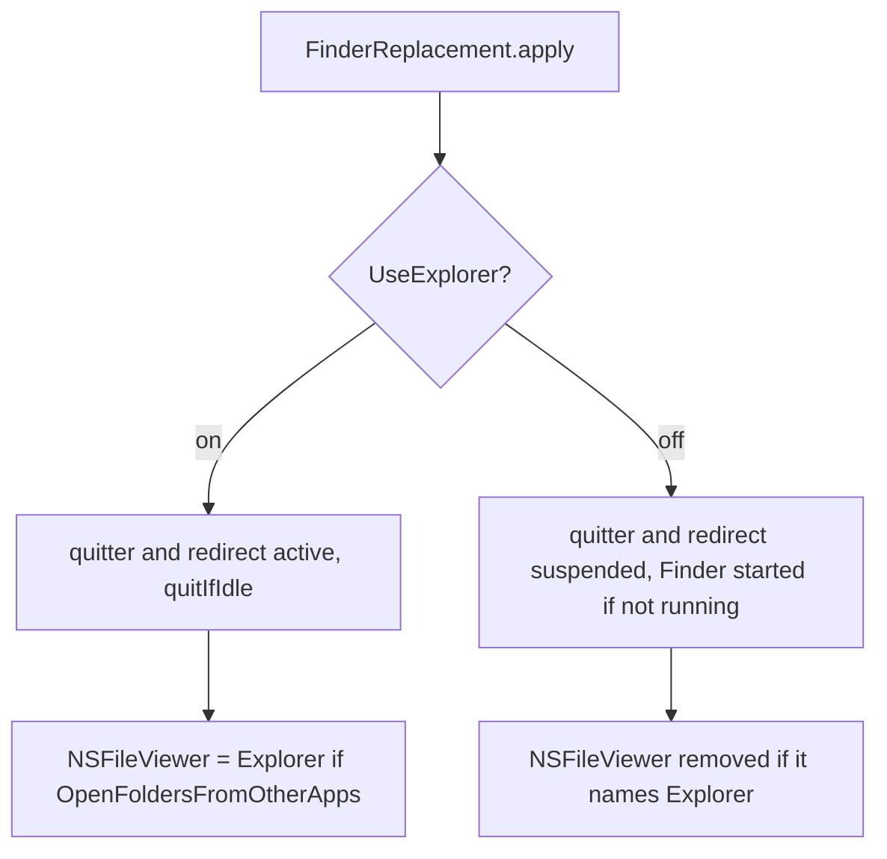
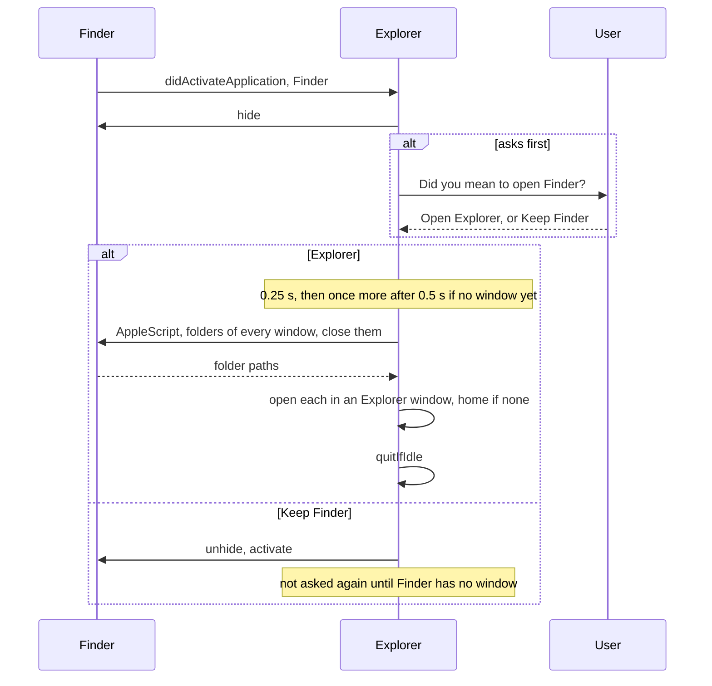
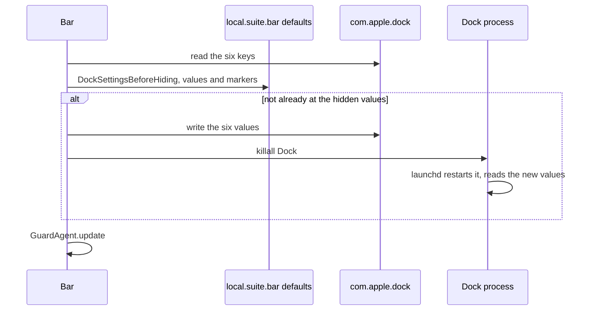
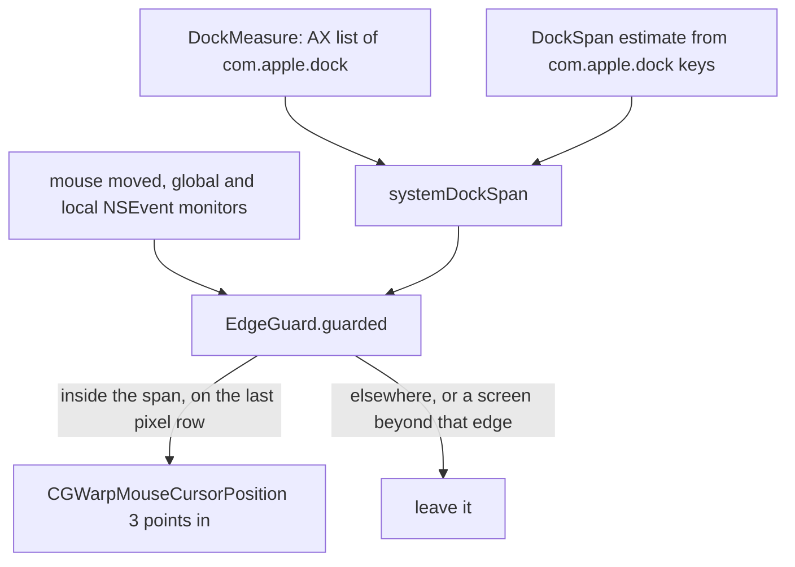
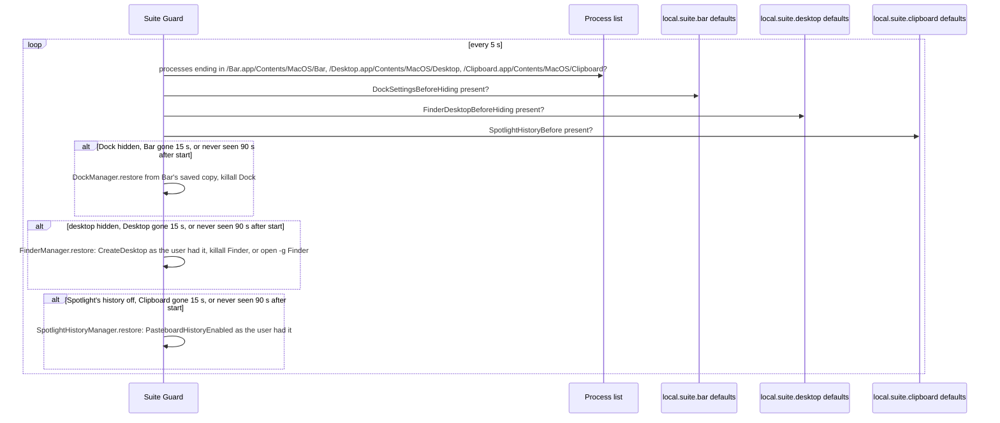

# Finder and the Dock

Three apps of the suite stand in for parts of macOS that can't be removed while System Integrity
Protection (SIP) stays on: Desktop for Finder's desktop, Explorer for Finder's windows, Bar for the system
Dock. Neither Finder nor the Dock is replaced: both keep running, hidden, through their public settings.
Every change is undone when the app stops, and Suite Guard undoes it should the app vanish without doing
so. (Suite Guard also guards Spotlight's clipboard history, which Clipboard turns off: see
[Suite Guard](../3-apps/suite-guard.md).)

Two macOS settings domains are involved. `com.apple.finder` is Finder's preferences; its key `CreateDesktop`
says whether Finder draws the desktop (icons and the desktop window), read when Finder starts.
`com.apple.dock` is the system Dock's preferences (size, position, automatic hiding, the apps in it), read
when the Dock process starts. The Dock is started by launchd (macOS's process manager), which starts it
again at once when it is killed: `killall Dock` is how a new setting is applied.

## Desktop and Finder's desktop

`suite-desktop`, `Sources/Desktop/AppDelegate.swift`, `Sources/Desktop/main.swift`, and `suite-guard`'s
`Sources/FinderGuard/FinderManager.swift`.

While Desktop runs, Finder's desktop is hidden; Finder keeps its windows.

| When | What runs |
|---|---|
| Desktop starts | `FinderManager.hide()`: Finder's own `CreateDesktop` saved in Desktop's defaults (`FinderDesktopBeforeHiding`, once), `CreateDesktop` false, Finder restarted (`killall Finder`) or started (`open -g -b com.apple.finder`); then `GuardAgent.update()`. Already hidden (Desktop reopening itself), Finder isn't restarted |
| Desktop quits (also `SIGINT`, `SIGTERM`, `SIGHUP`, turned into a normal quit) | `FinderManager.restore()`: `CreateDesktop` as the user had it (the key removed, or false if they had turned it off), the saved value removed, Finder restarted; then `GuardAgent.update()` |
| Desktop reopens itself (an update, `--relaunch`) | nothing: the new copy takes over, Finder's desktop stays hidden |
| `Desktop --restore-finder` (after a forced quit) | `FinderManager.restore()`, `GuardAgent.update()`; exits |
| Desktop vanished (crash, forced quit, not started at login) | Suite Guard, below |

`GuardedApps.finderDesktopHidden` is true while `FinderDesktopBeforeHiding` exists in Desktop's defaults:
the user turning Finder's desktop off by hand doesn't count. Only one Desktop runs at a time
(`Sources/Desktop/main.swift`).

## Explorer and Finder's windows

`suite-explorer`, `Sources/Explorer/FinderReplacement.swift`, `FinderApp.swift`, `FinderQuitter.swift`,
`FinderRedirect.swift`, and `suite-files`' `Sources/SuiteFilesUI/DefaultFileViewer.swift`.

One switch, `UseExplorer` (Settings › Explorer, and the menu bar extra), on by default, decides whether
Explorer stands in for Finder's windows. While it is on, three parts act, each with its own setting kept
while Finder is in use:

| Part | Setting (default) | What it does |
|---|---|---|
| Finder kept closed (`FinderQuitter`) | `QuitFinder` (on) | Only while Desktop hides Finder's desktop: each time Finder stops being the active app, if it isn't in front and has no window, Explorer asks it to quit |
| Finder redirected (`FinderRedirect`) | `RedirectFinder` (off), `RedirectFinderAsks` (on) | When Finder comes forward it is hidden at once; its windows reopen in Explorer and are closed in Finder, after asking or not |
| Default folder viewer (`DefaultFileViewer`) | `OpenFoldersFromOtherApps` (on) | The global `NSFileViewer` default names Explorer, so "Show in Finder" in any app sends Explorer the reveal Apple event |

Turning the switch off suspends the quitter and the redirect (`isSuspended`) without changing their
settings. The switch also decides where Desktop and Bar open folders (Explorer while it is on).

### Keeping Finder closed

macOS starts Finder again whenever something needs it (a click on its Dock icon, Get Info, and so on).
`FinderQuitter` watches `NSWorkspace.didDeactivateApplicationNotification` for Finder. Then, if enabled and
not suspended, if Finder's desktop is hidden (`GuardedApps.finderDesktopHidden`: Finder showing the desktop
is never quit), if Finder runs and isn't the frontmost app, it asks Finder by AppleScript how many windows it
has; at zero it quits Finder politely (`NSRunningApplication.terminate()`, an Apple event). When the
question fails (no Automation permission), Finder is left open: closing someone's window is worse than an
extra app.

### Redirecting Finder

"Don't ask again" with Explorer turns asking off; with Finder it turns the redirect off. If the AppleScript
fails, the redirect turns itself off and Explorer explains the Automation permission.

### Show in Finder

`NSFileViewer` is a user-wide default (in the global domain, written with
`CFPreferencesSetValue` for `kCFPreferencesAnyApplication`): the bundle id of the app that receives
"reveal these items" requests. Explorer handles the event (`'misc'/'mvis'`) in `AppDelegate.handleReveal`
and opens the items' folders with them selected. Turning the setting off removes the key only if it names
Explorer, leaving another viewer alone.

### Giving Finder back

| When | What runs |
|---|---|
| The switch turned to Finder | quitter and redirect suspended, Finder started if it isn't running; `NSFileViewer` removed |
| `Explorer --restore-finder` (after a forced quit) | Finder started if it isn't running, then Bar's executable with `--restore-bar`; exits. Finder's desktop is Desktop's: `Desktop --restore-finder` |

Only one Explorer runs at a time (`Sources/Explorer/main.swift`): a second copy activates the first and
exits without touching Finder, or, started with `--relaunch`, asks the first to reopen itself.

## Bar and the system Dock

`suite-bar`, `Sources/Bar/BarController.swift`, `Sources/Bar/AppDelegate.swift`, `Sources/Bar/main.swift`,
`Sources/BarCore/Bar.swift`, and `suite-guard`'s `Sources/DockGuard/DockManager.swift`.

Bar shows while it is turned on (`BarSettings.isShown`) and Explorer manages files (Explorer's `UseExplorer`,
read from Explorer's domain, true when absent). Bar applies this at launch, when its settings change, and on
every `explorerDidChange` from Explorer.

### Hiding the system Dock

`DockManager.hide()` (library `DockGuard`) sets six keys of `com.apple.dock` through `CFPreferences`:

| Key | Value | Why |
|---|---|---|
| `autohide` | true | the Dock hides |
| `autohide-delay` | 1000 s | it would wait that long before showing |
| `autohide-time-modifier` | 1000 s | and slide in that slowly |
| `tilesize` | 1 | icons of one point (below System Settings' 16, honoured on macOS 27): a sliver, even in Mission Control, and a short stretch of edge that wakes it |
| `orientation` | `bottom` | minimizing animates towards the bottom, where Bar is |
| `static-only` | true | running apps only, so the stretch stays short |

The values found before are saved in Bar's defaults under `DockSettingsBeforeHiding` before anything
changes. Each key saved gets a marker (`~autohide` and so on), so a key added to the list by a later version
is saved once, before it changes, and a value saved earlier is never overwritten by the hidden one. A key
that had no value is saved as absent. `isHiding` is true while that dictionary exists; Suite Guard reads it
too (`GuardedApps.systemDockHidden`). `hide()` doesn't restart the Dock when it already has the hidden
values.

`DockManager.restore()` writes each saved value back (absent ones removed, so they return to their
defaults), deletes `DockSettingsBeforeHiding`, and restarts the Dock.

Every Dock restart leaves Spaces, Command Tab and Mission Control unusable for a minute or two (they belong
to the Dock process). So the Dock is restarted as rarely as possible: not when Bar hands over to a new copy
(an update, `--relaunch`), and not at logout or shutdown.

| When | Is the system Dock put back? |
|---|---|
| Bar turned off (Settings › Bar) | yes: Bar restores it and quits |
| Switched to Finder | yes: Bar restores it, hides its panel, and keeps running |
| Bar quit by the user, or `SIGINT`, `SIGTERM`, `SIGHUP` | yes, in `applicationWillTerminate` |
| A new Bar takes over (`handOver`) | no |
| Logout, restart, shutdown (`willPowerOffNotification`) | no |
| Explorer quits | no: Bar is an app of its own and stays |
| `Bar --restore-bar` (and `Explorer --restore-finder`) | yes, from the saved copy |
| Bar vanished | Suite Guard, after 15 s (90 after login) |

### The edge guard

macOS 27 ignores the long `autohide-delay`: on the outermost pixels of its edge the hidden Dock wakes up and
shows its icons' names. Bar keeps the pointer off that row, but only along the stretch the hidden Dock
covers, so the rest of the edge and the corners stay free.

- `EdgeGuard.guarded` (`BarCore`) returns where the pointer goes instead, `gap` = 3 points in, or nil. It
  handles bottom, left and right edges, and lets the pointer through to another screen placed against that
  edge.
- `DockMeasure.iconListSpan` (`BarController.swift`) asks the Dock, through the Accessibility API, for the
  frame of its icon list (needs the Accessibility permission). Without it, `DockSpan.estimate` computes the
  span from `tilesize` and the number of tiles (`persistent-apps`, `persistent-others`, `recent-apps` when
  `show-recents`, the running apps not pinned). 12 points are added each end.
- The span is measured again one second after any app starts or quits, and 1 and 3 s after Bar applies its
  state (the Dock restarts meanwhile).
- After warping, `CGAssociateMouseAndMouseCursorPosition(1)` keeps the pointer from freezing.

Mouse monitors need no permission. `BarEdgeProbe` is a temporary diagnostic of the edge, logged under the
category `BarEdge`.

### Mission Control

Mission Control always shows the system Dock, a one-point sliver here. Bar's panel sits one window level
above the Dock's (`CGWindowLevelForKey(.dockWindow) + 1`), 2 points above the bottom of the main screen, on
every Space, so it covers the sliver.

When Bar hides itself automatically, it must slide in for Mission Control, which has no notification. While
hiding is on, Bar reads the list of windows on screen five times a second (`CGWindowListCopyWindowInfo`) and
`MissionControl.isOpen` looks for windows of `com.apple.WindowManager`: a strip as wide as the screen at layer
14 (the Spaces bar) or a full-screen shield at layer 19. While Mission Control is open, Bar stays revealed.

## Suite Guard

`suite-guard`: `Sources/GuardCore/GuardAgent.swift`, `GuardRule.swift`, `GuardedApps.swift`,
`PreferenceDomain.swift`, `Sources/FinderGuard/FinderManager.swift`,
`Sources/SpotlightGuard/SpotlightHistoryManager.swift`, `Sources/SuiteGuard/main.swift`.

Suite Guard.app (`local.suite.guard`, `LSBackgroundOnly`: no window, no Dock icon, no menu bar) watches while
something is hidden, and puts it back if the app that hid it is gone.

### Its launch agent

A launch agent is a program launchd runs in the user's session, described by a property list in
`~/Library/LaunchAgents`. `GuardAgent.update()` is called by Desktop, Bar and Clipboard after every hide or
show; it reads the shared state (`GuardedApps.systemDockHidden || GuardedApps.finderDesktopHidden ||
GuardedApps.spotlightHistoryHidden`) so whichever app calls last is right.

| State | What `GuardAgent` does |
|---|---|
| something hidden, Suite Guard.app found by Launch Services | writes `~/Library/LaunchAgents/local.suite.guard.plist` (`ProgramArguments`: the app's executable path, `RunAtLoad`, `KeepAlive`, `ProcessType` Background) if it changed; `launchctl bootstrap gui/<uid>` if not loaded or changed (`bootout` first); `launchctl kickstart -k` if the guard's build differs from `SuiteGuardRegisteredBuild` in the caller's defaults |
| something hidden, Suite Guard.app not installed | writes to standard error that nothing will put things back; nothing else |
| nothing hidden | `launchctl bootout`, removes the plist |

A plain launch agent was chosen over `SMAppService`: registered that way, launchd held the guard to an
earlier build's code signature (the certificate not being Apple's) and refused to start it after most
updates.

### The loop

- `GuardRule` (`grace` 15 s, `startGrace` 90 s): restore only while hidden and the owner isn't running;
  15 s after it was last seen, or, if not seen since the guard started (at login), 90 s after the start. The
  grace covers an app that is only relaunching.
- `RunningProcesses.contains(executableSuffix:)` reads the system's process list (`proc_listallpids`,
  `proc_pidpath`) rather than `NSWorkspace`, whose list isn't refreshed for a process without windows. Bar's
  executable is `Bar`, never `Dock`, so that it can't be mistaken for the system Dock's process
  (`/System/Library/CoreServices/Dock.app/Contents/MacOS/Dock`).
- Suite Guard updates itself quietly (`SuiteUpdater`, `quiet`, never busy); once the new copy is in place it
  exits and launchd (`KeepAlive`) starts the new one.

After putting something back, Suite Guard keeps running until Desktop, Bar or Clipboard next calls
`GuardAgent.update()`.
