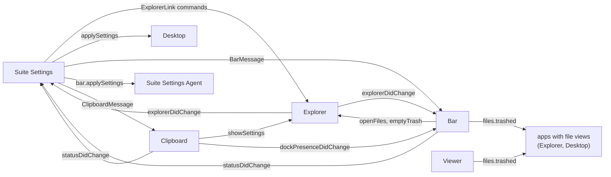
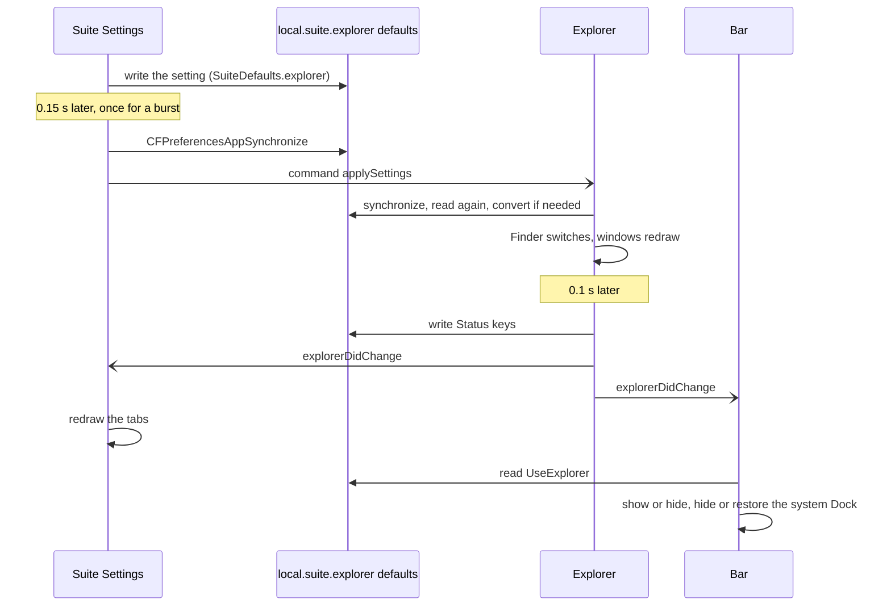
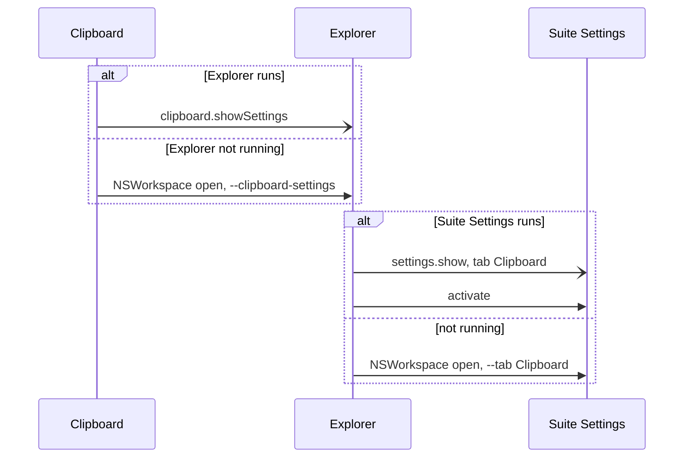
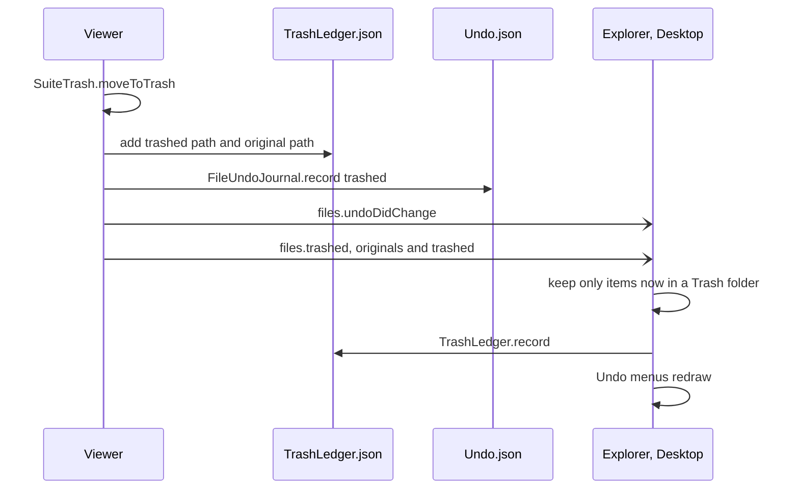

# Messages between the apps

The apps of the suite never import one another's code. They talk in four ways: distributed notifications
(most of it), Apple events (with Finder, and from macOS to Explorer), starting one another through
`NSWorkspace` with command-line arguments, and reading or writing one another's settings by domain name
(see [Settings and profiles](settings-and-profiles.md)). One more channel, XPC to the Suite Trash root
helper, is described in [Trash](trash.md). This page lists them all, as they are on `main` today.

## Distributed notifications

A distributed notification is a named message that a process posts through macOS's `distnoted` daemon
and that every process of the same user session which registered for that name receives
(`DistributedNotificationCenter`). It carries a name, an optional string `object` and an optional
`userInfo` dictionary of property-list values (strings, numbers, arrays, dictionaries). Its limits shape
how the suite uses it:

- **No reply.** The sender never learns whether anyone heard. Where an answer is needed, the receiver
  writes it in its defaults and posts a second notification saying so (the `Status` keys below).
- **Not kept.** A notification posted while the receiver isn't running is lost; nothing queues it. So
  every app reads its full state from its defaults at launch, and a notification only says "read again".
- **Not private.** Any process of the session can post or listen; nothing tells the sender apart.
  Nothing sent this way is secret or dangerous (the worst a stranger can do is ask Explorer to empty the
  Trash, which still asks the user first).

Every post in the suite uses `deliverImmediately: true`, so an app in the background (most of them are
`LSUIElement` agents, apps without a Dock icon) gets it at once instead of when it next comes forward.

All names start with the receiving or the owning app's bundle id (`local.suite.files` for the file
layer). The helpers that post and observe them live in `suite-core` (`Sources/SuiteCore/ExplorerLink.swift`,
`ClipboardMessage.swift`, `BindingsMessage.swift`, `SuiteApps.swift`), in `suite-files`
(`Sources/SuiteFilesCore/SuiteTrash.swift`, `FileUndoJournal.swift`), in the apps' settings libraries
(`BarMessage` in `suite-bar`'s `Sources/BarSettings/BarMessage.swift`, `DesktopMessage` in
`suite-desktop`'s `Sources/DesktopSettings/DesktopMessage.swift`), and `BarRelaunch`, private to Bar.app
(`Sources/Bar/AppDelegate.swift`).

### Every notification

Suite Settings is the settings app (`Suite Settings.app`, bundle id `local.suite.settings`); its agent is
`local.suite.settings.agent`.

| Name | Sender | Receiver | Payload | Purpose |
|---|---|---|---|---|
| `local.suite.explorer.command` (`ExplorerLink.commandNotification`) | Suite Settings; Bar (`emptyTrash`); a second Explorer started with `--relaunch` (`relaunch`, `relaunchInBackground`) | Explorer (`SettingsApp.startListening`, `Sources/Explorer/SettingsApp.swift`); Desktop (`applySettings` only: the display settings it shares with Explorer) | `object`: an `ExplorerLink.Command` raw value | Ask Explorer to do what only it can (list below) |
| `local.suite.settings.explorerDidChange` (`ExplorerLink.explorerDidChange`) | Explorer (`SettingsApp.report`, 0.1 s after its settings or status change, once per burst) | Suite Settings (`SettingsModel`, the Bar tab); Bar (`BarController.start`) | none | Explorer's settings or status keys changed: read them again. Bar reads Explorer's `UseExplorer` switch this way |
| `local.suite.settings.show` (`ExplorerLink.showNotification`) | Explorer (`SettingsApp.show`); any app through `SuiteSettingsApp.show(tab:)` (Bar's and Desktop's menus) | Suite Settings (`Sources/Settings/main.swift`) | `userInfo["tab"]`: a tab label (`"Bar"`, `"Clipboard"`), optional | Show the settings window on that tab. Sent only when Suite Settings runs; otherwise it is started with `--tab` |
| `local.suite.explorer.openFiles` (`ExplorerLink.openFilesNotification`) | Bar (Downloads stack, `ExplorerLink.openFiles`) | Explorer (`FileActions.openFile`) | `userInfo["paths"]`: `[String]` | Open files as Explorer does (pictures and PDFs to Viewer). Sent only if Explorer runs; otherwise `NSWorkspace.open` |
| `local.suite.files.trashed` (`SuiteTrash.didTrashNotification`, `SuiteTrash.announce`) | Viewer (`PictureViewer.moveToTrash`); Bar (`BarFiles`, files dropped on its Trash) | Explorer, Desktop (`FileUndo.recordTrashingInOtherApps`, `suite-files`' `Sources/SuiteFilesUI/FileOperations.swift`) | `userInfo["originals"]`, `userInfo["trashed"]`: `[String]`, same order | Items another app moved to the Trash keep their origin in the `TrashLedger`; the sender already added them to the shared Undo history |
| `local.suite.files.undoDidChange` (`FileUndoJournal.didChangeNotification`) | any app writing the shared Undo history (`FileUndoJournal.announceChange`) | the apps with file views, except the sender (`FileUndo.recordTrashingInOtherApps`) | `object`: the sender's pid | The shared Undo history changed: menus and views follow |
| `local.suite.desktop.applySettings` (`DesktopMessage`) | Suite Settings (Desktop tab, loading a profile) | Desktop (`AppDelegate.listenToSettings`) | none | Read `DesktopSettings` again |
| `local.suite.desktop.relaunch` (`DesktopMessage`) | a second Desktop started with `--relaunch` (`Sources/Desktop/main.swift`) | the running Desktop | none | Reopen as for an update, keeping Finder's desktop hidden |
| `local.suite.clipboard.settingsDidChange` | Suite Settings (Clipboard tab, loading a profile) | Clipboard | none | Read the settings again; quit if turned off; converts them first (`bringSettingsUpToDate`) |
| `local.suite.clipboard.clearHistory` | Suite Settings | Clipboard | none | Delete every item |
| `local.suite.clipboard.setOpensAtLogin` | Suite Settings | Clipboard | `userInfo["on"]`: `Bool` | Register or remove its login item (`SMAppService`), then report status |
| `local.suite.clipboard.requestAccessibility` | Suite Settings | Clipboard | none | Put itself in the Accessibility list and open System Settings there |
| `local.suite.clipboard.statusDidChange` | Clipboard (`reportStatus`) | Suite Settings (Clipboard tab) | none; the status is in Clipboard's defaults (`canPaste`, `loginStatus`) | Redraw what only Clipboard knows |
| `local.suite.clipboard.showSettings` | Clipboard (its gear button and Settings menu item) | Explorer (`ClipboardCompanion.start`) | none | Explorer opens Suite Settings on the Clipboard tab |
| `local.suite.clipboard.dockPresenceDidChange` | Clipboard (history window opened or closed) | Bar (`BarView`) | none | Clipboard came into the Dock or left it: Bar redraws its running apps |
| `local.suite.bar.applySettings` | Suite Settings (`BarApp.settingsChanged`: the Bar tab, loading a profile) | Bar (`AppDelegate`); Suite Settings Agent (Bar's cover comes or goes) | none | Read `BarSettings` again (after converting them); quit if turned off |
| `local.suite.bar.allowWindowFitting` | Suite Settings (Bar tab's Allow button) | Bar | none | Ask for Accessibility, which fitting windows above the Dock and reading minimized windows need |
| `local.suite.bar.reportStatus` | Suite Settings (each time its window shows) | Bar | none | Write the status key and post `statusDidChange` |
| `local.suite.bar.statusDidChange` | Bar (`report`) | Suite Settings (`SettingsModel`, Bar tab) | none; the status is `StatusWindowFittingAllowed` in Bar's defaults | Redraw whether Bar has Accessibility |
| `local.suite.bar.showSettings` | nobody | nobody | none | Defined in `BarMessage`, unused: Bar opens its tab with `SuiteSettingsApp.show(tab: "Bar")` |
| `local.suite.bar.handOver` (`BarRelaunch.handOver`) | a new Bar copy started with `--relaunch` (`Sources/Bar/main.swift`) | the running Bar | none | Leave without putting the system Dock back: the new copy takes over |
| `local.suite.bindings.<case>` (`BindingsMessage`: `rulesDidChange`, `settingsDidChange`, `setPaused`, `requestAccessibility`, `statusDidChange`, `explorerContextDidChange`, `requestExplorerContext`, `scanMenus`, `menusDidChange`) | nobody on `main` | nobody on `main` | keys `context` (an `ExplorerContext`: `desktop`, `folderWindow`, `otherWindow`), `bundleID`, `failed`, `paused` | Defined for Bindings, which has no code on `main` (see "Waiting on branches") |
| `local.suite.launcher.open`, `local.suite.launcher.settingsDidChange` (`LauncherMessage`) | `LauncherApp.open()`, called by nobody on `main` | nobody on `main` | none | Defined for Launcher (see "Waiting on branches") |

`ExplorerLink.Command` values (`Sources/SuiteCore/ExplorerLink.swift`):

| Command | Sent by | What Explorer does |
|---|---|---|
| `applySettings` | Suite Settings, through `ExplorerLink.settingsChanged()`: 0.15 s after the last change of a burst, once the domain is written out (`CFPreferencesAppSynchronize`); directly after loading a profile | `applyFromDefaults()`: synchronizes its domain, converts the settings (`SuiteUpdater.explorer.bringSettingsUpToDate()`), reloads the Finder switches and the update settings, then posts its own change notifications so the rest redraws |
| `checkForUpdates` | Suite Settings (General tab, Check Now) | `SuiteUpdater.explorer.check(userInitiated: true)` |
| `allowWindowFitting` | nobody now | ignored: asked of Bar with `BarMessage.allowWindowFitting` |
| `emptyTrash` | Suite Settings (Trash tab), Bar (Trash menu) | `FileActions.emptyTrash()`, which asks first |
| `relaunch` | Suite Settings (after a profile, after a language change), a second Explorer with `--relaunch` | `AppRelauncher.relaunch()` |
| `relaunchInBackground` | a second Explorer with `--relaunch --background` | `AppRelauncher.relaunch(inBackground: true)` |
| `reportStatus` | Suite Settings, each time its window shows | `report()`: writes `StatusUpdaterState` and `StatusCanSetDefaultViewer` in its defaults, then posts `explorerDidChange` |

### A setting changed in Suite Settings

### Clipboard's gear button

Clipboard's settings are a tab of Suite Settings, but Clipboard asks Explorer to open it, as it did when the
settings were inside Explorer.

### Trashing from Viewer

If no app with file views is running, the notifications are lost but the ledger and the Undo history
files already hold the records, so Restore and Undo still work. See [Trash](trash.md).

## Apple events

An Apple event is macOS's older inter-application message, with a reply, addressed to one app; AppleScript
is a language that sends them. Sending them to another app needs the user's Automation permission
(System Settings › Privacy & Security › Automation).

| Event | From | To | Where | Purpose |
|---|---|---|---|---|
| `count of Finder windows` (AppleScript) | Explorer | Finder | `FinderApp.windowCount()` (`Sources/Explorer/FinderApp.swift`) | Is Finder idle? Before quitting it, and in `FinderRedirect` |
| `POSIX path of (target of every Finder window)`, then `close every Finder window` | Explorer | Finder | `FinderRedirect.takeFinderWindows()` | Take Finder's windows over into Explorer |
| Quit (`NSRunningApplication.terminate()`) | Explorer | Finder | `FinderApp.quit()` | Keep Finder closed while Explorer stands in for it and Desktop hides Finder's desktop |
| Reveal, `'misc'/'mvis'` (`kAEMiscStandards`, `kAEMakeObjectsVisible`) | macOS, for "Show in Finder" in any app once the global `NSFileViewer` default names Explorer | Explorer | `AppDelegate.handleReveal` | Show the items selected in an Explorer window |
| Open documents (`application(_:open:)`) | macOS, for `NSWorkspace.open(_:withApplicationAt:)` | Explorer, Viewer | `AppDelegate`, `ViewerDelegate` | Bar's and Clipboard's "open this folder", Explorer's hand-off of pictures to Viewer |
| `do shell script "rm -rf" with administrator privileges` | Explorer, to itself (Standard Additions) | Explorer | `PrivilegedEraser.eraseViaOsascript` | Erase Trash items needing root when Suite Trash isn't available (asks for the password) |
| `tell application id "<bundle id>" to quit` (`osascript`) | `scripts/make-app.sh` of Clipboard, Viewer, Suite Settings, Suite Guard | the installed copy | the build script | Quit the running copy before starting the new build (Explorer, Desktop and Bar reopen with `--relaunch` instead, Suite Guard with `launchctl kickstart`) |

Without Automation permission, Explorer leaves Finder open rather than risk closing a window in use
(`FinderQuitter.quitIfIdle`), and turns the redirect off with an explanation (`FinderRedirect`). See
[Finder and Dock](finder-and-dock.md).

## Starting one another

Apps start one another by bundle id, found through Launch Services
(`NSWorkspace.urlForApplication(withBundleIdentifier:)`), and pass what they want on the command line
(`NSWorkspace.OpenConfiguration.arguments`). A missing app is simply not started; the caller falls back
(the system opens the file, or Explorer says Suite Settings isn't installed).

| Starter | Started | How | Arguments | When |
|---|---|---|---|---|
| Explorer (Edit › Clipboard History, `AppMenu.swift`) | Clipboard | `openApplication`, not activated | `--show` | Show the list; a running Clipboard gets a reopen event instead |
| Explorer (`ViewerHandoff.open`) | Viewer | `open(_:withApplicationAt:)`, activated | the file | A picture or PDF opened in Explorer |
| Explorer (`SettingsApp.show`), Bar, Desktop (`SuiteSettingsApp.show`) | Suite Settings | `openApplication`, activated | `--tab <label>` | Settings asked while Suite Settings isn't running |
| Explorer (`--restore-finder`, `BarCompanion.restoreSystemDock`) | Bar's executable | `Process`, waited for | `--restore-bar` | Put the system Dock back after a forced quit |
| Clipboard (`showSettings`) | Explorer | `openApplication` | `--clipboard-settings` | Its gear while Explorer isn't running |
| Suite Settings (`ClipboardLink.swift`, `ExplorerLink.launchClipboard`) | Clipboard | `openApplication`, not activated | none | Clipboard turned on in its tab |
| Suite Settings (`BarApp.settingsChanged`) | Bar | `openApplication`, not activated | none | Bar turned on while not running |
| Suite Settings (`AppLanguage.restartApps`) | Suite Settings itself | new instance | none | After the language changes, with `relaunch` sent to Explorer |
| Bar (`BarView`, `BarStack`) | Explorer | `ExplorerLink.activate`, `open`, `reveal` | folders, files | Its Explorer icon, the Trash, Downloads, "Show in Explorer" |
| Bar (its updater) | Bar | new instance | `--relaunch` | A new version installed |
| any app (`AppRelauncher.relaunch`, `Sources/SuiteCore/AppRelauncher.swift`) | itself | new instance, not activated | `--after <pid>`, `--background` | An update or Reopen: the new copy waits up to 30 s for that pid to be gone |
| Desktop, Bar, Clipboard (`GuardAgent.update`) | Suite Guard | `launchctl bootstrap`, `kickstart` | none | While something is hidden (see [Finder and Dock](finder-and-dock.md)) |

`ExplorerLink.reveal` calls `NSWorkspace.activateFileViewerSelecting`, which goes to whatever app the
`NSFileViewer` default names (Explorer while it stands in for Finder, else Finder).

### Arguments each app understands

| App | Argument | Effect |
|---|---|---|
| Explorer | `--restore-finder` | Finder started, then Bar's `--restore-bar`; exits (Finder's desktop is Desktop's) |
| Explorer | `--relaunch` | When another Explorer runs: send it `relaunch` and exit |
| Explorer | `--background` | Don't reopen last time's windows (with `--relaunch`, or from `AppRelauncher`) |
| Explorer | `--after <pid>` | Wait for that copy to be gone (`AppRelauncher.waitForPreviousCopy`) |
| Explorer | `--clipboard-settings` | Open Suite Settings on the Clipboard tab |
| Explorer | a path | Open that folder (`PathParser.parse`, Windows paths too) |
| Desktop | `--restore-finder` | Put Finder's desktop back as the user had it; exits |
| Desktop | `--relaunch` | When another Desktop runs: send it `relaunch` and exit |
| Bar | `--restore-bar` | Put the system Dock back from the saved copy; exits |
| Bar | `--relaunch` | Take over from a running Bar (`handOver`), up to 10 s |
| Clipboard | `--show` | Show the list at launch |
| Clipboard | `--after <pid>` | Wait for the previous copy |
| Suite Settings | `--tab <label>` | Open on that tab |
| Viewer | a path | Open that file |

A second copy of Explorer, Desktop or Bar started without `--relaunch` leaves at once (Explorer activates the first);
only one of each runs.

## Reading another app's defaults

Some state passes without any message, by reading another app's preferences domain by name. These reads
are listed in [Settings and profiles](settings-and-profiles.md); the main ones are Bar reading Explorer's
`UseExplorer`, Suite Guard reading Bar's `DockSettingsBeforeHiding`, Desktop's `FinderDesktopBeforeHiding`
and Clipboard's `SpotlightHistoryBefore` (Explorer reads Desktop's too, to keep Finder closed only while
its desktop is hidden), Explorer and Suite Settings reading
Clipboard's `isEnabled`, and Viewer reading Explorer's folder view options so its arrows follow
Explorer's sort order.

## Waiting on branches

- `feat/bindings` (`suite-explorer`, `suite-settings`, `suite-bindings`): Explorer starts Bindings
  (`BindingsCompanion`, `BindingsApp.launch`), posts `explorerContextDidChange` on every key window change and
  answers `requestExplorerContext`; Suite Settings's Bindings tab posts `rulesDidChange`, `settingsDidChange`,
  `setPaused` and listens to `statusDidChange` and `menusDidChange`.
- `feat/launcher/core` (`suite-bar`, `suite-settings`): Bar's Launcher tile calls `LauncherApp.open()`, which
  starts Launcher or posts `launcher.open`.
