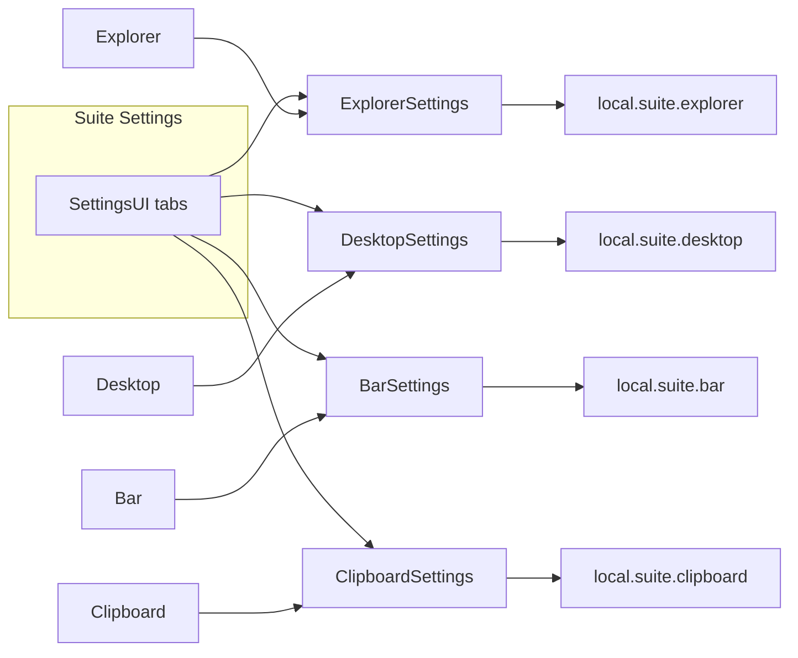
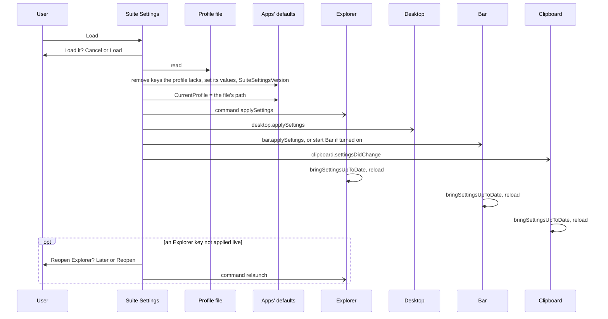
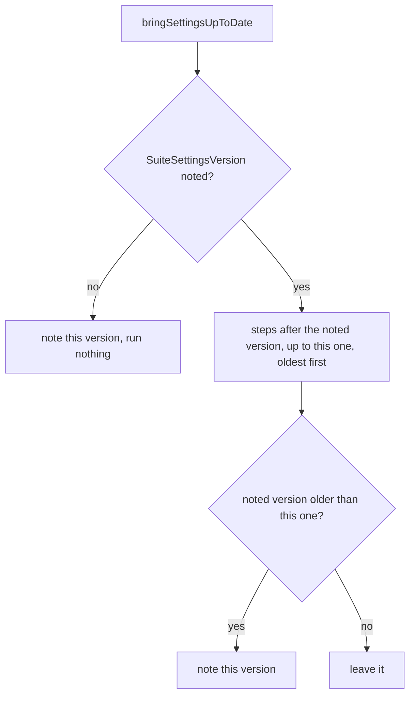

# Settings and profiles

Each app keeps its settings in its own preferences domain, written by the app itself and by Suite Settings,
the settings app (`Suite Settings.app`, bundle id `local.suite.settings`). Suite
Settings never imports an app's code: it links only that app's `<App>Settings` library, which knows the
keys. Named profiles save the settings of every app in one file; a version noted with the settings lets
an update convert them.

## Preferences domains

A preferences domain is the set of key-value settings macOS keeps for one app, named by its bundle id and
stored as `~/Library/Preferences/<domain>.plist` by the `cfprefsd` daemon. An app reads its own through
`UserDefaults.standard`; another app reads or writes the same domain with `UserDefaults(suiteName:)` or the
`CFPreferences` calls. Each process keeps a cache, so after another process writes, the reader calls
`CFPreferencesAppSynchronize(domain)` before reading (the suite does it on every "read again" message).

| Domain | Owner | What it holds | Written by | Read by others |
|---|---|---|---|---|
| `local.suite.explorer` | Explorer | Explorer's settings (the `ExplorerSettings` library: `WindowSettings`, `ToolbarLayout`, `SidebarPlaces`, `QuickAccessStore`, `FinderSwitches`, `ExplorerSession`; and suite-files' `DisplaySettings`, `FolderViewStore`, which the apps handling files share), its update settings, `Status` keys, `CurrentProfile`, `SuiteSettingsVersion`, `SuiteGuardRegisteredBuild` | Explorer; Suite Settings | Bar and Desktop (`UseExplorer`), Desktop and Viewer (`DisplaySettings`, `FolderViewStore`: sort order), Suite Settings, `TrashLocations` (`TrashIncludesICloudDrive`) |
| `local.suite.desktop` | Desktop | `DesktopSettings` (one JSON value under the key `DesktopSettings`: icon size, grid, arrangement, stacks, the icons' positions), what it keeps to put Finder's desktop back (`FinderSyncRecord`, `FinderRestartedByDesktop`), `LoginItemRegistered`, update settings | Desktop; Suite Settings (`DesktopSettings.current`) | Suite Settings |
| `local.suite.bar` | Bar | `BarSettings` (one JSON value under the key `BarSettings`), `BarPinnedApps`, the system Dock's settings from before hiding (`DockSettingsBeforeHiding`), `StatusWindowFittingAllowed`, update settings | Bar; Suite Settings (`BarSettings.current`); Suite Guard (removes `DockSettingsBeforeHiding` after putting the Dock back) | Suite Settings, Suite Guard |
| `local.suite.clipboard` | Clipboard | `ClipboardSettings`: `isEnabled`, `historyLimit`, `expiryDays`, `quickListSize`, `pinnedListOnTop`, `backsUpToICloud`, `holdsCommandV`, `ignoredApps`; status `canPaste`, `loginStatus`; Spotlight's clipboard history setting from before Clipboard turned it off (`SpotlightHistoryBefore`); update settings | Suite Settings (settings); Clipboard (status, `SpotlightHistoryBefore`); Suite Guard (removes `SpotlightHistoryBefore` after putting Spotlight's history back) | Explorer (`ClipboardApp.isEnabled`), Suite Settings, Suite Guard |
| `local.suite.viewer` | Viewer | window frames, update settings | Viewer | none |
| `local.suite.settings` | Suite Settings | window frames, its update settings | Suite Settings | none |
| `local.suite.settings.agent` | Suite Settings Agent | `LastSeen` (what it saw last, for diagnosis) | Suite Settings Agent | none |
| `local.suite.guard` | Suite Guard | its update settings | Suite Guard | none |
| `com.apple.dock`, `com.apple.finder`, the global `NSFileViewer` | macOS | the system Dock's, Finder's settings | Bar, Explorer, Suite Guard | see [Finder and Dock](finder-and-dock.md) |

Suite Settings also writes `AppleLanguages` (the language an app shows in) into the Explorer, Suite Settings,
Viewer and Clipboard domains (`AppLanguage.set`, `Sources/SettingsUI/SettingsWindow.swift`).

### `SuiteDefaults`

`SuiteDefaults` (`suite-core`, `Sources/SuiteCore/SuiteDefaults.swift`) names Explorer's domain
(`explorerDomain = "local.suite.explorer"`) and holds `SuiteDefaults.explorer`, the `UserDefaults` every
store of `ExplorerSettings` and `ExplorerCore` goes through. In Explorer it is `.standard`. Any other app
that touches Explorer's settings calls `SuiteDefaults.useExplorerDomain()` first thing, which swaps it for
`UserDefaults(suiteName: "local.suite.explorer")`; Suite Settings does so at the top of
`Sources/Settings/main.swift`. So the same library code reads and writes the same keys in both apps.

The other settings libraries pick their domain the same way, by checking whose process they run in:
`BarSettings.defaults` is `.standard` inside Bar and `UserDefaults(suiteName: "local.suite.bar")`
elsewhere (`suite-bar`, `Sources/BarSettings/BarSettings.swift`); `ClipboardSettings.shared` opens
`local.suite.clipboard` by name (`suite-clipboard`, `Sources/ClipboardSettings/ClipboardSettings.swift`);
`DesktopSettings.defaults` is `.standard` inside Desktop and `UserDefaults(suiteName: "local.suite.desktop")`
elsewhere (`suite-desktop`, `Sources/DesktopSettings/DesktopSettings.swift`).

### Who writes, who is told

After writing, Suite Settings tells the owner to read again: `ExplorerLink.settingsChanged()` (debounced
0.15 s, then `applySettings`), `DesktopMessage.applySettings`, `BarMessage.applySettings`,
`ClipboardMessage.settingsDidChange` (see
[Messages](messages.md)). What only the app can know (Accessibility, a login item, the updater's state) it
writes itself as status keys and announces with a `statusDidChange` or `explorerDidChange`.

Status keys are never carried by profiles. Two of them are written by Explorer (`StatusUpdaterState`,
`StatusCanSetDefaultViewer`); `StatusWindowFittingAllowed` is written by Bar in its own domain.

Suite Settings's General tab shows and edits Explorer's update settings only (`UpdaterProxy`, reading
`UpdateSettings` from Explorer's domain and sending `checkForUpdates`). The other apps' update settings
exist in their own domains with their defaults (check and install automatically) but no tab edits them.

## Profiles

A profile is a named copy of the settings of the suite's apps, kept as a property list file, to switch
between configurations or carry them to another Mac (`suite-core`, `Sources/SuiteCore/SettingsProfiles.swift`).

### `SettingsProfile`

| Field | What it is |
|---|---|
| `name` | The profile's name, shown in the Profile tab |
| `modified` | When it was saved |
| `settings` | Domain → its portable values, for the domains in `SettingsProfile.domains`: `local.suite.explorer`, `local.suite.desktop`, `local.suite.bar`, `local.suite.clipboard`, `local.suite.viewer`, `local.suite.bindings`, `local.suite.launcher` |
| `versions` | Domain → the `SuiteSettingsVersion` that domain had when captured: the version whose format its settings have |

`isPortable(key)` decides what goes in. Window frames (`NSWindow Frame <name>`) always do. Left out: keys
starting with `NS`, `Apple`, `com.apple.`, `WebKit` or `Status`, and the apps' own state:
`CurrentProfile`, `DockSettingsBeforeHiding`, `BarRecentApps`, `hasLaunchedBefore`, `canPaste`,
`loginStatus`, `hasExplainedAccessibility`, `ExplorerSession`, `SuiteGuardRegisteredBuild` and
`SuiteSettingsVersion`. So a profile never holds this Mac's state, such as the hidden Dock's previous
settings or the windows open now.

- `capture(name:from:)` builds a profile from each domain's current values.
- `changes(from:)` computes, per domain, what to set (the profile's values, plus `SuiteSettingsVersion` set
  to the profile's version for that domain) and which portable keys to remove (present now, absent from the
  profile, so they go back to their defaults).
- `restore(_:in:from:)` puts a few keys back from a profile, or to their defaults: Settings › Toolbar's
  Restore Profile Default uses it with `CurrentProfile`.
- `data()` and `read(_:)` write and read the XML property list (`name`, `modified`, `settings`, `versions`).

### `ProfileStore` and `ProfileLocation`

| Location | Folder |
|---|---|
| `thisMac` | `~/Library/Application Support/Explorer/Profiles` |
| `iCloudDrive` | `~/Library/Mobile Documents/com~apple~CloudDocs/Explorer/Profiles` (iCloud Drive › Explorer › Profiles, on every Mac of the account) |

`ProfileStore.list()` reads every `.plist` in both folders that parses as a profile, sorted by name.
`save` writes `<name>.plist` atomically (`/`, `:` and `\` become dashes; an empty name is `Profile`), replacing
a profile of the same name in that place. `move` saves in the other place, then moves the old file to the
Trash. `remove` moves the file to the Trash. Nothing is erased.

### Loading a profile

Suite Settings's Profile tab (`ProfilesModel`, `suite-settings`, `Sources/SettingsUI/ProfileSettingsTab.swift`)
reads each domain's whole persistent domain, asks first, then writes the changes and tells every app.

Explorer applies most of its settings at once; the keys that do (`liveKeys` in `ProfilesModel`, plus window
frames) don't ask for a reopen. Any other Explorer key changed by the profile makes Suite Settings offer to
reopen Explorer. Viewer is not told: it reads its domain at its next launch.

`CurrentProfile` (in Explorer's domain) remembers the file last loaded or saved, as a resolved path; the tab
marks it, and `CurrentProfile.load()` (`Sources/SettingsUI/CurrentProfile.swift`) gives the Toolbar tab the
profile's Explorer settings.

## Converting settings between versions

The suite has one rule: no code converts saved settings at launch. A change to saved settings between two
released versions is a `SettingsMigration`, run once by the app's `SuiteUpdater` after the update
(`suite-core`, `Sources/SuiteCore/SettingsMigrations.swift`).

| Type | What it does |
|---|---|
| `SuiteVersion` | Parses `AA.Y` or `AA.Y.Z`, missing parts as 0, anything after a `-` dropped: `27.1-dev.3` is 27.1.0. Comparable. `release` writes it back as a tag would (`27.1`, `27.1.1`) |
| `SettingsMigration` | `version` (the released version that brought the change) and `run`, a closure given the app's `UserDefaults` |
| `SettingsMigrations.run(_:current:defaults:)` | Reads `SuiteSettingsVersion`. Nothing noted (a fresh install, or settings from before migrations existed): notes the current version's `release` and runs nothing. Otherwise runs, oldest first, every step whose version is after the noted one and at most the current one, then notes the current one if it is later |

`SuiteUpdater` holds the app's steps (`migrations:` in its initializer) and its `defaults` (where both its
update settings and the settings to convert live). `start()` calls `bringSettingsUpToDate()`, which runs
`SettingsMigrations.run(migrations, current: CFBundleShortVersionString, defaults: defaults)`. Apps also call
it when told their settings were written, because a profile may have brought older settings with an older
`SuiteSettingsVersion`.

| App | Updater's defaults | Calls `bringSettingsUpToDate` | Steps today |
|---|---|---|---|
| Explorer (`SuiteUpdater.explorer`, `Sources/Explorer/ExplorerUpdates.swift`) | `SuiteDefaults.explorer` | at launch; on `applySettings` | none |
| Bar (`AppDelegate.updater`) | `local.suite.bar` | at launch; on `bar.applySettings` | none |
| Clipboard (`AppDelegate.updater`) | `local.suite.clipboard` | at launch; on `clipboard.settingsDidChange` | none |
| Desktop, Viewer, Suite Settings, Suite Guard | their own | at launch | none |

No app has a step yet: nothing has been released, so settings are renamed freely until 27.1 is out. A
profile loaded into an older app than the one that saved it notes the newer version; nothing runs, and the
app keeps that note until it is updated past it.

## Waiting on branches

- `feat/bindings` (`suite-settings`): the Bindings tab, writing `local.suite.bindings` (already a profile
  domain).
- `feat/launcher/core` (`suite-settings`): the Bar tab's Launcher switch.
