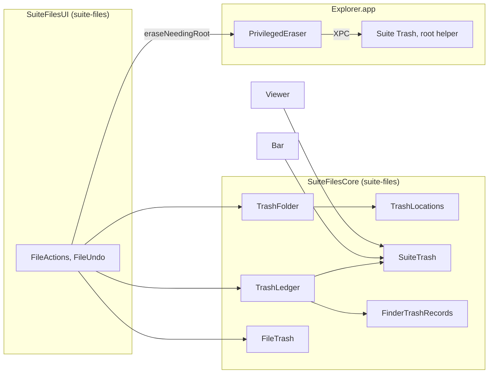
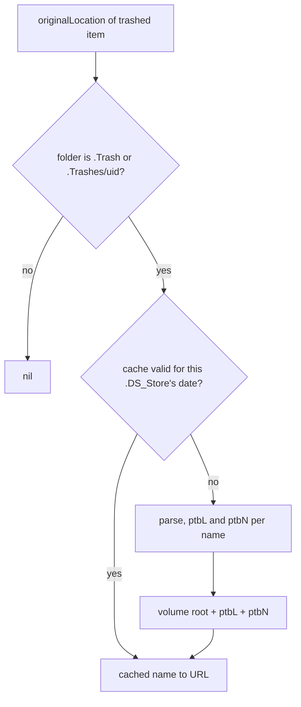
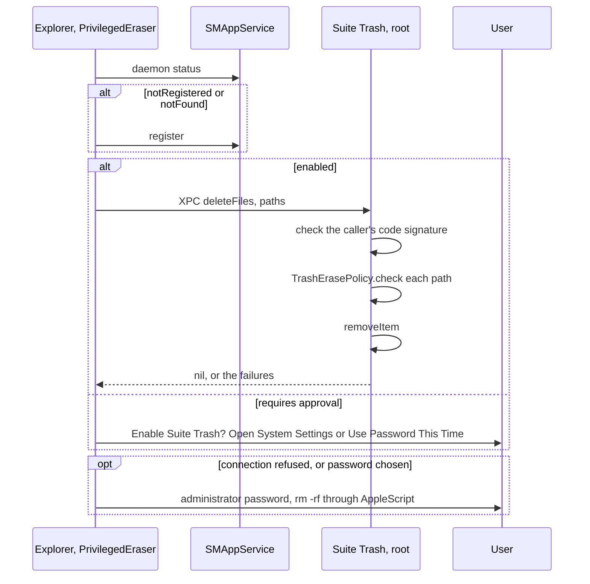

# The Trash

The suite never erases a file in one step: Delete moves to the Trash, and only what is already in the Trash
can be erased (Delete there, Delete Permanently, Empty Trash). Explorer's Trash gathers the same folders as
Finder's, can put any item back where it came from (Restore, Finder's Put Back), whichever app deleted it,
and erases items that need administrator rights through Suite Trash, a small root helper inside
Explorer.app. The Trash code is in `suite-files`, shared by Explorer, Desktop, Bar and Viewer; only Suite
Trash and its client stay in `suite-explorer`.

## The Trash's folders: `TrashLocations`

`suite-files`, `Sources/SuiteFilesCore/TrashLocations.swift`. On macOS the Trash is not one folder: each place
has its own, and Finder shows them together.

| Folder | Holds |
|---|---|
| `~/.Trash` (`TrashLocations.url`, always first) | what is deleted from the startup disk |
| `~/Library/Mobile Documents/.Trash` | what is deleted from iCloud Drive, and from the Desktop and Documents when they are in iCloud |
| `<disk>/.Trashes/<uid>` | what this user deletes on each other mounted disk (not the startup disk, whose Trash is the home one) |

`TrashLocations.all` lists those that exist, from the mounted volumes (hidden ones skipped). iCloud Drive's
is left out when `TrashIncludesICloudDrive` (Explorer's defaults, Settings › Trash) is false.
`TrashFolder` (`Sources/SuiteFilesCore/TrashLedger.swift`) wraps it and adds `contains`, `isTrashFolder`,
`partition` (what is in a Trash and can be erased, and the rest, which must go to the Trash first),
`contents` (every item of every folder; only the home folder's read error is passed on, as it means Full
Disk Access is missing), `empty` and `erase`.

## Moving to the Trash, with a record

`FileManager.trashItem` moves an item to the right Trash folder and says where it landed, renaming it if the
name is taken. It doesn't say, later, where it came from. So the suite writes it down.

**The ledger.** `~/Library/Application Support/Explorer/TrashLedger.json`: a JSON object, trashed path →
original path (standardized paths).

| Who trashes | How | Records in the ledger | Tells Explorer |
|---|---|---|---|
| Explorer and Desktop (Delete, Move to Trash) | `FileActions.moveToTrash` → `FileTrash.moveToTrash` (`suite-files`) | yes, through `TrashLedger.shared` | records `FileUndo .trashed` itself |
| Explorer, Undo of a copy or new item, redo of a trash | `FileOperation.undo`, `FileTrash.moveToTrash` | yes | it is the Undo history |
| Explorer, Replace in a conflict | `FileTransfer.run`, `FileTrash.moveToTrash(ledger: nil)` | no | no |
| Viewer (Move to Trash) | `SuiteTrash.moveToTrash` | yes, read, add, write the file | `SuiteTrash.announce` |
| Bar (files dropped on its Trash) | `SuiteTrash.moveToTrash` (`BarFiles`) | yes | `SuiteTrash.announce` |
| Bar, Replace when dropping on a folder | `SuiteTrash.moveToTrash` (`BarDrop`) | yes | no |

`SuiteTrash` (`suite-files`, `Sources/SuiteFilesCore/SuiteTrash.swift`) holds the ledger's file, `readLedger`,
`writeLedger` (atomic), `moveToTrash(_:ledger:)`, `announce` (which writes the move into the shared Undo
history, then posts) and the notification `local.suite.files.trashed` with `userInfo["originals"]` and
`userInfo["trashed"]` (see [Messages](messages.md)). `SuiteTrash.items(of:)` keeps only pairs of the same length whose trashed path is
now inside one of `TrashLocations.all` and exists: a stranger posting the notification can't make Explorer
move arbitrary files on Undo.

## `TrashLedger`

`TrashLedger.shared` (`suite-files`, `Sources/SuiteFilesCore/TrashLedger.swift`) reads the ledger file once,
at first use, and keeps it in memory; each `record` and `forget` writes the whole file again.

- `originalLocation(of:)`: the ledger first, else Finder's record (`FinderTrashRecords.originalLocation`).
- `canPutBack`: an original is known and the item still exists. It enables Restore.
- `putBack`: recreates the original folder if needed, moves the item back (a number added if the name is
  taken since), forgets it. `FileActions.putBack` records the move in the Undo history and, if
  `OpenFolderAfterRestore` is on (off by default), opens the folder it went back to.
- `forget`: on erase and on Undo of a trash.

## Finder's records: `FinderTrashRecords`

`suite-files`, `Sources/SuiteFilesCore/FinderTrashRecords.swift`. For items Finder or another app deleted, Finder wrote the
original place in the Trash folder's `.DS_Store`, the hidden file where Finder keeps per-folder data. Each
trashed item has two records: `ptbL`, the original folder relative to the volume's root, and `ptbN`, the
original name. Explorer only reads it.

The `.DS_Store` format is not documented by Apple but is well known: a four-byte prefix, the magic `Bud1`,
then a buddy allocator (a table of block addresses and a directory of named blocks) whose `DSDB` block is
the root of a B-tree of records. `DSStore` (same file) reads it big-endian: the root block, the address
table (padded to multiples of 256 entries), the `DSDB` tree, then each node's records (a UTF-16 file name,
a four-character code, a four-character type: `bool`, `long`, `shor`, `type`, `comp`, `dutc`, `blob`,
`ustr`). A visited set stops a damaged file from looping, and every read is bounds-checked.

The result, per Trash folder, is cached and read again only when the file's modification date changes.

## Undo of trashing

The suite keeps one Undo history for file operations, shared by every app that changes files
(`FileUndoJournal`, a file at `~/Library/Application Support/Suite Files/Undo.json` written under a lock;
`FileUndo`, `Sources/SuiteFilesUI/FileOperations.swift`; `FileOperation`,
`Sources/SuiteFilesCore/FileOperation.swift`, all in `suite-files`).

- Undo of `.trashed(originals, trashed)` moves each item back to its original path (its folder recreated),
  forgets it in the ledger, and becomes `.created(originals)`, whose undo (that is, Redo) trashes them again.
- Undo of a copy or a new item moves it to the Trash rather than erasing it.
- What Viewer and Bar trash joins this history directly (`SuiteTrash.announce` writes `.trashed` into the
  journal); the apps with file views (Explorer, Desktop) follow through the notifications
  (`recordTrashingInOtherApps`, set up at launch): `local.suite.files.undoDidChange` updates their Edit
  menus, `local.suite.files.trashed` records the pairs in the ledger for Restore.

## Erasing

`FileActions.deletePermanently` (`suite-files`, `Sources/SuiteFilesUI/FileActions.swift`): items outside the Trash are moved
to it instead; the rest are erased after a confirmation ("You can't undo this action"). `emptyTrash` asks
too, then erases every item of every Trash folder, hidden files included (asking for Full Disk Access if
the home Trash can't be read). Erasing goes through `FileManager.removeItem`; the items that fail with a
permission error (`EACCES`, `EPERM`, Cocoa's no-permission errors) go to `FileActions.eraseNeedingRoot`,
which Explorer sets to its `PrivilegedEraser` (`suite-explorer`, `Sources/ExplorerUI/PrivilegedEraser.swift`);
the others are reported.

### `PrivilegedEraser` and Suite Trash

Some Trash items belong to root or another user (an installer's leftovers, items from another account on an
external disk). Erasing them needs root. Suite Trash is a launch daemon, a program launchd runs as root
outside any user session, registered through `SMAppService` (macOS 13's Service Management API, which
registers a daemon shipped inside an app bundle once the user allows it in System Settings › General ›
Login Items).

**Packaging.** `scripts/make-app.sh` builds the `Trash` product, copies it to
`Explorer.app/Contents/Library/LaunchDaemons/local.suite.explorer.trash` with
`Support/Trash-LaunchDaemon.plist` beside it (`Label` and Mach service `local.suite.explorer.trash`,
`BundleProgram` pointing inside the bundle), and signs it with the same certificate as Explorer.

**The helper** (`Sources/Trash/main.swift`) listens on the Mach service `local.suite.explorer.trash` with
`NSXPCListener`. XPC is macOS's inter-process call mechanism: the client calls methods of an
`@objc` protocol (`TrashHelperXPC`: `deleteFiles(_:withReply:)`, `version(withReply:)`) on a proxy, and the
system carries them to the other process. For each connection:

- `ClientRequirement.forOwnCertificate()` (`Sources/TrashCore/ClientRequirement.swift`) reads the helper's
  own leaf certificate from its signature and pins its SHA-1 hash with Explorer's bundle id:
  `identifier "local.suite.explorer" and certificate leaf = H"<sha1>"`. It fits "Suite Local Signing" on
  this Mac and "Suite Release Signing" for releases without naming either; a certificate merely named the
  same doesn't pass. Signed ad hoc, the helper has no certificate and refuses every connection.
- `connection.setCodeSigningRequirement` makes the system check that requirement on every message; a caller
  that doesn't meet it is cut off.
- The exported `Eraser` works for the connection's effective user id: it finds that user's home folder
  (`getpwuid`) and the mounted volumes.

**What it agrees to erase** (`TrashErasePolicy`, `Sources/TrashCore/TrashErasePolicy.swift`). The helper
doesn't link SuiteFilesCore (which reads the user's defaults), so it rebuilds the same list of Trash folders as
`TrashLocations` (a test keeps both equal): `<home>/.Trash`, `<home>/Library/Mobile Documents/.Trash` and
each non-startup volume's `.Trashes/<uid>`. Then, for each path:

| Check | Refusal |
|---|---|
| absolute path | `notAbsolute` |
| names an item (not empty, `.`, `..` or `/`) | `notAnItem` |
| its folder resolves (`realpath`: symbolic links and `..`) | `notFound` |
| the folder plus the name is inside a Trash folder, and isn't one | `outsideTrash` |

Each Trash folder is accepted only if every component below its trusted base (the home folder, the mounted
disk) exists, isn't a symbolic link, and resolves to itself, so a user can't swap a link in to point the
root helper elsewhere. The item itself isn't resolved: a symbolic link in the Trash is erased, not what it
points to. Refusals and failures come back as one message, shown by Explorer.

**The fallback** (`eraseViaOsascript`): `rm -rf` on the quoted paths through AppleScript's
`do shell script "rm -rf <paths>" with administrator privileges`, which asks for the password (or Touch ID) each time.
Cancelling (error -128) is silent.

