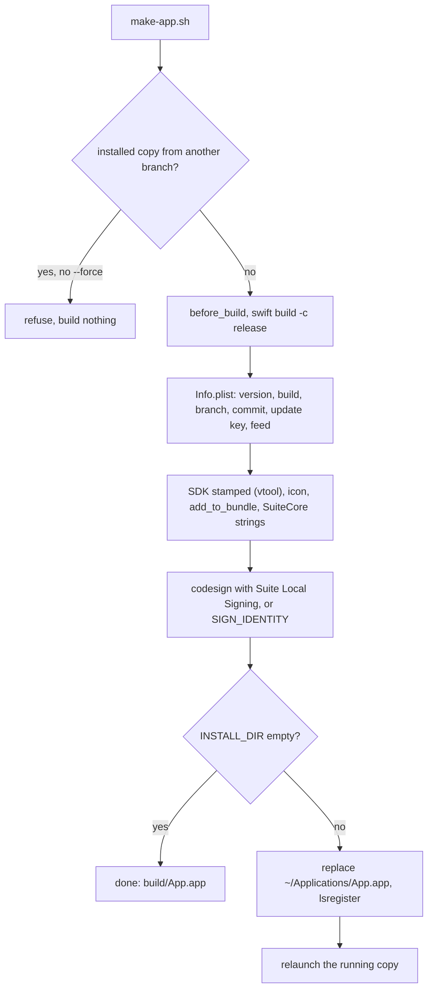
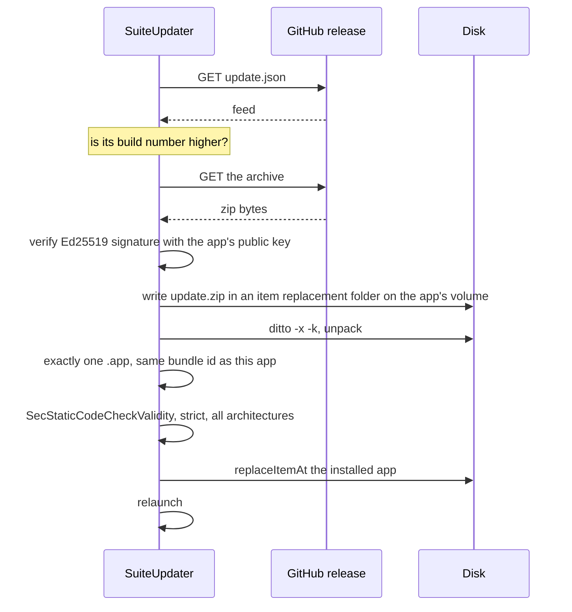
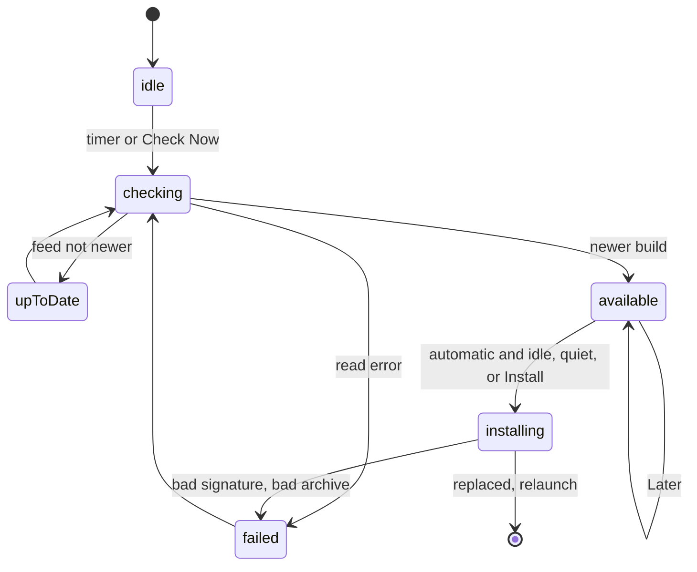
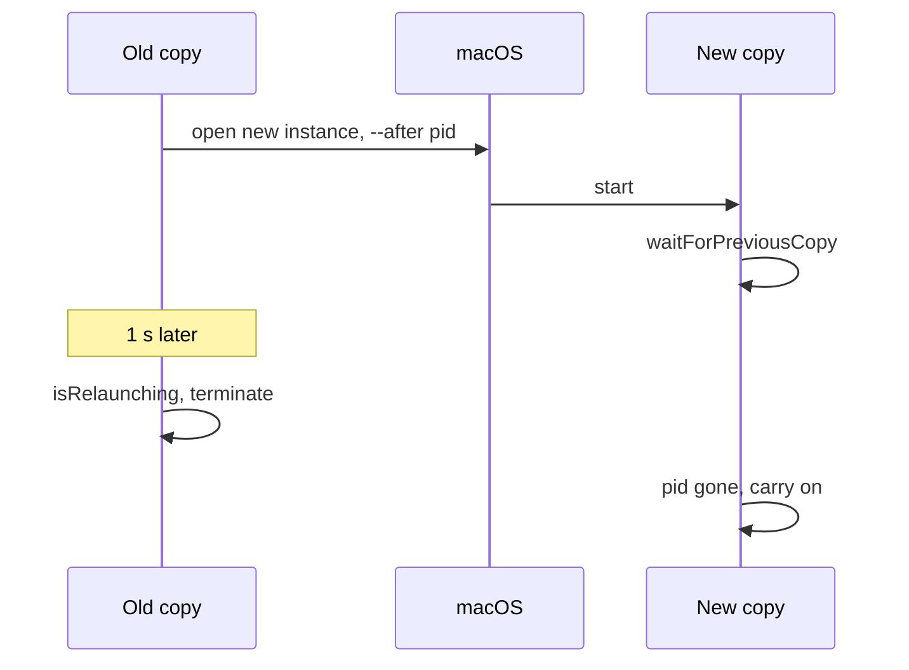
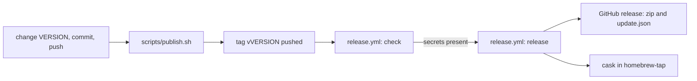
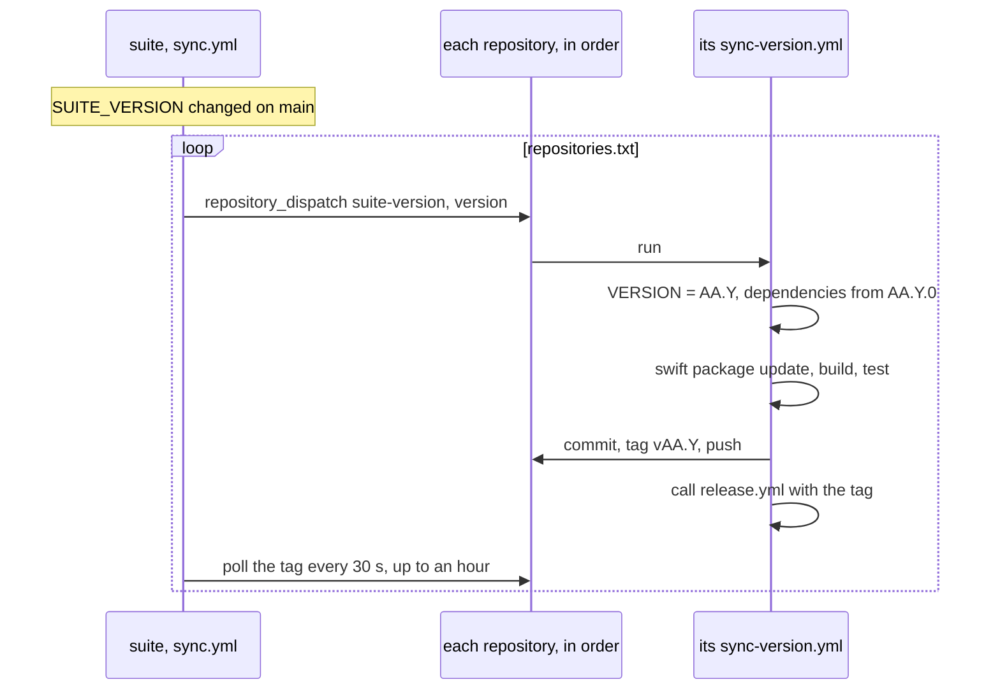

# Updates and releases

Each app of the suite is released on its own, from its own GitHub repository, and updates itself from its
own releases. A release is built and signed entirely on GitHub; this Mac only pushes a tag. The shared
version `AA.Y` is moved from the `suite` repository, which brings every repository to it in turn. Nothing
has been released yet: the casks still carry placeholder checksums.

## Versions

| Thing | Where | Form |
|---|---|---|
| The suite's version | `suite/SUITE_VERSION` | `AA.Y` (27.1): `AA` is the latest macOS in production, `Y` the same in every repository |
| A repository's version | `VERSION` in each repository | `AA.Y`, then `AA.Y.Z` for a fix of that repository alone (27.1.1) |
| A release tag | git tag `vVERSION` | `v27.1`; SwiftPM reads it as 27.1.0. Never moved once pushed |
| A development tag | git tag `vVERSION-dev.N` | marks a commit another repository can depend on; releases nothing |
| A development build's version | `CFBundleShortVersionString`, from `make-app.sh` | `VERSION-dev.N`, N = the commits since the last commit that changed `VERSION`, merges aside, plus 1 |
| The build number | `CFBundleVersion`, from `make-app.sh` | `git rev-list --count HEAD`: the number of commits of that repository, always growing; the updater compares it |

`make-app.sh` gives the plain `VERSION` only to a build of the commit tagged `vVERSION`
(`git describe --exact-match --tags HEAD`); any other build is `VERSION-dev.N`. `SuiteVersion` reads
`27.1-dev.3` as 27.1 (see [Settings and profiles](settings-and-profiles.md)).

Dependencies between repositories use `.upToNextMinor(from: "27.1.0-dev.1")` (`Package.swift`): the latest
development tag, then the release, never the next `AA.Y`. `Package.resolved` is committed.

## Building: `scripts/make-app.sh`

Every app repository has the same script, with a few lines of its own at the top (`APP_NAME`,
`EXECUTABLE`, `EXTRA_PRODUCTS`, `BUNDLE_ID`, `INFO_PLIST`, `ICON`, and the functions `before_build`,
`make_icon`, `add_to_bundle`, `relaunch`).

- **Refusal.** The Info.plist records `SuiteBuildBranch` and `SuiteBuildCommit` (with "with uncommitted
  changes" when the tree is dirty). An installed copy whose branch is missing or different is not replaced
  without `--force`: another session may be testing it.
- **Signing.** `SIGN_IDENTITY` or "Suite Local Signing" from the login keychain, so macOS permissions tied to
  the signature survive rebuilds. Without that certificate, ad-hoc signing (`-`), which re-asks every
  permission; a certificate named in `SIGN_IDENTITY` (a release) is never replaced by ad-hoc signing.
- **SDK.** SwiftPM records the deployment target (macOS 13) as the SDK the executable was built with, and
  macOS would then draw the old controls; `stamp_sdk` writes the SDK actually used (`vtool
  -set-build-version`), so the app looks as the latest macOS.
- **Update key and feed.** `Support/update-public-key.txt` becomes `ExplorerUpdatePublicKey` and
  the GitHub repository it is built from (owner/name: `GITHUB_REPOSITORY` in CI, else the `origin` remote) becomes `ExplorerUpdateFeed`,
  `https://github.com/<owner/name>/releases/latest/download/update.json`, in every app's Info.plist (the
  keys kept Explorer's name).
- **Installing.** Unless `INSTALL_DIR=` is empty: `~/Applications/<App>.app` (or `INSTALL_DIR`) is replaced,
  the build folder's copy is unregistered from Launch Services and the installed one registered, so only one
  copy is known.

| App | Extra | `relaunch` when it was running |
|---|---|---|
| Explorer | `gen-build-info.sh` first; Suite Trash embedded in `Contents/Library/LaunchDaemons` and signed with the same identity; Finder's icon copied from this Mac | `open -n --args --relaunch`: the running copy reopens itself (see below) |
| Desktop | the desktop folder's icon from this Mac; its French strings and suite-files' strings bundle | `open -n --args --relaunch`: the running copy reopens itself |
| Bar | the Dock's icon from this Mac | `open -n --args --relaunch`: the new copy takes over |
| Clipboard, Viewer | their strings bundles | quit with `osascript`, wait, `open -g` |
| Suite Settings (`Suite Settings.app`) | its icon drawn by `scripts/settings-icon.swift`; Suite Settings Agent (`SettingsAgent`) built into `Contents/Library/LoginItems/Suite Settings Agent.app` | the agent killed and reopened from the new copy, then quit, wait, `open -g` |
| Suite Guard | no icon | `launchctl kickstart -k gui/<uid>/local.suite.guard` |

## The update feed: `Updates.swift`

`suite-core`, `Sources/SuiteCore/Updates.swift`.

`UpdateFeed` is `update.json`, published next to the archive among a release's files:

| Field | Meaning |
|---|---|
| `version` | shown to people (`27.1`) |
| `build` | the build number, compared: `isNewer(thanBuild:)` is `build > CFBundleVersion` |
| `archive` | the zip's file name next to the feed, or a full `https` address |
| `signature` | Ed25519 signature of the archive's bytes, base64 |
| `notes` | shown in the dialog |
| `published` | ISO 8601 date |

`archiveURL(relativeTo:)` accepts an `https` address, or a bare file name (no `/`, not `.` or `..`) next to
the feed.

`UpdateSignature.verify` checks the archive with the public key carried in the app (Curve25519 signing,
`CryptoKit`): a changed archive, or one signed with another key, is refused. Ed25519 is a public-key
signature: only the holder of the private key (kept in GitHub secrets) can sign, anyone with the public key
can check.

`UpdateSettings` holds `CheckForUpdates` (default on), `InstallUpdatesAutomatically` (default on) and
`UpdateFeed` (an address typed in the settings, `https` or `file`, which wins over the Info.plist's
`ExplorerUpdateFeed`). `gitHubFeed(repository:)` builds GitHub's fixed "latest release" address.

## `SuiteUpdater`

`suite-core`, `Sources/SuiteCore/SuiteUpdater.swift`. One per app, made with:

- `appName`, for dialogs;
- `defaults`, where `UpdateSettings` and the settings to convert live (the app's own domain by default);
- `isBusy`, true while replacing the app would be under the user's feet (by default: a visible window);
- `quiet`, for an agent without windows: never asks, never shows an alert;
- `migrations` (see [Settings and profiles](settings-and-profiles.md));
- `relaunch`, how the new copy starts (by default `AppRelauncher.relaunch()`).

**When it checks.** `start()` converts the settings, then, if automatic checks are on and the app carries a
public key, checks 60 s later and every 6 hours. Changing `settings` reschedules. A build without the public
key never checks (its state says so). `check(userInitiated: true)` (Check Now) runs at once and shows
alerts.

**What it does with a newer build.** If `quiet`, or installing automatically and the check wasn't asked
for: `installWhenIdle`, which installs at once if not busy, else retries every 30 s until not busy.
Otherwise it asks ("Install and Relaunch" or "Later").

**Installing** (`prepare`, on a background queue):

A local feed (`file:` address) is read through `NSFileCoordinator`, for testing.

### Each app's updater

| App | `defaults` | `isBusy` | `quiet` | After replacing |
|---|---|---|---|---|
| Explorer (`SuiteUpdater.explorer`) | `local.suite.explorer` | an Explorer window open | no | `AppRelauncher.relaunch()` |
| Bar | `local.suite.bar` | never | no | starts a new copy with `--relaunch`, which sends `handOver`: the old one leaves without putting the system Dock back |
| Desktop | `local.suite.desktop` | never | no | `AppRelauncher.relaunch()`: the desktop comes back within a second |
| Clipboard | `local.suite.clipboard` | a visible window | no | `AppRelauncher.relaunch()` |
| Viewer | `local.suite.viewer` | never | no | nothing: replaced in place, the new version runs at its next launch |
| Suite Settings | `local.suite.settings` | never | no | nothing, as Viewer (its agent, inside the bundle, too) |
| Suite Guard | `local.suite.guard` | never | yes | `exit(0)`: launchd (`KeepAlive`) starts it again from the new copy |

### `AppRelauncher`

`suite-core`, `Sources/SuiteCore/AppRelauncher.swift`. The old copy can't simply start the new one as a child
process, which would end with it. So `relaunch(inBackground:)` asks macOS for a new instance of the app's
bundle (`createsNewApplicationInstance`), not activated, with `--after <pid>` (and `--background`), then quits
one second later with `isRelaunching` set. The new copy calls `waitForPreviousCopy()` first thing
(Explorer's, Desktop's and Clipboard's `main.swift`): it waits, at most 30 s, until that process is gone, then carries on.
`--background` keeps last time's windows closed (`isBackgroundLaunch`).

## Releasing an app

**`scripts/publish.sh`** refuses unless origin is a GitHub repository, `Support/update-public-key.txt` and
`Support/release-certificate.cer` exist, the branch is `main`, the tree is clean, `HEAD` is pushed, and the
tag `vVERSION` doesn't exist yet. Then it tags and pushes the tag.

**`.github/workflows/release.yml`** runs on a pushed tag `v*` except `v*-dev.*`, or when called by
`sync-version.yml` with a tag. Two jobs, both in the repository's `release` environment (a GitHub
environment is a named set of secrets that only the jobs naming it receive):

1. `check` (Ubuntu): continues only if `RELEASE_CERTIFICATE` and `UPDATE_PRIVATE_KEY` are set; otherwise a tag
   is only a tag.
2. `release` (`xcode-27` runner, Xcode 27.2):
   - imports `RELEASE_CERTIFICATE` (a base64 `.p12`, password `RELEASE_CERTIFICATE_PASSWORD`) into a
     temporary keychain;
   - `SIGN_IDENTITY="Suite Release Signing" INSTALL_DIR= scripts/make-app.sh`;
   - checks that `VERSION` matches the tag, and that the app is signed by the very certificate committed in
     `Support/release-certificate.cer` (`codesign --verify --deep --strict -R="certificate leaf = H<sha1>"`);
   - zips the app (`ditto -c -k --keepParent`, `<App>-<version>.zip`), signs it with `UPDATE_PRIVATE_KEY`
     through `scripts/sign-update.swift`, and publishes the release (`gh release create --verify-tag --latest`)
     with the zip and `update.json`;
   - if `HOMEBREW_TAP_TOKEN` is set, rewrites the `version` and `sha256` lines of the app's cask in
     `love-suite/homebrew-tap` through the GitHub contents API;
   - deletes the temporary keychain, always.

**`scripts/sign-update.swift`** (the same file in every app repository and in `suite`): `--create-key`
prints a new private and public key (base64); otherwise it reads the private key on standard input, signs
the archive and prints `update.json` (`version`, `build`, `archive`, `signature`, `notes`, `published`).

## A new `AA.Y` for the whole suite

- **`suite/.github/workflows/sync.yml`** runs when `SUITE_VERSION` changes on `main`. Without the secret
  `SUITE_DISPATCH_TOKEN` it does nothing. Otherwise, for each repository of `repositories.txt` (suite-core,
  suite-guard, suite-files, suite-desktop, suite-bar, suite-explorer, suite-clipboard, suite-viewer,
  suite-settings), it sends a
  `repository_dispatch` event `suite-version` with the version, then waits for the tag `vAA.Y` to exist
  before the next, failing after an hour.
- **`sync-version.yml`** in each app repository writes `VERSION`, rewrites every
  `github.com/love-suite/suite-<name>` dependency's lower bound to `AA.Y.0`, runs `swift package update`,
  `swift build` and `swift test` (when there are tests), commits, tags and pushes, then calls `release.yml`
  with the tag (`secrets: inherit`). The call is needed because a tag pushed with the workflow's own token
  doesn't start other workflows. In `suite-core` and `suite-files` the same job only tags: a library has nothing to release.

## The `suite` repository's scripts

All read `repositories.txt` through `scripts/apps.sh` (every repository but the libraries `suite-core` and
`suite-files`; the owner from this repository's `origin` remote; local root the folder above `suite`), and create each repository's `release` environment if
needed.

| Script | What it does |
|---|---|
| `scripts/release-certificate.sh [--replace]` | Makes, once, a self-signed code-signing certificate "Suite Release Signing" (RSA 3072, ten years, `openssl`), puts the `.p12` and its random password in every app repository's `release` environment (`RELEASE_CERTIFICATE`, `RELEASE_CERTIFICATE_PASSWORD`), writes the public certificate to each local `Support/release-certificate.cer` to commit. The private key exists only in a temporary folder removed at exit |
| `scripts/update-key.sh [--replace]` | Makes, once, the Ed25519 key pair with `sign-update.swift --create-key`, checks both are 44-character base64 keys, puts the private half in every `release` environment (`UPDATE_PRIVATE_KEY`) and the public half in each local `Support/update-public-key.txt` to commit. Replacing it makes installed apps refuse later updates |
| `scripts/set-secret.sh NAME` | A secret from standard input into every app repository's `release` environment (`HOMEBREW_TAP_TOKEN`) |
| `scripts/set-secret.sh --suite NAME` | A secret of the `suite` repository itself (`SUITE_DISPATCH_TOKEN`) |
| `scripts/each.sh <command>` | Runs a command in every local repository |
| `scripts/rename-organization.sh <new>` | After the organization is renamed on GitHub, points every local repository at it: `origin`, `organization` in `Package.swift`, `Package.resolved`, the addresses in casks, catalog and documentation. Commits nothing |

All of this is in place: every app repository commits a release certificate and an update public key.

## The Homebrew tap: `homebrew-tap`

Homebrew is the common package manager for macOS; a tap is a git repository of install recipes, and a cask
is the recipe for an app. `brew install --cask love-suite/tap/<cask>` installs from the tap.

| Cask | App | Archive | Depends on |
|---|---|---|---|
| `explorer` | `Explorer.app` | `suite-explorer` release `Explorer-<version>.zip` | `guard`, `settings` |
| `desktop` | `Desktop.app` | `Desktop-<version>.zip` | `guard` |
| `bar` | `Bar.app` | `Bar-<version>.zip` | `guard` |
| `clipboard`, `viewer` | their apps | their zips | none |
| `settings` | `Suite Settings.app` | `Suite-Settings-<version>.zip` | none |
| `guard` | `Suite Guard.app` | `Suite-Guard-<version>.zip` | none |

Each cask says `auto_updates true` (the app updates itself, so Homebrew leaves it be), requires macOS 13 and
zaps the app's preferences file. The release workflows rewrite only the `version` and `sha256` lines, which
must stay as they are (two spaces, a string). Today they read `27.1` and a placeholder checksum of zeros.

## Planned

- **(to build)** The release certificate and the update key become organization secrets of `love-suite`
  shared with the app repositories, instead of today's copy in each app repository's own `release`
  environment, which `release-certificate.sh`, `update-key.sh` and `set-secret.sh` write one repository
  at a time.
